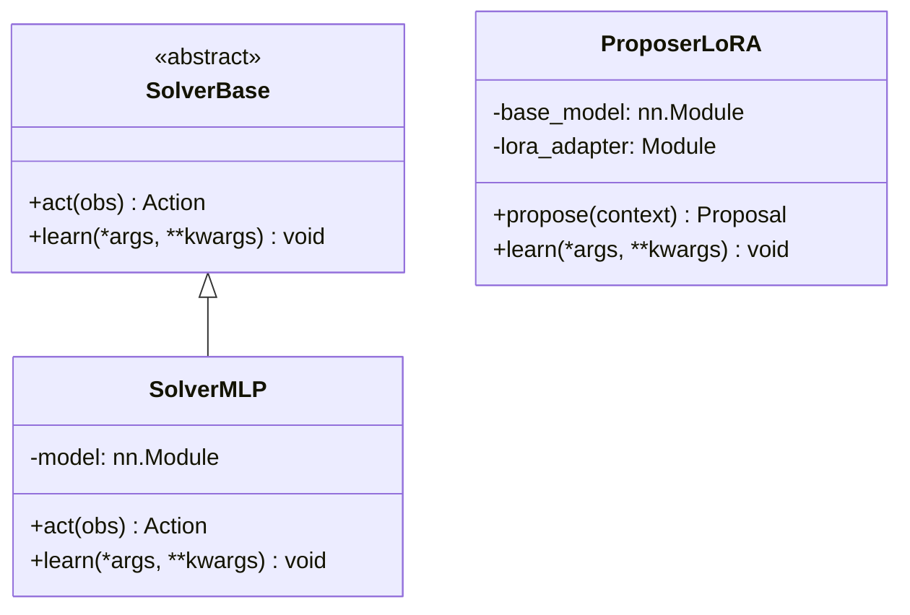

# Agent Architecture

# Agent Architecture Module

## Overview

The `itrader.agents` module defines the agent abstraction layer for the trading system. Agents are autonomous decision-making components that observe market state and execute trading actions. This module provides the base interfaces and concrete implementations for different agent types.

## Module Structure

```
itrader/agents/
├── __init__.py           # Package initialization
├── solver_base.py        # Abstract base class for all solvers
├── solver_mlp.py         # MLP-based solver implementation
└── proposer_lora.py      # LoRA-based proposer agent
```

## Core Components

### SolverBase

The abstract base class that defines the contract for all solver agents. Every solver must implement two fundamental operations:

```python
class SolverBase:
    """Abstract base for all solver agents."""
    def act(self, obs): raise NotImplementedError
    def learn(self, *args, **kwargs): raise NotImplementedError
```

#### Methods

| Method | Signature | Description |
|--------|-----------|-------------|
| `act` | `act(self, obs) -> Action` | Select an action given an observation. Must be implemented by all concrete solvers. |
| `learn` | `learn(self, *args, **kwargs) -> None` | Update internal model parameters from experience. Signature is flexible to accommodate different learning paradigms. |

#### Design Intent

`SolverBase` establishes a minimal but complete interface that supports both:

- **Inference**: The `act()` method handles real-time decision making
- **Training**: The `learn()` method supports online learning, batch updates, or reinforcement learning

Concrete implementations determine the actual learning algorithm and action selection strategy.

## Agent Types

### Solver Agents (`solver_mlp.py`)

Solver agents are responsible for executing trading decisions. They receive observations and output actions. The MLP variant uses a multi-layer perceptron architecture for decision making.

### Proposer Agents (`proposer_lora.py`)

Proposer agents suggest potential strategies or parameter configurations. The LoRA variant uses Low-Rank Adaptation for efficient fine-tuning, enabling rapid adaptation to changing market conditions.

## Architecture Pattern



## Integration Points

### Environment Integration

Agents receive observations from the trading environment and return actions that modify portfolio state:

```
Environment → observation → Agent → action → Environment
```

### Training Loop Integration

The `learn()` method integrates with the training pipeline:

```python
# Typical usage pattern
solver = SolverMLP(...)
for episode in training_loop:
    obs = env.reset()
    action = solver.act(obs)
    next_obs, reward, done, info = env.step(action)
    solver.learn(obs, action, reward, next_obs, done)
```

## Extending the Module

To implement a new solver:

1. Subclass `SolverBase`
2. Implement `act(self, obs)` to return valid actions
3. Implement `learn(self, *args, **kwargs)` for your training paradigm
4. Register in `__init__.py` for module-level exports

```python
from itrader.agents.solver_base import SolverBase

class MyCustomSolver(SolverBase):
    def act(self, obs):
        # Your action selection logic
        return action
    
    def learn(self, *args, **kwargs):
        # Your learning update logic
        pass
```