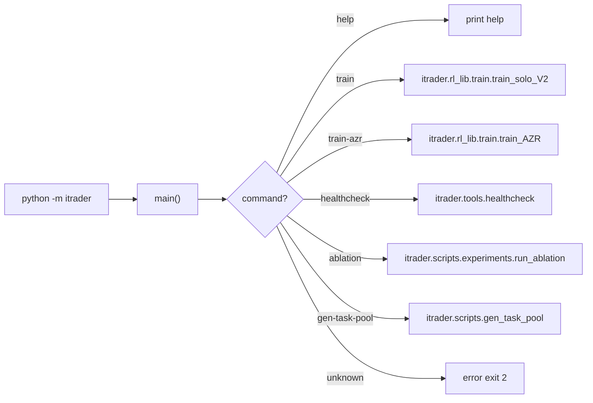

# Core Application

# Core Application Module

The `itrader` core module provides a unified command-line interface gateway for the entire application. It implements a dispatcher pattern that routes CLI commands to their respective handler modules.

## Architecture Overview



## Entry Point

The module is invoked via `python -m itrader`. The `__main__.py` file handles this entry point and delegates execution to the appropriate submodule.

## Command Registry

Commands are defined in `COMMAND_TO_MODULE` dictionary:

| Command | Target Module | Purpose |
|---------|---------------|---------|
| `train` | `itrader.rl_lib.train.train_solo_V2` | Standard training workflow |
| `train-azr` | `itrader.rl_lib.train.train_AZR` | AZR training variant |
| `healthcheck` | `itrader.tools.healthcheck` | System health verification |
| `ablation` | `itrader.scripts.experiments.run_ablation` | Ablation experiment runner |
| `gen-task-pool` | `itrader.scripts.gen_task_pool` | Task pool generation |

## Execution Flow

### Argument Parsing

The `_build_parser()` function creates a minimal `ArgumentParser` that:
- Accepts a single positional `command` argument (defaults to `"help"`)
- Passes any remaining arguments through to the target module

### Command Dispatch

The `main()` function orchestrates the dispatch:

1. Parses known arguments, separating the command from remainder args
2. Normalizes command to lowercase
3. Handles help requests (`help`, `-h`, `--help`) by printing usage and exiting cleanly
4. Looks up the command in `COMMAND_TO_MODULE`
5. On unknown command: prints help, shows error, returns exit code 2
6. On valid command: rewrites `sys.argv` and uses `runpy.run_module()` to execute the target

### Argument Forwarding

Remaining CLI arguments are forwarded to the target module via `sys.argv` rewrite:

```python
sys.argv = [f"python -m {module}", *remainder]
```

This allows submodules to define their own argument parsers without modification.

## Adding New Commands

To register a new command:

1. Add entry to `COMMAND_TO_MODULE`:
   ```python
   COMMAND_TO_MODULE = {
       ...
       "new-command": "itrader.path.to.module",
   }
   ```

2. Ensure the target module has a `if __name__ == "__main__":` entry point

## Exit Codes

| Code | Meaning |
|------|---------|
| 0 | Success (including help display) |
| 2 | Unknown command |

## Usage Examples

```bash
# Show help
python -m itrader help
python -m itrader

# Run training
python -m itrader train --config config.yaml

# Run healthcheck
python -m itrader healthcheck

# Run ablation with args forwarded
python -m itrader ablation --experiment baseline
```
