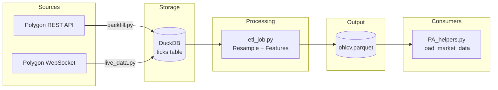

# Data Pipeline

# Data Pipeline Module

The `itrader/inputs` module provides a complete data pipeline for collecting, storing, and transforming market data. It handles historical backfill, real-time streaming, ETL processing, and data loading for downstream training workflows.

## Architecture Overview



## Pipeline Stages

### Stage 1: Data Ingestion

Two complementary ingestion paths populate the raw `ticks` table in DuckDB:

| Path | Script | Use Case | Rate Limiting |
|------|--------|----------|---------------|
| Historical | `backfill.py` | Initial data load, gap filling | 5 calls/min (13s sleep) |
| Real-time | `live_data.py` | Live trading, continuous updates | WebSocket (no limit) |

Both paths write to the same schema:
```sql
CREATE TABLE ticks(
    ts TIMESTAMP,
    symbol VARCHAR,
    price DOUBLE,
    size BIGINT
);
```

### Stage 2: ETL Processing

`etl_job.py` reads raw ticks, resamples to 1-minute OHLCV bars, adds technical indicators, and writes to Parquet for efficient downstream access.

### Stage 3: Data Loading

`PA_helpers.py` provides the interface consumed by Phase-A PPO training, loading the processed Parquet into GPU-ready float32 arrays.

---

## Components

### backfill.py — Historical Data Ingestion

Fetches historical minute-bar data from Polygon's REST API with built-in resumability.

**Key Features:**
- **Rate limit compliance**: Enforces 13-second sleep between API calls (Polygon's 5 calls/min limit)
- **Resumable**: Tracks progress per symbol in `_backfill_cursor` table
- **Chunked fetching**: Processes data in 5-day slices to stay within API limits

**Entry Point:**
```python
def main() -> int:
    # Orchestrates: args → symbols → date ranges → API calls → DB inserts
```

**Core Functions:**

| Function | Purpose |
|----------|---------|
| `_parse_args()` | CLI argument parsing (--symbols, --days, --api-key) |
| `_resolve_api_key(cli_key)` | Returns API key from CLI or `POLYGON_API_KEY` env var |
| `_symbols_arg(raw_symbols)` | Parses comma-separated symbol list |
| `_resume_date(con, symbol, start_date)` | Returns resume point from cursor table |
| `_date_slices(start, end)` | Yields 5-day chunks as `(start, end)` tuples |
| `grab(sym, date_from, date_to, api_key)` | Fetches bars from Polygon API |
| `_insert_bars(con, symbol, bars)` | Writes bars to `ticks` table |
| `_ensure_cursor_table(con)` | Creates/resets cursor tracking table |

**Usage:**
```bash
# Single symbol, 2 years
python itrader/inputs/backfill.py --symbols AAPL --days 730

# Multiple symbols, 1 year
python itrader/inputs/backfill.py --symbols AAPL,MSFT,AMZN --days 365

# With explicit API key
python itrader/inputs/backfill.py --symbols AAPL --days 365 --api-key YOUR_KEY
```

**Resume Behavior:**
The `_backfill_cursor` table stores the last successfully processed date per symbol. On restart, `_resume_date()` calculates where to continue, preventing duplicate data.

---

### live_data.py — Real-Time Streaming

Streams live trade data via WebSocket into DuckDB.

**Key Design Principle:** Raw tick data remains immutable. The ETL job reads from this table, ensuring reproducibility across multiple runs.

**Entry Point:**
```python
async def stream() -> None:
    # WebSocket loop: auth → subscribe → receive → insert
```

**Core Functions:**

| Function | Purpose |
|----------|---------|
| `_require_api_key()` | Validates `POLYGON_API_KEY` env var exists |
| `_configured_symbols()` | Returns symbol list from `POLYGON_SYMBOLS` or defaults |
| `_connect_db()` | Opens DuckDB connection, creates `ticks` table if needed |
| `_trade_rows(messages)` | Extracts `(ts, symbol, price, size)` from WebSocket messages |

**Configuration:**

| Environment Variable | Default | Description |
|---------------------|---------|-------------|
| `POLYGON_API_KEY` | (required) | API key for authentication |
| `POLYGON_SYMBOLS` | `AAPL,MSFT,AMZN` | Comma-separated symbol list |
| `POLYGON_WS_URL` | `wss://socket.polygon.io/stocks` | WebSocket endpoint |
| `ITRADER_DUCKDB_PATH` | `itrader/data/itrader.duckdb` | Database path |

**Usage:**
```bash
export POLYGON_API_KEY=your_key
export POLYGON_SYMBOLS=AAPL,MSFT
python itrader/inputs/live_data.py
```

---

### etl_job.py — OHLCV Bar Construction

Transforms raw ticks into 1-minute OHLCV bars with technical indicators.

**Entry Point:**
```python
def main() -> int:
    # Pipeline: load ticks → build bars → add features → write parquet
```

**Core Functions:**

| Function | Purpose |
|----------|---------|
| `_load_ticks(con)` | Reads all ticks from DuckDB into DataFrame |
| `_build_bars(ticks)` | Resamples to 1-min OHLCV via groupby aggregation |
| `_add_features(bars)` | Adds RSI14 and SMA20 indicators per symbol |

**Bar Construction Logic:**
```python
# Aggregation per (symbol, 1-minute bucket):
open   = first price
high   = max price
low    = min price
close  = last price
volume = sum of sizes
```

**Technical Indicators:**
- **RSI14**: 14-period Relative Strength Index (via `ta.momentum.rsi`)
- **SMA20**: 20-period Simple Moving Average (via `ta.trend.sma_indicator`)

Both indicators are computed per-symbol using `groupby("symbol").transform()`.

**Output:**
- Path: `itrader/data/ohlcv.parquet`
- Format: Parquet, unindexed
- Schema: `ts, symbol, open, high, low, close, volume, rsi14, sma20`

**Usage:**
```bash
python itrader/inputs/etl_job.py
```

---

### PA_helpers.py — Data Loading for Training

Lightweight utilities for loading processed data into training workflows.

**Functions:**

#### `load_market_data(path) → np.ndarray`

Loads the Parquet file and returns a float32 NumPy array.

```python
from itrader.inputs.PA_helpers import load_market_data

# Returns shape [T, 5] with columns: open, high, low, close, volume
arr = load_market_data("itrader/data/ohlcv.parquet")
```

**Path Resolution:**
1. Try path as-is
2. Try path relative to repo root
3. Raise `FileNotFoundError` with guidance

**Column Handling:**
- Expects columns: `open`, `high`, `low`, `close`, `volume` (case-insensitive)
- Raises `ValueError` if any required column is missing
- Sorts by index before extraction

#### `compute_valid_indices(array, window_size) → np.ndarray`

Returns all valid starting indices for sliding windows.

```python
from itrader.inputs.PA_helpers import compute_valid_indices

# For array of length 1000 with window 50
indices = compute_valid_indices(arr, window_size=50)
# Returns [0, 1, 2, ..., 949] (950 valid starts)
```

**Internal Functions:**

| Function | Purpose |
|----------|---------|
| `_resolve_input_path(path)` | Handles relative/absolute path resolution |
| `_core_columns(df)` | Validates and returns OHLCV column names |

---

## Data Flow Summary

```
┌─────────────────────────────────────────────────────────────────┐
│                        Ingestion Layer                          │
│  backfill.py (historical)  │  live_data.py (real-time)          │
│         ↓                  │         ↓                          │
│  ┌─────────────────────────────────────────────────────────┐   │
│  │              DuckDB: ticks table                         │   │
│  │  (ts, symbol, price, size) — immutable raw data         │   │
│  └─────────────────────────────────────────────────────────┘   │
└─────────────────────────────────────────────────────────────────┘
                              ↓
┌─────────────────────────────────────────────────────────────────┐
│                      Processing Layer                           │
│  etl_job.py                                                     │
│    • Resample to 1-min bars                                     │
│    • Add RSI14, SMA20                                          │
│    • Write to Parquet                                          │
└─────────────────────────────────────────────────────────────────┘
                              ↓
┌─────────────────────────────────────────────────────────────────┐
│                       Output Layer                              │
│  ohlcv.parquet                                                  │
│    • Sorted by timestamp                                        │
│    • Float32-ready for GPU                                      │
└─────────────────────────────────────────────────────────────────┘
                              ↓
┌─────────────────────────────────────────────────────────────────┐
│                      Consumer Layer                             │
│  PA_helpers.py                                                  │
│    • load_market_data() → np.ndarray [T, 5]                    │
│    • compute_valid_indices() → sliding window starts           │
└─────────────────────────────────────────────────────────────────┘
```

---

## Common Workflows

### Initial Setup (Historical Data)

```bash
# 1. Set API key
export POLYGON_API_KEY=your_key

# 2. Backfill historical data
python itrader/inputs/backfill.py --symbols AAPL,MSFT,AMZN --days 365

# 3. Run ETL to generate bars
python itrader/inputs/etl_job.py
```

### Live Trading Setup

```bash
# Terminal 1: Start real-time stream
export POLYGON_API_KEY=your_key
export POLYGON_SYMBOLS=AAPL,MSFT
python itrader/inputs/live_data.py

# Terminal 2: Periodic ETL (e.g., via cron or manual)
python itrader/inputs/etl_job.py
```

### Loading Data for Training

```python
from itrader.inputs.PA_helpers import load_market_data, compute_valid_indices

# Load processed bars
data = load_market_data("itrader/data/ohlcv.parquet")  # shape: [T, 5]

# Get valid window starts for training
window_size = 100
valid_starts = compute_valid_indices(data, window_size)
```

---

## File Locations

| File | Purpose |
|------|---------|
| `itrader/data/itrader.duckdb` | DuckDB database containing raw `ticks` table |
| `itrader/data/ohlcv.parquet` | Processed OHLCV bars with indicators |

Both paths are configurable via environment variables (`ITRADER_DUCKDB_PATH`) or function parameters.
