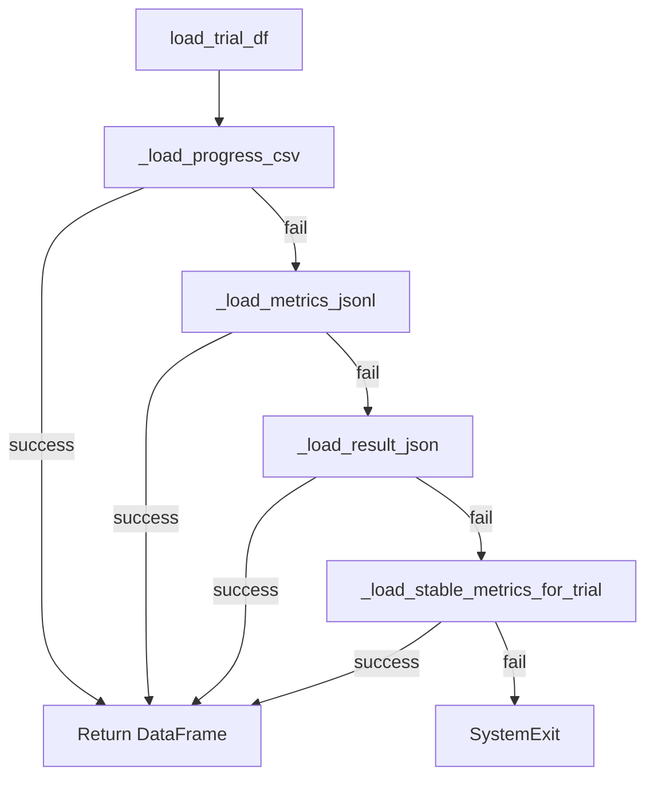

# Diagnostic Tools

# Diagnostic Tools Module

The `itrader/tools` package provides three standalone CLI utilities for monitoring training runs, validating environments, and visualizing experiment results. These tools operate independently and do not import from the main itrader codebase.

## Tools Overview

| Tool | Purpose | Input | Output |
|------|---------|-------|--------|
| `healthcheck.py` | Validate runtime environment | None | JSON status report |
| `diagnose_run.py` | Quick training diagnostics | Ray results directory | Console output with hints |
| `plot_ray_results.py` | Generate metric visualizations | Trial directory or metrics file | PNG plots + summary |

---

## healthcheck.py

Lightweight environment validator for CI pipelines and local development. Checks that required dependencies are importable and reports CUDA availability.

### Usage

```bash
python -m itrader.tools.healthcheck
```

### Output Structure

Returns a JSON object with the following structure:

```json
{
  "python": "3.11.5",
  "platform": "macOS-14.0-arm64",
  "required": {
    "numpy": {"ok": true, "version_or_error": "1.26.0"},
    "pandas": {"ok": true, "version_or_error": "2.1.0"},
    "torch": {"ok": true, "version_or_error": "2.1.0"},
    "ray": {"ok": true, "version_or_error": "2.6.0"},
    "gymnasium": {"ok": true, "version_or_error": "0.29.0"},
    "duckdb": {"ok": true, "version_or_error": "0.9.0"}
  },
  "optional": {
    "llama_cpp": {"ok": false, "version_or_error": "ModuleNotFoundError: ..."},
    "transformers": {"ok": true, "version_or_error": "4.35.0"}
  },
  "cuda": {
    "available": true,
    "device_count": 1,
    "device_name": "NVIDIA GeForce RTX 3080"
  }
}
```

### Exit Codes

- `0`: All required packages importable
- `1`: One or more required packages failed to import

### Implementation Details

The `_import_version()` function attempts to import a package and extract its `__version__` attribute, returning a tuple of `(success, version_or_error_message)`.

---

## diagnose_run.py

Quick diagnostic tool for identifying common training issues. Reads the most recent trial's `progress.csv` and prints the last 30 iterations with actionable hints.

### Usage

```bash
python -m itrader.tools.diagnose_run /path/to/ray_results/Phase_A
```

### Column Selection

The `_selected_columns()` function builds a column list from:

1. **Base columns** (if present in the dataframe):
   - `training_iteration`
   - `episode_return_mean`
   - `entropy`
   - `policy_loss`
   - `value_loss`
   - `custom_metrics/success_mean`

2. **Action columns**: All columns matching `custom_metrics/act_*_mean` (sorted)

3. **Reward component columns**: All columns matching `custom_metrics/rc_*_mean` (sorted)

### Diagnostic Hints

After printing the table, the tool checks for:

| Condition | Hint |
|-----------|------|
| `entropy < 0.05` | Policy collapsed. Increase `entropy_coeff` or check observation scaling. |
| `episode_return_mean < 0` | Negative returns. Try zeroing penalties/fees to sanity-check learnability. |

### Trial Selection

The `last_trial_dir()` function finds the most recently modified subdirectory:

```python
trials = sorted(
    (path for path in root.glob("*/") if path.is_dir()),
    key=lambda path: path.stat().st_mtime
)
```

---

## plot_ray_results.py

Comprehensive visualization tool for Ray Tune experiment results. Generates multiple plot types from trial data with robust fallback loading.

### Usage

```bash
# From trial directory
python -m itrader.tools.plot_ray_results /path/to/trial_dir

# Direct metrics file
python -m itrader.tools.plot_ray_results --metrics-jsonl /path/to/metrics_full.jsonl

# Custom output location
python -m itrader.tools.plot_ray_results /path/to/trial_dir --out /custom/output/dir
```

### Data Loading Pipeline

The `load_trial_df()` function attempts to load data from multiple sources in order:



#### Source Priority

1. **progress.csv**: Standard Ray CSV output (preferred)
2. **metrics_full.jsonl**: JSONL metrics file in trial or `rllib/` subdirectory
3. **result.json**: JSON result file in trial or `rllib/` subdirectory
4. **Stable metrics**: Fallback to `~/.ray_results/_stable_metrics/{trial_name}/metrics_full.jsonl`

### Output Files

| File | Content |
|------|---------|
| `original_metrics.png` | Episode return, entropy/length, losses, action fractions |
| `enhanced_metrics.png` | Extended view with reward components |
| `task_sampler_metrics.png` | Success rate, task horizon, reward components, throughput |
| `plot_summary.txt` | Metadata: source path, iteration count, column list |

### X-Axis Selection

The `pick_x_axis()` function selects the x-axis column with this priority:

1. `training_iteration`
2. `iteration`
3. `iterations_since_restore`
4. `time_total_s`
5. Falls back to integer index if none found

### Plot Functions

Each plot function follows the same pattern:

```python
def plot_XXX_metrics(df: pd.DataFrame, out: Path, xcol: str | None):
    # Create figure with subplots
    fig, axes = plt.subplots(n_rows, 1, figsize=(width, height))
    
    # Plot series with _plot_series()
    # Hide empty axes with _hide_axis_if_empty()
    
    # Save to out/filename.png
```

The `_plot_series()` helper handles edge cases:
- Single-point series: Plots as markers only (no line)
- Multi-point series: Plots as line with small markers
- Missing/NaN values: Filters to valid points only

### JSON Flattening

For `result.json` files with nested structures, `_flatten_record()` recursively flattens dictionaries:

```python
# Input: {"metrics": {"reward": {"mean": 1.5}}}
# Output: {"metrics/reward/mean": 1.5}
```

---

## Common Patterns

### Headless Operation

`plot_ray_results.py` forces the Agg backend before importing pyplot:

```python
import matplotlib
matplotlib.use("Agg")
import matplotlib.pyplot as plt
```

This ensures the tool works in CI environments without display.

### Empty Data Handling

Multiple guards prevent crashes on malformed data:

```python
# Check for empty/numeric columns
if df.empty or _columns_look_numeric(df.columns):
    return None

# Check for plottable data
if not y.notna().any():
    continue
```

### Path Resolution

Output directory resolution follows this logic:

1. Use `--out` argument if provided
2. For `--metrics-jsonl`, use `{parent_dir}/plots`
3. Check for stable metrics; use `{stable_trial_dir}/plots` if present
4. Fall back to `{trial_dir}/plots`

---

## Integration Points

These tools are designed for offline analysis and do not integrate with the training pipeline directly. Typical workflow:

1. Run `healthcheck.py` before training to validate environment
2. During/after training, run `diagnose_run.py` for quick sanity checks
3. Generate detailed visualizations with `plot_ray_results.py` for deeper analysis

The tools read standard Ray Tune output formats and require no itrader-specific configuration.