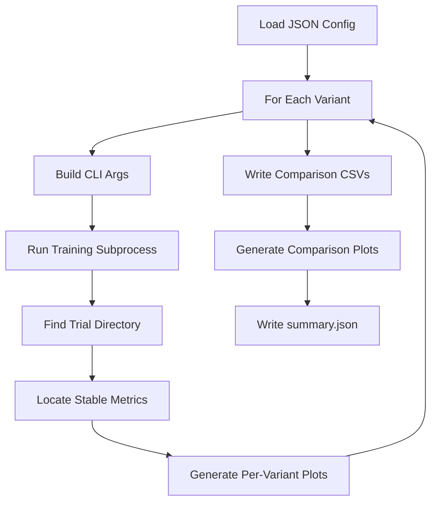
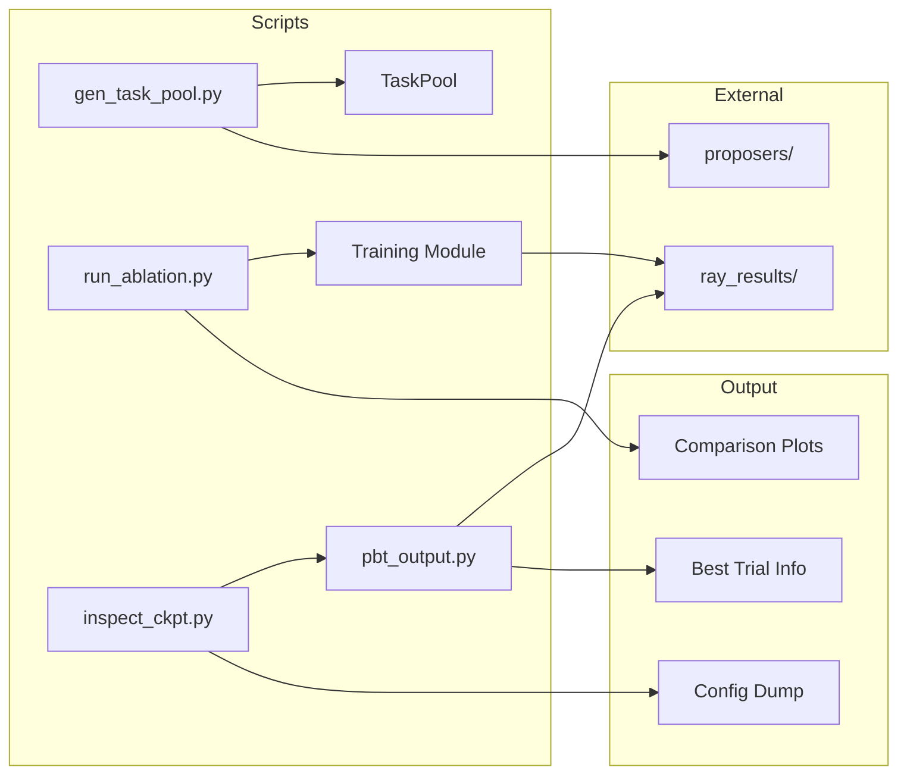

# Experiment Scripts

# Experiment Scripts Module

The `itrader.scripts` module provides command-line utilities for running experiments, generating training tasks, and analyzing results from RLlib training runs.

## Module Overview

```
itrader/scripts/
├── __init__.py
├── experiments/
│   └── run_ablation.py    # Ablation study runner
├── gen_task_pool.py       # Task generation CLI
├── inspect_ckpt.py        # Checkpoint inspection tool
└── pbt_output.py          # Experiment result scanner
```

## Scripts

### run_ablation.py — Ablation Study Runner

Runs reproducible ablation experiments comparing multiple training variants with automated result collection and visualization.

**Usage:**
```bash
python -m itrader.scripts.experiments.run_ablation config.json [--out-dir OUTPUT_DIR]
```

**Configuration Format (JSON):**
```json
{
  "name": "start_index_ablation",
  "python_exe": "python",
  "train_module": "itrader.rl_lib.train.train_solo_V2",
  "common_args": {
    "stop_iters": 50,
    "num_workers": 4
  },
  "variants": [
    {"id": "baseline", "args": {"start_index": 0}},
    {"id": "mid_start", "args": {"start_index": 500}},
    {"id": "late_start", "args": {"start_index": 1000}}
  ]
}
```

**Workflow:**



**Key Functions:**

| Function | Purpose |
|----------|---------|
| `_to_cli_args(arg_map)` | Converts dict to command-line argument list, handling boolean flags |
| `_find_trial_dir(experiment_root)` | Locates the most recent trial directory under an experiment |
| `_run_variant(...)` | Executes a single variant and collects results into `VariantResult` |
| `_write_metric_compare(results, metric, out_csv)` | Writes per-iteration metric comparison across variants |
| `_plot_metric(df, title, ylabel, out_png)` | Generates single-metric comparison plot |
| `_plot_multi_metrics(metric_dfs, out_png)` | Generates 2×2 grid of key metrics |

**Output Artifacts:**
- `ablation_compare.csv` — Episode return comparison across iterations
- `ablation_compare.png` — Episode return visualization
- `ablation_compare_entropy.png` — Entropy comparison
- `ablation_compare_episode_len.png` — Episode length comparison
- `ablation_compare_diagnostics.png` — Multi-metric diagnostic grid
- `summary.json` — Run metadata and artifact paths

---

### gen_task_pool.py — Task Pool Generator

Generates training tasks using configurable proposer backends (rule-based or LLM-based).

**Usage:**
```bash
python -m itrader.scripts.gen_task_pool \
    --backend rule_based \
    --out task_pool.jsonl \
    --n_tasks 100 \
    --seed 42
```

**Backend Options:**

| Backend | Description | Key Arguments |
|---------|-------------|---------------|
| `rule_based` | Deterministic task generation | `--seed`, `--window_size`, `--n_features` |
| `llm` | HuggingFace transformers | `--model_id` |
| `ollama` | Local Ollama server | `--ollama_model`, `--ollama_base_url` |
| `vllm` | vLLM inference server | `--api_model`, `--api_base_url` |
| `sglang` | SGLang inference server | `--api_model`, `--api_base_url` |

**Generation Loop:**
```python
while n_generated < n_tasks:
    raw_tasks = proposer.propose_tasks(market_summary, n=batch_size)
    for raw_task in raw_tasks:
        validated_task = validate_and_clamp_task(raw_task, env_config, fallback_seed)
        TaskSpec.from_dict(validated_task)  # validate structure
        pool.add(validated_task, meta=metadata)
```

**Error Handling:**
- `--max_empty_batches` — Abort after N consecutive empty responses
- `--max_backend_errors` — Abort after N consecutive call failures
- Invalid tasks are dropped with warnings (first 5 logged)

**Output:** JSONL file with one `TaskSpec` per line, including generation metadata.

---

### inspect_ckpt.py — Checkpoint Inspector

Extracts and displays configuration from trial directories or experiment directories.

**Usage:**
```bash
# Inspect a specific trial
python -m itrader.scripts.inspect_ckpt --trial_dir /path/to/trial

# Auto-pick best trial from experiment
python -m itrader.scripts.inspect_ckpt --exp_dir /path/to/experiment --metric custom_metrics/episode_return_mean --mode max
```

**Arguments:**

| Argument | Description |
|----------|-------------|
| `--trial_dir` | Path to a specific trial directory |
| `--exp_dir` | Path to experiment directory (auto-selects best trial) |
| `--metric` | Metric for best-trial selection (default: `custom_metrics/episode_return_mean`) |
| `--mode` | `max` or `min` for metric optimization |
| `--out` | Optional path to write full config JSON |

**Output Sections:**
1. **Trial Info** — Path, best metric value, checkpoint location
2. **PPO/RLlib Config** — Learning rate, clip parameters, batch sizes, entropy coeff, etc.
3. **Env Config** — Data path, window size, embedding settings
4. **TaskSampler Config** — Horizon ranges, reward parameters, task pool path
5. **Tune Overrides** — Flattened config keys with `/` separators

**Config Loading Priority:**
1. `params.json` in trial directory (preferred)
2. `result.json` — extracts config from the iteration with best metric

---

### pbt_output.py — Experiment Scanner

Scans experiment directories to identify top-performing trials based on metrics.

**Usage:**
```bash
python -m itrader.scripts.pbt_output \
    --exp_dir ~/ray_results/Phase_A \
    --metric custom_metrics/episode_return_mean \
    --mode max \
    --top_k 10
```

**Key Function:**
```python
def scan_experiment(exp_dir: Path, metric_key: str, mode: str, top_k: int) -> List[BestRow]:
    """Scan experiment directory and return top-k trials by metric."""
```

**BestRow Dataclass:**
```python
@dataclass
class BestRow:
    trial_dir: Path
    trial_id: str
    iteration: int
    metric: float
    checkpoint: Optional[Path]
    params_path: Path
```

**Metric Extraction Sources:**
1. `result.json` — JSONL file with per-iteration metrics (preferred)
2. `progress.csv` — Fallback CSV with training progress

**Checkpoint Matching:**
- Parses checkpoint directory names (`checkpoint_000123`, `checkpoint-123`, `iter_123`)
- Selects checkpoint nearest to the best iteration
- Falls back to most recently modified if no iteration in name

---

## Shared Utilities

### Metric Extraction Pattern

Both `inspect_ckpt.py` and `pbt_output.py` use identical metric extraction logic:

```python
def _get_metric(rec: Dict[str, Any], metric_key: str) -> Optional[float]:
    # 1. Direct key lookup
    if metric_key in rec:
        return _safe_float(rec.get(metric_key))

    # 2. Nested under "custom_metrics"
    if metric_key.startswith("custom_metrics/"):
        sub = metric_key.split("/", 1)[1]
        cm = rec.get("custom_metrics")
        if isinstance(cm, dict) and sub in cm:
            return _safe_float(cm.get(sub))

    # 3. Nested under "sampler_results"
    sr = rec.get("sampler_results")
    if isinstance(sr, dict):
        # ... same pattern
```

### Checkpoint Discovery Pattern

Both scripts share checkpoint listing and selection:

```python
def _list_checkpoints(trial_dir: Path) -> List[Path]:
    patterns = ("checkpoint_*", "checkpoint-*", "rllib_checkpoints", "rllib_checkpoint*")
    # ... glob matching

def _pick_checkpoint_near_iter(checkpoints: List[Path], target_iter: int) -> Optional[Path]:
    # Returns checkpoint <= target_iter, or closest available
```

---

## Integration Points



**Dependencies:**
- `itrader.proposers` — Task generation backends
- `itrader.rl_lib.tasks` — TaskSpec, TaskPool, validation
- `itrader.rl_lib.tasks.families` — Default bar resolution
- `itrader.scripts.pbt_output` — Used by `inspect_ckpt.py` for `--exp_dir` mode

**Ray Results Structure:**
```
~/ray_results/
├── experiment_name/
│   └── training_fn_abc123/    # Trial directory
│       ├── params.json
│       ├── result.json         # JSONL per-iteration
│       ├── progress.csv
│       └── checkpoint_000050/
└── _stable_metrics/
    └── training_fn_abc123/
        ├── report_rows.csv
        ├── metrics_full.jsonl
        └── plots/
```
