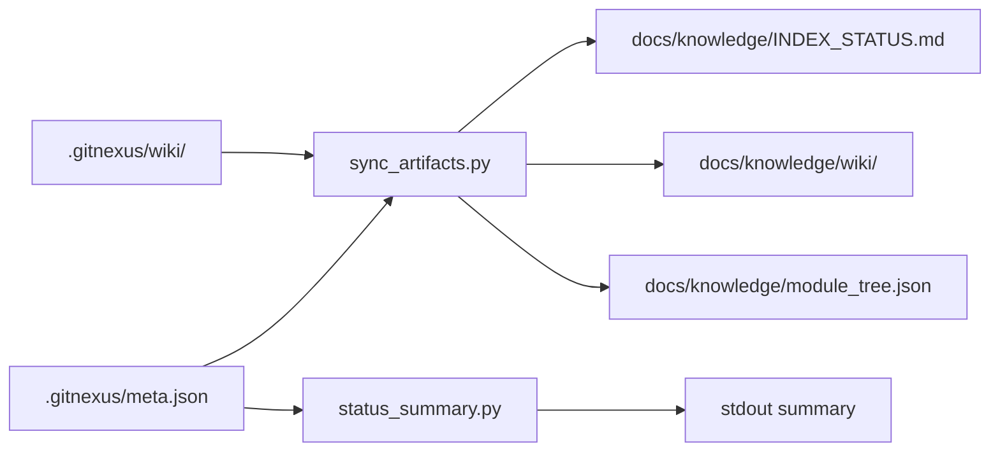

# Knowledge Management

# Knowledge Management Module

## Overview

The Knowledge Management module synchronizes and reports on GitNexus-generated artifacts, making indexed code knowledge available in the repository's documentation structure. It bridges the gap between GitNexus's internal `.gitnexus/` metadata and human-readable documentation under `docs/knowledge/`.

## Architecture



## Key Paths

| Path | Source/Target | Description |
|------|---------------|-------------|
| `.gitnexus/meta.json` | Source | GitNexus index metadata |
| `.gitnexus/wiki/` | Source | Generated wiki pages |
| `docs/knowledge/INDEX_STATUS.md` | Target | Human-readable index status |
| `docs/knowledge/wiki/` | Target | Tracked wiki pages |
| `docs/knowledge/module_tree.json` | Target | Repository file tree |

## Scripts

### sync_artifacts.py

Synchronizes GitNexus outputs into tracked documentation. Run after indexing to update all knowledge artifacts.

**Entry point:** `main()` orchestrates three sync operations:

1. **`write_index_status()`** — Generates `INDEX_STATUS.md` with index metadata and statistics. Falls back to a placeholder document if no index exists.

2. **`sync_wiki()`** — Mirrors `.gitnexus/wiki/*.md` files to `docs/knowledge/wiki/`. Removes orphaned pages that no longer exist in the source.

3. **`write_module_tree()`** — Produces `module_tree.json` representing the repository structure. Uses GitNexus's tree if available, otherwise falls back to `git ls-files`.

**Usage:**
```bash
python tools/knowledge/sync_artifacts.py --repo-root /path/to/repo
```

#### Module Tree Generation

When GitNexus doesn't provide a pre-built tree, `build_tree_from_paths()` constructs a hierarchical structure from file paths:

```python
# Input: ["src/main.py", "src/lib/utils.py"]
# Output:
{
  "repo": "myproject",
  "source": "git-ls-files fallback",
  "children": [
    {
      "name": "src",
      "type": "directory",
      "children": [
        {"name": "main.py", "type": "file"},
        {
          "name": "lib",
          "type": "directory",
          "children": [{"name": "utils.py", "type": "file"}]
        }
      ]
    }
  ]
}
```

The internal `normalize()` function recursively transforms the intermediate dict structure into sorted, clean JSON output.

### status_summary.py

Prints a concise summary of local knowledge artifacts to stdout. Used for quick status checks without modifying files.

**Usage:**
```bash
python tools/knowledge/status_summary.py --repo-root /path/to/repo
```

**Output example:**
```
[knowledge] Local artifact summary
[knowledge] Indexed at: 2024-01-15T10:30:00Z
[knowledge] Indexed commit: abc1234
[knowledge] Stats: 142 files, 892 nodes, 2341 edges, 15 flows
[knowledge] INDEX_STATUS.md stale: no
[knowledge] Tracked wiki pages: 8
[knowledge] module_tree.json present: yes
```

#### Staleness Detection

`build_summary()` compares modification times to detect stale artifacts:

```python
is_stale = status_doc.stat().st_mtime < meta_path.stat().st_mtime
```

If `INDEX_STATUS.md` is older than `meta.json`, it indicates the index was updated but artifacts weren't synced.

## Integration Points

### GitNexus Backend

The module expects GitNexus to produce:

- `.gitnexus/meta.json` — Contains `indexedAt`, `lastCommit`, and `stats` (files, nodes, edges, communities, processes, embeddings)
- `.gitnexus/wiki/*.md` — Generated documentation pages
- `.gitnexus/wiki/module_tree.json` — Optional pre-computed file tree

### Downstream Consumers

- Documentation sites can render `docs/knowledge/wiki/` pages
- Tools can parse `module_tree.json` for repository structure
- CI pipelines can check staleness via `status_summary.py`

## Typical Workflow

1. Run `tools/knowledge/index_repo.sh` to generate GitNexus artifacts
2. Run `sync_artifacts.py` to sync outputs to tracked docs
3. Run `status_summary.py` to verify sync completed
4. Commit changes to `docs/knowledge/`
