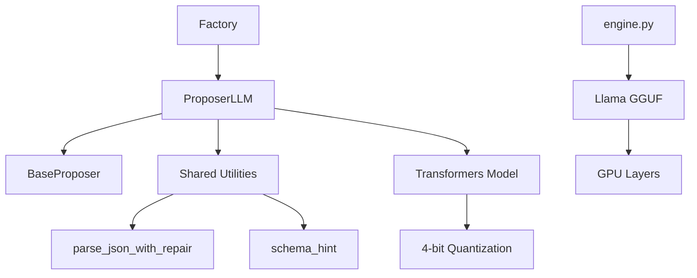
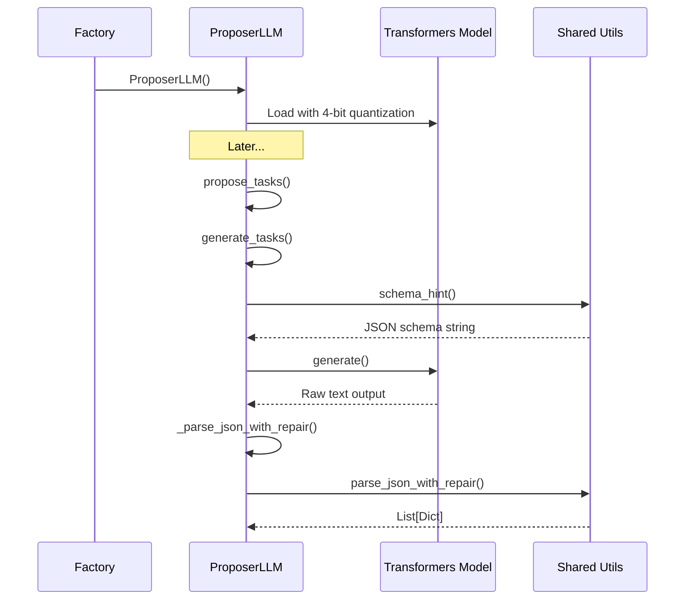

# LLM Integration

# LLM Integration Module

## Overview

The LLM Integration module provides two distinct approaches for integrating large language models into the trading system:

1. **Lightweight Engine** (`engine.py`) — A minimal llama.cpp-based interface for fast local inference
2. **Task Proposer** (`proposer_llm.py`) — A full-featured task generation system using Transformers with 4-bit quantization

These components serve different purposes: the engine provides simple text completion capabilities, while the proposer generates structured task specifications from market data.

## Architecture



---

## Components

### engine.py — Lightweight LLM Engine

A minimal wrapper around `llama_cpp` for local model inference. Designed for scenarios requiring simple text completion without the overhead of the full Transformers stack.

#### Configuration

| Setting | Value | Description |
|---------|-------|-------------|
| Model | DeepSeek Coder 6.7B Q4_K_M | GGUF quantized model |
| Context Window | 4096 tokens | Maximum sequence length |
| GPU Layers | -1 | Offload all layers to GPU |

#### Functions

**`get_llm() -> Llama`**

Returns a cached `Llama` instance. Uses `@lru_cache` to ensure the model is loaded only once per process.

```python
from itrader.llm.engine import get_llm

llm = get_llm()  # Loads model on first call
llm2 = get_llm()  # Returns same instance
```

**`ask(prompt: str, **gen) -> str`**

Generates a text completion for the given prompt.

| Parameter | Type | Default | Description |
|-----------|------|---------|-------------|
| `prompt` | `str` | required | Input text to complete |
| `**gen` | `dict` | — | Override generation parameters |

Default generation parameters:
- `max_tokens`: 128
- `temperature`: 0.7

```python
from itrader.llm.engine import ask

response = ask("Analyze this market trend:")
response = ask("Predict price movement:", max_tokens=256, temperature=0.3)
```

---

### proposer_llm.py — Task Generation System

A `BaseProposer` implementation that generates structured `TaskSpec` objects from market summaries using a HuggingFace Transformers model with efficient 4-bit quantization.

#### Class: `ProposerLLM`

**Inheritance:** `BaseProposer`

**Initialization**

```python
ProposerLLM(
    model_id: str = "Qwen2.5-7B-Instruct",
    device: Optional[str] = None
)
```

| Parameter | Type | Default | Description |
|-----------|------|---------|-------------|
| `model_id` | `str` | `"Qwen2.5-7B-Instruct"` | HuggingFace model identifier |
| `device` | `Optional[str]` | `None` | Target device; auto-detects CUDA availability |

**Quantization Behavior:**

- On CUDA: Attempts 4-bit quantization via `BitsAndBytesConfig`
- Fallback: Full precision if bitsandbytes unavailable
- On CPU: Loads in full precision (quantization not supported)

**Methods**

**`generate_tasks(market_summary, n, schema_hint, temperature, max_new_tokens) -> List[Dict]`**

Generates `n` task specifications from a market summary.

| Parameter | Type | Default | Description |
|-----------|------|---------|-------------|
| `market_summary` | `str` | required | Market context/conditions description |
| `n` | `int` | required | Number of tasks to generate |
| `schema_hint` | `Optional[str]` | `None` | Custom schema; uses default if None |
| `temperature` | `float` | `0.7` | Sampling temperature |
| `max_new_tokens` | `int` | `512` | Maximum tokens to generate |

**Returns:** `List[Dict[str, Any]]` — List of TaskSpec dictionaries; empty list if parsing fails.

**`propose_tasks(market_summary, n, **kwargs) -> List[Dict]`**

Alias for `generate_tasks`. Implements the `BaseProposer` interface.

```python
from itrader.llm.proposer_llm import ProposerLLM

proposer = ProposerLLM(model_id="Qwen2.5-7B-Instruct")

tasks = proposer.propose_tasks(
    market_summary="BTC showing high volatility with 15% swing in 24h",
    n=3,
    temperature=0.8
)
```

---

## Execution Flow

### Task Generation Pipeline



### Integration Points

| Entry Point | Script | Flow |
|-------------|--------|------|
| Training | `rl_lib/train/train_AZR.py` | `main` → `_generate_task_pool` → `_build_proposer_from_args` → `build_proposer` → `ProposerLLM` |
| Task Pool Generation | `itrader/scripts/gen_task_pool.py` | `main` → `_build_proposer_from_args` → `build_proposer` → `ProposerLLM` |

---

## Dependencies

### External Libraries

| Library | Purpose |
|---------|---------|
| `llama_cpp` | GGUF model inference (engine.py) |
| `transformers` | HuggingFace model loading |
| `bitsandbytes` | 4-bit quantization (optional) |
| `torch` | Tensor operations |

### Internal Dependencies

| Module | Usage |
|--------|-------|
| `itrader.proposers.base.BaseProposer` | Abstract base class |
| `itrader.proposers._shared.parse_json_with_repair` | JSON extraction with error recovery |
| `itrader.proposers._shared.schema_hint` | Default TaskSpec schema |

---

## Model Files

The engine expects the following model file structure:

```
itrader/
└── models/
    └── deepseek-llm-6b-q4_k_m/
        └── deepseek-coder-6.7b-instruct.Q4_K_M.gguf
```

Ensure the GGUF file is downloaded before using `engine.py`.

---

## Error Handling

### Quantization Fallback

If bitsandbytes is unavailable on CUDA systems, `ProposerLLM` logs a warning and falls back to full precision:

```
Warning: bitsandbytes not available, loading model in full precision
```

### JSON Parsing Recovery

Generated JSON may be malformed. The `_parse_json_with_repair` method delegates to shared utilities that attempt multiple repair strategies before returning an empty list on complete failure.

---

## Testing

Tests in `itrader/tests/test_llm.py` verify JSON parsing behavior:

- `test_parse_json_with_repair_direct_array` — Parses clean JSON arrays
- `test_parse_json_with_repair_embedded_object` — Extracts JSON from surrounding text
