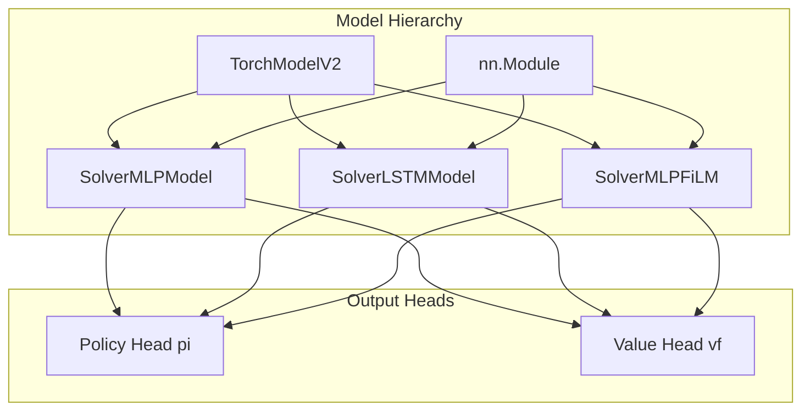

# Neural Network Models

# Neural Network Models

This module provides custom PyTorch neural network models for RLlib-based reinforcement learning agents. All models implement the `TorchModelV2` interface and follow the actor-critic pattern, outputting both policy logits and value estimates.

## Architecture Overview



## Models

### SolverMLPModel

**File:** `itrader/models/solver_MLP.py`
**Registration name:** `"solver_mlp"`

A straightforward multi-layer perceptron for policy and value estimation. Best suited for environments where observations are already feature-engineered or don't require temporal modeling.

#### Architecture

```
Observation → Linear(flat_dim, hidden) → ReLU → Linear(hidden, hidden) → ReLU → [pi_head, vf_head]
```

#### Configuration

| Parameter | Default | Description |
|-----------|---------|-------------|
| `fcnet_hiddens` | `[256, 256]` | Hidden layer sizes (uses first element) |

#### Forward Pass

```python
def forward(self, input_dict, state, seq_lens):
    x = input_dict["obs"].float()
    h = self.trunk(x)
    logits = self.pi(h)
    self._value_out = self.vf(h).squeeze(-1)
    return logits, state
```

The model expects flat observations and processes them through a 2-layer MLP trunk before branching into policy logits and a scalar value estimate.

---

### SolverLSTMModel

**File:** `itrader/models/solver_lstm.py`
**Registration name:** `"solver_lstm_v2"`

An LSTM-based model for temporal sequence processing. Reshapes flat observations into a time series format before processing.

#### Architecture

```
Observation (B, win·F) → reshape(B, win, F) → Linear(F, 128) → ReLU → LSTM(128, 64) → last_hidden → [pi_head, vf_head]
```

#### Configuration

| Parameter | Default | Description |
|-----------|---------|-------------|
| `window_size` | `30` | Number of timesteps in observation window |

**Important:** The model assumes `flat_dim = window_size × n_features`. The feature dimension is inferred as `flat_dim // window_size`.

#### Forward Pass

```python
def forward(self, input_dict, state, seq_lens):
    obs = input_dict["obs"].float()
    B = obs.size(0)
    x = obs.view(B, self.win, self.n_feat)    # Reshape to (B, T, F)
    x = F.relu(self.fc(x))                    # (B, T, 128)
    seq, _ = self.lstm(x)                     # (B, T, 64)
    h = seq[:, -1]                            # Last timestep (B, 64)

    logits = self.pi(h)
    self._value_out = self.vf(h).squeeze(-1)
    return logits, state
```

The model extracts the final LSTM hidden state for policy and value prediction.

---

### SolverMLPFiLM

**File:** `itrader/models/solver_mlp_film.py`
**Registration name:** Not registered by default (instantiate directly)

An MLP with Feature-wise Linear Modulation (FiLM) conditioning. Designed for multi-task learning where a task embedding modulates the network's hidden representations.

#### Architecture

```
Observation → split → [price_features, task_embed]
                         ↓                      ↓
                    trunk MLP              t_mlp → (gamma, beta)
                         ↓                      ↓
                    hidden ←─────── FiLM conditioning ←───────┘
                         ↓
                  [pi_head, vf_head]
```

#### Observation Layout

Observations must be structured as: `[price_window_flat, t_embed]`

- `price_window_flat`: Market/price features
- `t_embed`: Task embedding vector

#### Configuration

| Parameter | Default | Description |
|-----------|---------|-------------|
| `t_embed_dim` | `32` | Dimension of task embedding |
| `fcnet_hiddens` | `[256, 256]` | Trunk MLP hidden layer sizes |
| `t_proj` | `64` | Intermediate projection dimension for task MLP |
| `conditioning` | `"film"` | Conditioning type (only `"film"` supported) |
| `t_keep_p` | `0.9` | Keep probability for task embedding dropout |

#### FiLM Conditioning

The FiLM mechanism applies feature-wise affine transformations:

```python
def _condition_hidden(self, hidden, task_embed):
    gamma_beta = self.t_mlp(task_embed)
    gamma, beta = torch.chunk(gamma_beta, 2, dim=-1)
    gamma = torch.tanh(gamma)  # Clamped to [-1, 1] for stability
    return gamma * hidden + beta
```

This allows the task embedding to scale and shift hidden activations, enabling the network to adapt its behavior per-task.

#### Forward Pass

```python
def forward(self, input_dict, state, seq_lens):
    x = torch.nan_to_num(input_dict["obs"].float())  # NaN handling
    price, task_embed = self._split_obs(x)

    if self.training and self.t_keep_p < 1.0:
        task_embed = self.dropout(task_embed)

    hidden = self.trunk(price)
    hidden = self._condition_hidden(hidden, task_embed)

    logits = self.pi(hidden)
    self._value_out = self.vf(hidden).squeeze(-1)
    return logits, state
```

**Note:** The model applies `nan_to_num` for robustness and uses dropout on task embeddings during training when `t_keep_p < 1.0`.

## RLlib Integration

All models follow the RLlib `TorchModelV2` interface:

| Method | Purpose |
|--------|---------|
| `__init__` | Initialize architecture from `obs_space`, `action_space`, `model_config` |
| `forward` | Compute policy logits; cache value estimate |
| `value_function` | Return cached value estimate from last forward pass |

### Registration

Models are registered with RLlib's `ModelCatalog`:

```python
# Automatic registration at import
ModelCatalog.register_custom_model("solver_mlp", SolverMLPModel)
ModelCatalog.register_custom_model("solver_lstm_v2", SolverLSTMModel)
```

To use in an RLlib config:

```python
config = {
    "model": {
        "custom_model": "solver_mlp",
        "fcnet_hiddens": [256, 256],
    }
}
```

For LSTM:

```python
config = {
    "model": {
        "custom_model": "solver_lstm_v2",
        "custom_model_config": {"window_size": 30},
    }
}
```

## Model Selection Guide

| Model | Use Case |
|-------|----------|
| `SolverMLPModel` | Simple state-based observations, no temporal dependencies |
| `SolverLSTMModel` | Sequential data, temporal patterns, time-series forecasting |
| `SolverMLPFiLM` | Multi-task learning, meta-learning, conditional policies |

## Testing

The `SolverMLPFiLM` model has dedicated tests in `itrader/tests/test_no_nan_forward.py`:

- `test_forward_no_nan_inf_in_logits`: Validates output numerical stability
- `test_value_function_shape_and_finiteness`: Checks value function output shape and finiteness
