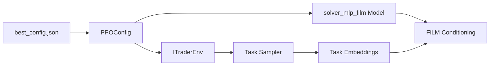

# Other — best_config.json

# best_config.json — RLlib Training Configuration

## Overview

This configuration file defines the hyperparameters and settings for training a reinforcement learning agent using RLlib's PPO algorithm on the `ITraderEnv` trading environment. The configuration represents an optimized set of parameters, likely derived from hyperparameter tuning.

## Purpose

The file serves as the primary configuration input for the training pipeline, specifying:
- Environment parameters for the trading simulation
- Neural network architecture (custom FiLM-conditioned MLP)
- PPO algorithm hyperparameters
- Resource allocation for distributed training
- TensorFlow/PyTorch session settings

---

## Configuration Sections

### Environment Settings

```json
"env": "ITraderEnv",
"env_config": {
  "df_path": "itrader/data/ohlcv.parquet",
  "window_size": 60,
  "t_embed_mode": "concat",
  "t_scale": 1.0,
  ...
}
```

| Parameter | Value | Description |
|-----------|-------|-------------|
| `env` | `"ITraderEnv"` | Registered environment name |
| `df_path` | `"itrader/data/ohlcv.parquet"` | Path to OHLCV market data |
| `window_size` | `60` | Observation window size (timesteps) |
| `t_embed_mode` | `"concat"` | Task embedding concatenation mode |
| `t_embed_dim` | `32` | Task embedding dimension |

### Task Sampler Configuration

The task sampler defines the distribution of training tasks with varying difficulty:

```json
"task_sampler": {
  "horizons": [96, 128, 160, 200],
  "turnover_w_choices": [0.0, 0.0005, 0.001, 0.002],
  "dd_modes": ["delta"],
  "dd_w_range": [0.0, 0.04],
  "turnover_cap": 0.02,
  "dd_cap": 0.1
}
```

**Task Parameters:**
- **Horizons**: Episode lengths sampled from `[96, 128, 160, 200]`
- **Turnover weights**: Penalty coefficients for trading activity
- **Drawdown modes**: Uses delta-based drawdown calculation
- **Caps**: Maximum allowed turnover (2%) and drawdown (10%)

**Override Values** (fixed during this training run):
```json
"task_sampler_overrides": {
  "turnover_w": 0.001478969213630136,
  "dd_w": 0.01573559912930409,
  "dd_T_weight": 0.08909330514088692
}
```

---

### Model Architecture

```json
"model": {
  "custom_model": "solver_mlp_film",
  "custom_model_config": {
    "window_size": 60,
    "t_embed_dim": 32,
    "fcnet_hiddens": [256, 256],
    "conditioning": "film",
    "t_keep_p": 0.7,
    "t_proj": 64
  }
}
```

The model uses a **FiLM-conditioned MLP** architecture:

| Parameter | Value | Description |
|-----------|-------|-------------|
| `custom_model` | `"solver_mlp_film"` | Registered custom model class |
| `fcnet_hiddens` | `[256, 256]` | Hidden layer dimensions |
| `conditioning` | `"film"` | Feature-wise Linear Modulation |
| `t_keep_p` | `0.7` | Task embedding dropout probability |
| `t_proj` | `64` | Task projection dimension |

**FiLM Conditioning**: The network modulates its features based on task embeddings, allowing the same network to handle multiple task configurations dynamically.

---

### PPO Hyperparameters

```json
"gamma": 0.15945066086400006,
"lr": 2.9931256986154753e-05,
"grad_clip": 10.0,
"train_batch_size": 4800,
"sgd_minibatch_size": 97,
"num_sgd_iter": 30,
"clip_param": 0.1,
"lambda": 0.9
```

| Parameter | Value | Description |
|-----------|-------|-------------|
| `gamma` | `0.159` | Discount factor (unusually low, optimized for short horizons) |
| `lr` | `2.99e-05` | Learning rate |
| `grad_clip` | `10.0` | Gradient clipping threshold |
| `train_batch_size` | `4800` | Total samples per training iteration |
| `sgd_minibatch_size` | `97` | Minibatch size for SGD updates |
| `num_sgd_iter` | `30` | Number of SGD epochs per iteration |
| `clip_param` | `0.1` | PPO clipping parameter |
| `lambda` | `0.9` | GAE (Generalized Advantage Estimation) parameter |

**Entropy Schedule**:
```json
"entropy_coeff_schedule": [
  [0, 0.02],
  [200000, 0.01],
  [800000, 0.003]
]
```

The entropy coefficient decays from `0.02` → `0.01` → `0.003` over training steps, encouraging early exploration and later exploitation.

---

### Resource Allocation

```json
"num_workers": 4,
"num_cpus_per_worker": 1,
"num_gpus_per_worker": 0,
"num_gpus": 0,
"framework": "torch",
"placement_strategy": "PACK"
```

| Parameter | Value | Description |
|-----------|-------|-------------|
| `num_workers` | `4` | Parallel rollout workers |
| `num_cpus_per_worker` | `1` | CPU cores per worker |
| `num_gpus_per_worker` | `0` | GPUs per worker (CPU-only inference) |
| `num_gpus` | `0` | Total GPUs for learner |
| `placement_strategy` | `"PACK"` | Co-locate workers on same node |

---

### TensorFlow Session Configuration

```json
"tf_session_args": {
  "intra_op_parallelism_threads": 2,
  "inter_op_parallelism_threads": 2,
  "gpu_options": { "allow_growth": true },
  "allow_soft_placement": true
}
```

These settings optimize TensorFlow execution for multi-worker scenarios, limiting per-worker threading to avoid contention.

---

## Training Control

```json
"stop_iters": 100000,
"checkpoint_interval": 3
```

- **Maximum iterations**: 100,000
- **Checkpoint frequency**: Every 3 iterations

---

## Usage

Load the configuration in your training script:

```python
import json
from ray.rllib.algorithms.ppo import PPOConfig

with open("best_config.json", "r") as f:
    config_dict = json.load(f)

# Apply to PPOConfig
config = PPOConfig().from_dict(config_dict)
algo = config.build()
```

---

## Modification Guide

### Adjusting Task Difficulty

Modify `task_sampler_overrides` to change the reward shaping:

```json
"task_sampler_overrides": {
  "turnover_w": 0.002,    // Increase turnover penalty
  "dd_w": 0.02,           // Adjust drawdown penalty
  "dd_T_weight": 0.05     // Time-weighted drawdown coefficient
}
```

### Changing Model Capacity

Adjust `fcnet_hiddens` in both `model` and `custom_model_config`:

```json
"fcnet_hiddens": [512, 512, 256]  // Larger network
```

### Enabling GPU Training

```json
"num_gpus": 1,
"num_gpus_per_worker": 0  // Workers typically remain CPU-only
```

---

## Key Relationships



The configuration binds together:
1. **Environment** (`ITraderEnv`) with task sampling
2. **Model** (`solver_mlp_film`) with task-conditioned architecture
3. **Algorithm** (PPO) with optimized hyperparameters for this specific environment-model combination