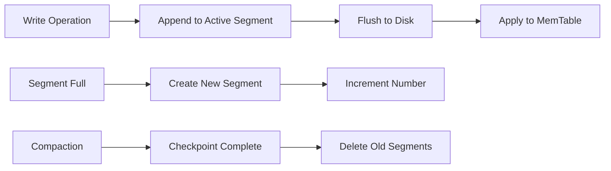

# Other — data-wal

# Data — Write-Ahead Log (WAL)

## Overview

The `data/wal/` directory contains Write-Ahead Log segment files used for durability and crash recovery. These are binary data files, not source code, and are generated and consumed by the storage engine at runtime.

## Purpose

Write-Ahead Logging is a recovery mechanism that ensures data integrity:

1. **Durability** — All operations are persisted to disk before being applied to in-memory state
2. **Crash Recovery** — After an unexpected shutdown, the system replays WAL entries to restore the last consistent state
3. **Atomicity** — Transactions can be completed or rolled back based on WAL contents

## File Structure

```
data/wal/
├── 00000000    # Oldest segment
├── 00000001
├── 00000002
├── 00000003
├── 00000004
└── 00000005    # Newest segment (active)
```

### Naming Convention

Files use zero-padded sequential numbering:

- **Format**: 8-digit decimal numbers (`%08d`)
- **Ordering**: Numerically ascending from `00000000`
- **Active segment**: The highest-numbered file receives new writes

### Segment Rotation

The WAL is split into segments to:

- Limit individual file sizes for easier management
- Enable safe deletion of old segments after compaction
- Support incremental backup strategies

## Lifecycle



## Usage Notes

| Operation | Description |
|-----------|-------------|
| **Read** | Sequential scan during recovery; random access for specific entries |
| **Write** | Append-only to the active (highest-numbered) segment |
| **Delete** | Old segments removed after successful checkpoint/compaction |
| **Backup** | Copy segments in order; active segment may require special handling |

## Integration Points

This directory is managed by the WAL subsystem of the storage engine. The actual implementation lives elsewhere in the codebase — this directory contains only the runtime data files.

**Expected callers** (not in this module):
- WAL writer — appends entries to the active segment
- WAL reader — replays entries during recovery
- Compaction manager — removes obsolete segments

## Configuration

Segment size, flush policies, and retention rules are typically configured in the main storage engine configuration, not in this directory.