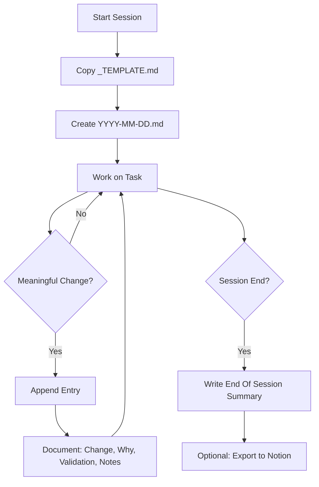

# Other — docs-daily_logs

# Daily Logs Documentation System

## Overview

The `docs/daily_logs/` module provides a structured workflow for maintaining a persistent engineering record across development sessions. It enables consistent tracking of changes, rationale, validation steps, and follow-up items—particularly valuable when work spans multiple sessions or involves different AI assistants.

## Purpose

- **Session continuity**: Preserve context between development sessions
- **Change traceability**: Record what changed, why, and how it was validated
- **Cross-model handoff**: Enable different AI assistants to understand prior work
- **Audit trail**: Maintain a chronological record of engineering decisions

## File Structure

```
docs/daily_logs/
├── README.md           # System overview and workflow guide
├── COMMANDS.md         # Ready-to-use prompts for log generation
├── _TEMPLATE.md        # Template for new daily log files
├── 2026-02-15.md       # Example: completed daily log
└── 2026-03-03.md       # Example: completed daily log
```

## Workflow



## Entry Format

### Daily Log Header

Each daily log file begins with context metadata:

```markdown
# Daily Log - YYYY-MM-DD

## Context
- Branch: `feature-branch-name`
- Session goal: Description of intended work
- Constraints: Environment limitations, restrictions
```

### Automatic Daily Log Entries

Individual work entries follow this structure:

```markdown
### Entry HH:MM
- Change: What was modified or added
- Why: Rationale for the change
- Validation: How the change was verified
- Notes: Additional context, caveats, or follow-ups
```

### End Of Session Summary

Closing section aggregates session outcomes:

```markdown
## End Of Session
- Key outcomes: Summary of achievements
- Files changed: List of modified files
- Commands run: Executed commands for reproducibility
- Open items: Pending work or blockers
```

## Usage Prompts

### During Session

```
Append an automatic daily log entry to docs/daily_logs/YYYY-MM-DD.md
with what changed, why, validation, and follow-ups.
```

### End Of Session

```
Generate daily log for today and append a final AUTOMATIC DAILY LOG
section to docs/daily_logs/YYYY-MM-DD.md.
```

### Notion Export

```
Generate a Notion-ready daily summary from docs/daily_logs/YYYY-MM-DD.md
with sections: Outcomes, Changes, Validation, Pending.
```

## File Naming Convention

| Pattern | Example | Description |
|---------|---------|-------------|
| `YYYY-MM-DD.md` | `2026-02-15.md` | One file per calendar day |

Files use ISO 8601 date format for natural chronological sorting.

## Integration Points

### Pre-commit Hooks

Daily logs integrate with the project's pre-commit workflow. The `.pre-commit-config.yaml` references hygiene checks that may validate log file structure.

### Healthcheck Script

The `itrader/tools/healthcheck.py` script can verify documentation integrity as part of environment diagnostics.

### Notion Sync (Optional)

The COMMANDS.md file includes a prompt template for generating Notion-compatible summaries, enabling optional synchronization with external project management tools.

## Best Practices

1. **Timestamp entries**: Use `HH:MM` format for chronological clarity
2. **Be specific about validation**: Note exact commands run and their outputs
3. **Link related work**: Reference previous entries when continuing work
4. **Document blockers**: Record environment issues or dependency problems
5. **Close loops**: Mark open items as resolved in subsequent entries

## Example: Complete Entry

```markdown
### Entry 14:32
- Change: added `itrader/tools/healthcheck.py` for environment diagnostics
- Why: introduce repeatable pre-commit checks for faster debugging
- Validation: healthcheck script compiled; runtime execution pending
  environment dependency setup
- Notes: pre-commit hooks include hygiene checks, healthcheck, and tests
```

## Relationship to Codebase

The daily logs system is purely documentary—it contains no executable code and has no runtime dependencies. It serves as a meta-layer for tracking changes to:

- `itrader/rl_lib/` - Reinforcement learning training modules
- `itrader/envs/` - Trading environment implementations
- `itrader/tests/` - Test suites
- `itrader/tools/` - Utility scripts
- Configuration files (`pyproject.toml`, `.pre-commit-config.yaml`)
