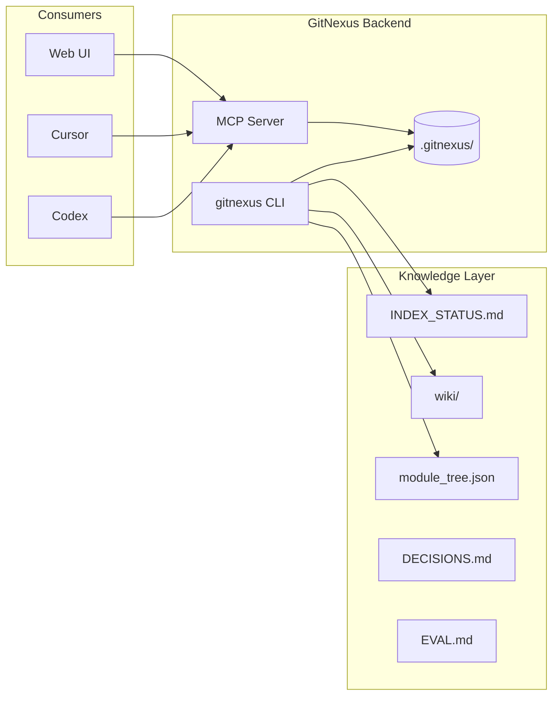

# Other — docs-knowledge

# Knowledge Layer (`docs/knowledge/`)

## Purpose

The `docs/knowledge/` module provides a graph-native code intelligence layer for the `itrader-azr` repository. It uses **GitNexus** as the backend to give agents (Codex, Cursor) structured understanding of code relationships—call graphs, dependencies, and impact analysis—beyond what grep and direct file reading provide.

This is an **advisory layer**: GitNexus augments but does not replace source inspection. When graph context and source disagree, the code wins.

## Architecture



## Key Components

### Tracked Artifacts

| Artifact | Purpose |
|----------|---------|
| `INDEX_STATUS.md` | Current index freshness, commit hash, node/edge counts |
| `module_tree.json` | JSON representation of repository structure |
| `wiki/` | Human-readable module documentation (synced from `.gitnexus/wiki/`) |
| `DECISIONS.md` | Architectural decisions and rationale |
| `EVAL.md` | Evaluation framework for GitNexus vs baseline comparison |

The local `.gitnexus/` database is **never committed**—it's regenerated from source.

### Tooling Scripts (`tools/knowledge/`)

| Script | Function |
|--------|----------|
| `setup_gitnexus.sh` | One-time GitNexus installation |
| `index_repo.sh` | Build/rebuild the knowledge graph |
| `status.sh` | Check index freshness against current commit |
| `generate_wiki.sh` | LLM-backed wiki generation (requires API key) |
| `serve_http_mcp.sh` | Expose GitNexus via HTTP MCP for remote access |
| `codex_with_gitnexus.sh` | Launch Codex with GitNexus MCP injected |
| `post_commit_refresh.sh` | Update index after commit (recommended automation) |
| `pre_commit_advisory.sh` | Optional advisory hook for pre-commit |
| `gitnexus.sh` | Wrapper for direct CLI commands |

### Bootstrap Layer (`tools/knowledge/bootstrap/`)

Reusable setup for seeding other repositories:

```bash
tools/knowledge/bootstrap/init_repo_knowledge.sh /path/to/other-repo
```

Creates runtime scripts, configs, and docs skeleton without overwriting existing `AGENTS.md` or editor configs.

## Usage

### First-Time Setup

```bash
tools/knowledge/setup_gitnexus.sh
tools/knowledge/index_repo.sh
tools/knowledge/status.sh
```

Expected output: `Status: up-to-date` with node/edge/flow counts.

### CLI Queries

```bash
# List indexed symbols
./tools/knowledge/gitnexus.sh list

# Query for a concept
./tools/knowledge/gitnexus.sh query TaskPool

# Get context around a symbol
./tools/knowledge/gitnexus.sh context TaskPool

# Analyze impact of changes
./tools/knowledge/gitnexus.sh impact TaskPool
```

### Codex Integration

**Stdio mode (default):**
```bash
tools/knowledge/codex_with_gitnexus.sh
```

**HTTP mode (shared backend):**
```bash
# Start the HTTP backend first
tools/knowledge/serve_http_mcp.sh

# Then attach Codex
GITNEXUS_USE_HTTP=1 tools/knowledge/codex_with_gitnexus.sh
```

In HTTP mode, `codex mcp list` shows `gitnexus_http` as the shared backend.

### Remote Access

The HTTP MCP endpoint enables LAN access from other machines:

```text
http://<mac-ip>:4747/api/mcp
```

This is optional—same-machine editor access is the default.

## Agent Workflows

### Exploring Unfamiliar Code

1. Run `tools/knowledge/status.sh` to verify freshness
2. `./tools/knowledge/gitnexus.sh query <concept>`
3. `./tools/knowledge/gitnexus.sh context <symbol>`
4. Read the source files GitNexus identifies

Good starting points in `itrader`: `TaskPool`, `_generate_task_pool`, `train_AZR`, `TaskSampler00`

### Debugging

1. `./tools/knowledge/gitnexus.sh query <error-text-or-symptom>`
2. `./tools/knowledge/gitnexus.sh context <suspect-symbol>`
3. Inspect surrounding process cluster in the web UI if available
4. Confirm root cause in source

### Impact Analysis (Before Edits)

1. `./tools/knowledge/gitnexus.sh impact <symbol>`
2. Review direct dependents (depth 1 = break risk)
3. Check whether affected files are tests, training code, samplers, or task definitions
4. Only then start editing

### Refactoring

1. `./tools/knowledge/gitnexus.sh context <symbol>`
2. `./tools/knowledge/gitnexus.sh impact <symbol>`
3. Make code changes
4. `tools/knowledge/post_commit_refresh.sh` after commit

## Freshness Model

GitNexus tracks freshness against **git commits**, not file timestamps:

- Indexing after edits but before commit shows "fresh" until the commit changes
- After a new commit, re-run `index_repo.sh` or `post_commit_refresh.sh`
- This is why `post-commit` hooks are more accurate than `pre-commit` for graph updates

## Wiki Generation

Wiki generation requires an OpenAI-compatible chat endpoint:

```bash
# With OpenAI API key
OPENAI_API_KEY=... tools/knowledge/generate_wiki.sh

# With Azure OpenAI
AZURE_OPENAI_API_KEY=... tools/knowledge/generate_wiki.sh

# With self-hosted endpoint
tools/knowledge/generate_wiki.sh --base-url http://host:11434/v1 --api-key dummy --model <model>
```

**Note:** ChatGPT Plus subscription does not provide a reusable API key. Codex can still work in this repo without wiki generation—this limitation only affects `gitnexus wiki`.

## Evaluation Framework

`EVAL.md` defines a comparison protocol between:

1. **Baseline**: raw grep + direct file reading
2. **GitNexus-assisted**: `query`, `context`, `impact`, `detect_changes`

Record for each prompt:
- Correctness of answer
- Key files found
- Dependencies missed
- Time to first useful answer
- Overconfidence level
- Whether direct reads changed the conclusion

**Decision rule**: Keep advisory mode unless GitNexus consistently finds right files faster, misses fewer dependencies, and stays calibrated when the graph is stale.

## Design Decisions

| Decision | Rationale |
|----------|-----------|
| GitNexus as backend | Real standalone CLI, MCP tools for agents, local + HTTP serving |
| Advisory rollout | Measurable comparison before hard-switch; graph augments, doesn't override |
| Post-commit over pre-commit | Indexing is heavy; wiki generation is LLM-backed; commit-based freshness is accurate |
| Mac as primary host | Local testing without loading main PC; same-machine Codex/Cursor is default |

## Configuration Files

| File | Purpose |
|------|---------|
| `.codex/config.toml` | Codex project configuration with MCP settings |
| `.cursor/mcp.json` | Cursor MCP configuration |
| `~/.gitnexus/config.json` | GitNexus user-level config (API keys, not committed) |

## Current Index Status

As of the last index:
- **Commit**: `42595f2157b49a087f3183735cd22363fddef79b`
- **Files**: 129
- **Nodes**: 1070
- **Edges**: 2212
- **Communities**: 59
- **Processes**: 86

Run `tools/knowledge/status.sh` for current status.