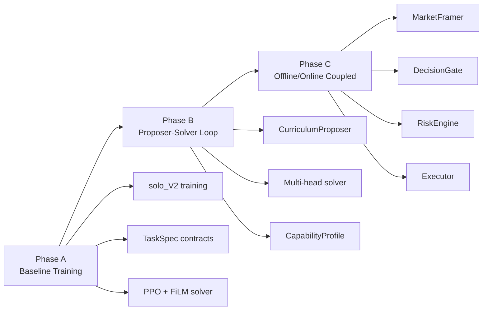

# Other — docs

# iTrader Documentation Module

## Overview

The `docs/` module contains the canonical planning, architecture, and operational documentation for the iTrader project. These documents define the system's evolution from Phase A (baseline training) through Phase B (proposer-solver loop) to Phase C (coupled offline/online architecture).

## Document Index

| Document | Purpose | Audience |
|----------|---------|----------|
| `architecture.md` | Current baseline and target architecture overview | All developers |
| `iTRADER_Codex_Implementation_Spec.md` | Detailed implementation specification for Phase B/C | Implementers, Codex sessions |
| `ops_runbook.md` | Local execution workflow and reproducibility | Operators, developers |
| `phase_b_plan.md` | Concrete milestone breakdown for Phase B | Project leads, implementers |
| `phase_b_handoff_2026-03-04.md` | Session continuation point with validated state | Codex sessions, new contributors |

## Architecture Overview

### Phase Progression



### Current Baseline (Phase A)

The active training path uses:

- **Entry point**: `itrader/rl_lib/train/train_solo_V2.py`
- **Environment**: `itrader/envs/itrader_env.py` (`ITraderEnv`)
- **Reward computation**: `itrader/rl_lib/tasks/rewards.py` via `RewardEngine`
- **Model**: `itrader/models/solver_mlp_film.py` (`SolverMLPFiLM`)
- **Observability**: `itrader/rl_lib/callbacks/ps_metrics.py`, `auto_plotter.py`

Key runtime components:

1. **Data layer**: OHLCV parquet input at `itrader/data/ohlcv.parquet`
2. **Environment**: Emits `flattened_price_window + task_embedding` observations
3. **Task layer**: `TaskSpec` contract with `TaskSampler00` for stochastic generation
4. **Solver**: PPO (RLlib) with FiLM-conditioned policy

### Target Architecture (Phase B/C)

The implementation spec defines a coupled architecture:

**Offline path**:
```
Historical windows → Summarizer → CurriculumProposer → TaskSpecs → Solver → Metrics
```

**Online path**:
```
Live window → MarketFramer → CandidateTasks → Solver → DecisionGate → RiskEngine → Executor
```

## Key Contracts

### TaskSpec

The canonical contract for task definition. Required fields:

| Field | Description |
|-------|-------------|
| `task_family` | Task family identifier (e.g., `"00"`, `"01"`) |
| `bar_resolution` | Time resolution (e.g., `"1m"`, `"5m"`) — **required** to eliminate ambiguity |
| `horizon_bars` | Number of bars in task horizon |
| `start_idx` | Starting index reference |
| `reward_config` | Reward function configuration |
| `regime_tags` | Market regime labels |
| `difficulty_target` | Target solve probability range |
| `metadata` | Source tracking and fingerprints |

### New Contracts (Phase B/C)

The spec introduces additional contracts:

- **`ExecutionIntent`**: Defines how a candidate task would be traded (entry/exit logic, TTL, confidence bands)
- **`CandidateTask`**: Combines `TaskSpec` with execution framing and rationale
- **`CapabilityProfile`**: Tracks solver capability by family/regime/horizon
- **`DecisionRecord`**: Immutable audit trail for decision cycles

## Task Families

| Family | Name | Purpose |
|--------|------|---------|
| `00` | Directional predictor | Current proven path — **lock and preserve** |
| `01` | Breakout/expansion | Trend-following opportunities |
| `02` | Mean reversion | Snapback opportunities |
| `03` | Trade management | Hold/trim/exit decisions for open positions |
| `04` | Abstain/unsuitable | Detect no-trade regimes |

**Implementation order**: Lock `00` → Add `01` → Add `02` → Optionally `03` → Add `04`

## Operations Workflow

### Environment Setup

```bash
# Create and activate environment
conda env create -f itrader/environment.yml
conda activate itrader

# Validate runtime
python itrader/tools/healthcheck.py
python -m pytest -q itrader/tests

# Freeze lock after validation
conda env export --from-history > env.lock.yml
pip freeze > itrader/constraints.lock.txt
```

### Canonical Entry Points

| Operation | Command |
|-----------|---------|
| Training | `python -m itrader.rl_lib.train.train_solo_V2 ...` |
| Health check | `python itrader/tools/healthcheck.py` |
| Tests | `python -m pytest -q itrader/tests` |
| Ablation | `python -m itrader.scripts.experiments.run_ablation <config.json>` |
| Task pool generation | `python -m itrader.scripts.gen_task_pool --backend <backend> ...` |

### Proposer Backends

| Backend | Use Case | Notes |
|---------|----------|-------|
| `rule_based` | CI/smoke tests | Fast, deterministic fallback |
| `ollama` | Local experimentation | Requires model compatibility |
| `vllm` | High-throughput serving | Preferred for main PC |
| `sglang` | Alternative serving | Advanced inference support |

### Metrics Locations

- **Ray results**: `~/ray_results/<experiment_name>/...`
- **Stable mirror**: `~/ray_results/_stable_metrics/<trial_dir>/`
  - `metrics_full.jsonl`
  - `report_rows.csv`
  - `plots/`

## Phase B Milestones

| Milestone | Focus | Key Deliverables |
|-----------|-------|------------------|
| M0 | Stabilization | Remove secrets, fix entrypoints, dependency lock |
| M1 | Contract layer | `BaseProposer` interface, validation, fallback |
| M2 | AZR loop | Runnable `train_AZR.py`, CLI flags, manifests |
| M3 | Guardrails | Integration tests, regression checks, comparison scripts |

## Architectural Gaps (Current)

1. **AZR loop**: `train_AZR.py` is conceptual pseudocode, not runnable
2. **Proposer integration**: LLM proposer exists but not wired into training
3. **Contract clarity**: Module boundaries for proposer/sampler/solver not explicit
4. **Dependency drift**: Multiple manifests with divergent versions
5. **Legacy surface**: Stale entrypoints and cached artifacts create confusion

## Implementation Principles

1. **Single executable truth** for each workflow
2. **Typed contracts** before additional model complexity
3. **Deterministic and inspectable** control paths
4. **Extension over rewrite** — preserve working Phase A paths
5. **WAIT is first-class** — online stack must support abstention natively

## Security

Never hardcode API keys. Required environment variables:

```bash
export POLYGON_API_KEY="your_key_here"
# Optional:
export POLYGON_WS_URL="wss://..."
```

## Pre-Run Checklist

1. `git status` clean or intentionally dirty
2. `healthcheck` passes required packages
3. Tests pass or skips are understood
4. Dataset path exists and matches intended snapshot
5. Experiment name and seed are explicitly set

## Handoff Protocol

For Codex session continuation, use `phase_b_handoff_2026-03-04.md` which provides:

- Validated branch state and commit reference
- Exact commands for sanity checks
- Backend-specific task generation commands
- Known blockers and workarounds

## Definition of Done (Phase B Initial)

Phase B initial is complete when:

1. `train_AZR.py` (or equivalent) is executable
2. Proposer backend is switchable via CLI
3. Smoke run passes with stable metrics + manifests
4. At least one proposer-vs-baseline comparison is reproducible