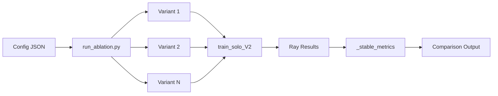

# Other — itrader-scripts

# Experiment Harness

The `itrader/scripts/experiments` module provides a configuration-driven framework for running reproducible A/B ablation studies. It enables systematic comparison of training variants by executing controlled experiments with shared baselines and isolated parameter changes.

## Overview

This harness standardizes experiment execution by:

1. **Declarative configuration** — Define experiments via JSON with validated schemas
2. **Variant isolation** — Run multiple training configurations with controlled differences
3. **Automated comparison** — Generate comparative plots and metrics across variants
4. **Reproducibility** — Consistent output structure and metric collection

## Running Experiments

Execute an ablation study by passing a configuration file:

```bash
python -m itrader.scripts.experiments.run_ablation \
  itrader/scripts/experiments/configs/ablation_start_idx.example.json
```

## Configuration Structure

Experiments are defined in JSON files following the schema in `schemas/ablation.schema.json`.

### Top-Level Fields

| Field | Required | Description |
|-------|----------|-------------|
| `name` | Yes | Experiment identifier used for output directory |
| `python_exe` | No | Python executable (defaults to `python`) |
| `train_module` | No | Training module path (defaults to `itrader.rl_lib.train.train_solo_V2`) |
| `common_args` | Yes | Shared arguments applied to all variants |
| `variants` | Yes | Array of variant configurations (minimum 2) |

### Variant Structure

Each variant in the `variants` array requires:

```json
{
  "id": "variant_identifier",
  "args": {
    // Variant-specific overrides to common_args
  }
}
```

The `args` object merges with `common_args`, with variant values taking precedence.

## Configuration Parameters

### Execution Control

| Parameter | Type | Description |
|-----------|------|-------------|
| `iters` | integer ≥ 1 | Number of training iterations |
| `workers` | integer ≥ 0 | Number of parallel workers |
| `timeout_hours` | number ≥ 0 | Maximum runtime in hours |
| `window` | integer ≥ 2 | Rolling window size for metrics |
| `seed` | integer | Random seed for reproducibility |

### PPO Hyperparameters

| Parameter | Type | Range | Description |
|-----------|------|-------|-------------|
| `gamma` | number | [0.0, 1.0] | Discount factor |
| `lambda` | number | [0.0, 1.0] | GAE lambda |
| `lr` | number | > 0.0 | Learning rate |
| `train_batch_size` | integer | ≥ 1 | Samples per training batch |
| `sgd_minibatch_size` | integer | ≥ 1 | Minibatch size for SGD |
| `num_sgd_iter` | integer | ≥ 1 | SGD iterations per batch |
| `clip_param` | number | ≥ 0.0 | PPO clip parameter |
| `vf_clip_param` | number | ≥ 0.0 | Value function clip parameter |
| `vf_loss_coeff` | number | ≥ 0.0 | Value function loss coefficient |

### Episode/Stream Control

| Parameter | Type | Values | Description |
|-----------|------|--------|-------------|
| `start_idx_mode` | string | `random_episode`, `stream_worker`, `task_spec` | Episode initialization strategy |
| `ret_norm_reset` | string | `episode`, `stream` | Return normalization reset scope |
| `stream_jump_every_episodes` | integer | ≥ 0 | Stream jump frequency |
| `stream_jump_on_wrap` | boolean | — | Jump on data wrap |
| `stream_stride` | integer | ≥ 0 | Stream stride offset |

### Checkpoint & PBT

| Parameter | Type | Description |
|-----------|------|-------------|
| `pbt` | boolean | Enable Population Based Training |
| `cpu_pbt` | boolean | Use CPU-based PBT |
| `pop` | integer ≥ 1 | Population size for PBT |
| `restore_ckpt` | string | Path to checkpoint for restoration |
| `best_params_json` | string | Path to best parameters JSON |

### Data & Output

| Parameter | Type | Description |
|-----------|------|-------------|
| `data_path` | string | Path to OHLCV data file |
| `experiment_name` | string | Experiment name override |
| `auto_plot_on_end` | boolean | Generate plots on training completion |

## Output Structure

Each experiment run creates an output directory under:

```
itrader/scripts/experiments/configs/outputs/<run_tag>/
```

### Generated Files

| File | Description |
|------|-------------|
| `ablation_compare.csv` | Tabular comparison data across variants |
| `ablation_compare.png` | Primary comparison visualization |
| `ablation_compare_entropy.png` | Entropy comparison plot |
| `ablation_compare_episode_len.png` | Episode length comparison |
| `ablation_compare_diagnostics.png` | Diagnostic metrics comparison |
| `summary.json` | Aggregated experiment summary |

### Per-Variant Metrics

Each variant generates individual plots under:

```
~/ray_results/_stable_metrics/<trial_dir_name>/plots/
```

The training module writes per-iteration metrics to:

```
~/ray_results/_stable_metrics/<trial_dir_name>/metrics_full.jsonl
~/ray_results/_stable_metrics/<trial_dir_name>/report_rows.csv
```

## Example Configurations

### Smoke Test (Quick Validation)

The `ablation_smoke_quick.json` provides a minimal configuration for rapid testing:

- 3 iterations, 2 workers
- Compares `random_episode` vs `stream_worker` start modes
- 1-hour timeout ceiling

### Learning Rate Ablation

The `ablation_start_idx.example.json` demonstrates hyperparameter comparison:

- Two variants with different learning rates (0.005 vs 0.0005)
- Different `ret_norm_reset` strategies
- 30 iterations for meaningful comparison

### Checkpoint Restoration

The `pbt_winner_retrain_compare_20260216.json` shows checkpoint-based comparison:

- Restores from specific PBT trial checkpoints
- Compares peak vs final checkpoint performance
- Uses `stream_worker` mode with periodic jumps

## Configuration Validation

All configurations must conform to `schemas/ablation.schema.json`. The schema enforces:

- Required fields: `name`, `common_args`, `variants`
- Minimum 2 variants per experiment
- Type constraints on all parameters
- Enum constraints on `start_idx_mode` and `ret_norm_reset`

Validate a configuration before running:

```python
import json
import jsonschema

with open('schemas/ablation.schema.json') as f:
    schema = json.load(f)

with open('configs/your_experiment.json') as f:
    config = json.load(f)

jsonschema.validate(config, schema)
```

## Integration with Training Pipeline



The harness invokes `train_solo_V2` for each variant, collecting metrics in a standardized location independent of Ray's trial directory structure. This ensures consistent metric access regardless of Ray's internal organization.
