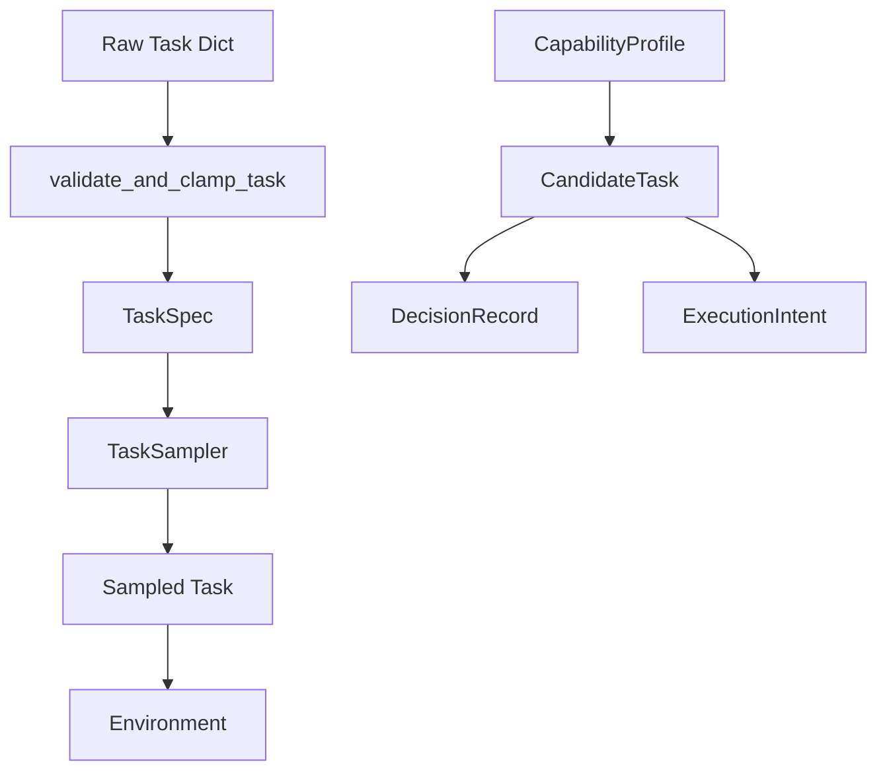

# Other — itrader-tests

# itrader-tests Module

## Overview

The `itrader/tests` module provides comprehensive test coverage for the itrader reinforcement learning trading system. It validates core components including the trading environment, reward computation, task specification contracts, LLM-based task proposers, neural network models, and training configuration.

## Test Organization

```
itrader/tests/
├── conftest.py              # Shared fixtures and pytest configuration
├── env_check.py             # Dependency availability verification
├── sanity.py                # Reward engine sanity checks
├── test_env_core.py         # Trading environment behavior tests
├── test_llm.py              # LLM proposer JSON parsing tests
├── test_no_nan_forward.py   # Model forward pass robustness tests
├── test_ps_metrics.py       # Episode metrics callback tests
├── test_rewards.py          # Reward engine computation tests
├── test_rule_based_proposer.py  # Task proposer factory and implementations
├── test_task_contracts.py   # Task specification contract tests
├── test_task_validation.py  # Task validation and normalization tests
└── test_train_config.py     # Training configuration builder tests
```

## Fixtures

### `tiny_ohlcv_path`

Defined in `conftest.py`, this fixture creates a minimal OHLCV dataset for environment tests:

```python
@pytest.fixture
def tiny_ohlcv_path(tmp_path: Path) -> Path
```

**Behavior:**
- Generates 500 bars of synthetic price data
- Creates a trending base price from 100.0 to 120.0 with sinusoidal noise
- Writes to a temporary parquet file
- Returns the path for use in environment instantiation

**Usage:**
```python
def test_my_feature(tiny_ohlcv_path):
    env = ITraderEnv({"df_path": str(tiny_ohlcv_path), ...})
```

## Test Categories

### Environment Tests (`test_env_core.py`)

Validates `ITraderEnv` behavior:

| Test | Purpose |
|------|---------|
| `test_env_reset_and_step_outputs_are_finite` | Ensures observations and rewards are finite after reset/step |
| `test_env_start_idx_respects_bounds` | Validates episode start index stays within valid range |
| `test_env_seeded_reset_is_reproducible_across_instances` | Confirms identical seeds produce identical task parameters |
| `test_env_applies_terminal_drawdown_penalty_on_final_step` | Verifies terminal drawdown penalty application |

### Reward Engine Tests (`test_rewards.py`, `sanity.py`)

Validates `RewardEngine` computation:

```python
# Computing rewards with explicit parameters
reward, components = RewardEngine.compute(
    "pnl_linear",
    {"pnl_w": 1.0, "turnover_w": 0.01, "dd_w": 0.2},
    {"pnl_delta": 0.5, "turnover_t": 1.0, "dd_inc": 0.3, ...}
)
```

**Key validations:**
- Unknown reward IDs raise `KeyError`
- NaN/Inf inputs produce finite outputs
- Component signs are correct (PnL positive, turnover/drawdown negative)
- Terminal drawdown penalty only applies on terminal step
- Custom reward functions preserve arbitrary component names

### Task Contract Tests (`test_task_contracts.py`, `test_task_validation.py`)

Validates the task specification system:



**Contract types tested:**
- `TaskSpec` - Core task specification with family, price, horizon, reward
- `ExecutionIntent` - Entry/exit logic, confidence bands, risk envelope
- `CandidateTask` - Task spec + execution intent + metadata
- `CapabilityProfile` - Agent capability tracking per family/horizon
- `DecisionRecord` - Full decision trace with candidates and outcomes

**Validation behaviors:**
- Populates required defaults for missing fields
- Clamps out-of-range values to valid bounds
- Normalizes GPT-style aliases to canonical field names
- Preserves unknown reward parameters for future extensibility

### Proposer Tests (`test_rule_based_proposer.py`, `test_llm.py`)

Validates task proposal generation:

```python
# Factory pattern for proposer creation
proposer = build_proposer("rule_based", seed=1)
proposer = build_proposer("ollama", model="qwen2.5:7b-instruct")
proposer = build_proposer("vllm", model="Qwen/Qwen3.5-9B", base_url="...")
```

**Key validations:**
- Deterministic output for identical seeds
- Correct task shape fields (obs_dim, action_dim)
- Reward-specific parameter shapes
- JSON parsing with repair for malformed LLM output

### Model Tests (`test_no_nan_forward.py`)

Validates `SolverMLPFiLM` robustness:

```python
def test_forward_no_nan_inf_in_logits():
    # Model receives NaN/Inf inputs
    x[0, 0] = float("nan")
    x[1, 1] = float("inf")
    x[2, 2] = float("-inf")

    logits, _ = model.forward({"obs": x}, [], None)
    assert torch.isfinite(logits).all()  # Must produce finite outputs
```

### Training Configuration Tests (`test_train_config.py`)

Validates `build_base_config` function:

| Test | Purpose |
|------|---------|
| `test_build_base_config_sets_seed_in_all_required_places` | Seed propagation to all config sections |
| `test_build_base_config_pbt_disables_prometheus` | PBT mode disables metrics export |
| `test_build_base_config_wires_task_pool_when_path_is_set` | Task pool path integration |
| `test_build_base_config_defaults_new_ppo_args_when_missing` | PPO hyperparameter defaults |
| `test_build_base_config_respects_explicit_ppo_args` | CLI argument override behavior |

## Running Tests

### Prerequisites

Core dependencies (always required):
- numpy, pandas, torch, ray, gymnasium, duckdb

Optional dependencies:
- `llama_cpp` - LLM proposer backends (tests skip if unavailable)
- `transformers` - ProposerLLM tests
- `pydantic` - Configuration validation tests

### Execution

```bash
# Run all tests
pytest itrader/tests/

# Run specific test file
pytest itrader/tests/test_env_core.py

# Run with verbose output
pytest itrader/tests/ -v

# Run only fast tests (skip integration tests)
pytest itrader/tests/ -m "not slow"
```

## Test Data Patterns

### Environment Configuration

Tests use a standard environment configuration pattern:

```python
def _make_env(df_path: str, start_idx_mode: str = "random_episode", seed: int = 1234):
    return ITraderEnv({
        "df_path": df_path,
        "window_size": 30,
        "start_idx_mode": start_idx_mode,
        "ret_norm_reset": "episode",
        "task_sampler": {
            "seed": seed,
            "window_size": 30,
            "n_features": 5,
            "t_embed_dim": 32,
            "action_dim": 3,
            "horizons": [64],
            "reward_ids": ["pnl_linear"],
        },
    })
```

### Task Validation Pattern

```python
# Raw input with potential issues
raw_task = {"horizon": 99999, "start_idx": -10, ...}

# Validation clamps and normalizes
validated = validate_and_clamp_task(
    raw_task,
    {"window_size": 30, "n_features": 5, "t_embed_dim": 32, "action_dim": 3},
    fallback_seed=123
)

# Convert to typed spec
spec = TaskSpec.from_dict(validated)
```

## Key Assertions

The test suite enforces several critical invariants:

1. **Finite outputs**: All environment observations, rewards, and model outputs must be finite
2. **Reproducibility**: Seeded environments produce identical task parameters across instances
3. **Bounds respect**: Start indices stay within valid episode ranges
4. **Contract normalization**: All task specs normalize to canonical field names
5. **Metric preservation**: Dynamic reward components flow through to episode metrics
