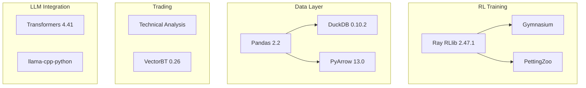

# Other — itrader

# itrader Module

## Overview

The `itrader` module is an experimental trading research environment configured for reinforcement learning-based trading strategies. It provides the dependency baseline and environment configuration for Phase B development, integrating RL frameworks, technical analysis tools, and LLM capabilities.

**Note:** This module currently contains only configuration scaffolding. No runtime code, classes, or functions are implemented yet.

## Purpose

- Establish a canonical dependency baseline for trading research
- Configure a reproducible conda environment for Phase B development
- Define testing and linting standards for future code

## Dependencies Architecture

The module's dependencies reveal its intended architecture:



### Core Dependencies

| Category | Package | Version | Purpose |
|----------|---------|---------|---------|
| **Reinforcement Learning** | `ray[rllib]` | 2.47.1 | Distributed RL training framework |
| | `gymnasium` | ≥0.29, <1.0 | Environment interface standard |
| | `pettingzoo` | 1.24.1 | Multi-agent RL environments |
| **Data Processing** | `numpy` | 1.26.* | Numerical computing |
| | `pandas` | 2.2.* | DataFrame operations |
| | `duckdb` | 0.10.2 | In-process analytical database |
| | `pyarrow` | 13.0.0 | Columnar data format |
| **Trading** | `ta` | ≥0.11.0 | Technical analysis indicators |
| | `vectorbt` | 0.26.0 | Vectorized backtesting |
| **LLM** | `transformers` | 4.41.1 | Hugging Face model hub |
| | `llama-cpp-python` | 0.3.9 | Local LLM inference |
| **Validation** | `great_expectations` | ≥0.19 | Data quality validation |

## Environment Setup

### Using Conda (Recommended)

```bash
# Create environment from specification
conda env create -f itrader/environment.yml

# Activate environment
conda activate itrader
```

### Using pip with Constraints

```bash
# Create virtual environment
python -m venv .venv
source .venv/bin/activate

# Install with constraints
pip install -r itrader/constraints.txt
```

### Post-Installation

After environment creation, generate a concrete lock file on the target machine:

```bash
pip freeze > requirements.lock
```

## Project Structure

```
itrader/
├── README.md           # Project overview
├── constraints.txt     # pip constraint baseline
├── environment.yml     # conda environment specification
└── pyproject.toml      # pytest configuration
```

## Testing Configuration

The `pyproject.toml` defines the testing standards:

| Setting | Value |
|---------|-------|
| `minversion` | pytest 7.0+ |
| `testpaths` | `["tests"]` |
| `python_files` | `test_*.py`, `*_test.py` |
| `addopts` | `-ra` (show extra test summary) |
| `console_output_style` | `progress` |

### Running Tests

```bash
# Run all tests
pytest

# Run with verbose output
pytest -v

# Run specific test file
pytest tests/test_example.py
```

## Development Tools

| Tool | Purpose |
|------|---------|
| `pytest` | Test framework |
| `black` | Code formatting |
| `isort` | Import sorting |

### Linting Workflow

```bash
# Format code
black itrader/

# Sort imports
isort itrader/

# Run both with checks
black --check itrader/ && isort --check-only itrader/
```

## Key Integration Points

Based on the dependency configuration, the module is designed to integrate with:

1. **Ray RLlib** — For distributed training of trading agents
2. **Gymnasium/PettingZoo** — Custom trading environment implementations
3. **VectorBT** — Backtesting trained strategies
4. **DuckDB + PyArrow** — Efficient market data storage and retrieval
5. **Great Expectations** — Data quality validation for market data pipelines
6. **LLM Components** — Potential use for strategy generation or market analysis

## Notes

- The `constraints.txt` explicitly states it is "not a full transitive lock" — generate locks on target machines
- Python 3.11 is the canonical version
- PyTorch 2.3.* is included via conda, not pip
- `ta-lib` requires conda-forge channel (C library dependency)