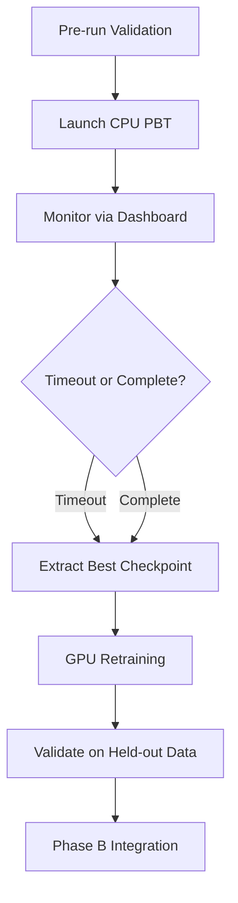

# Other — PBT_SETUP_GUIDE.md

# PBT Setup Guide Documentation

## Overview

The `PBT_SETUP_GUIDE.md` is a comprehensive operational reference for running Population-Based Training (PBT) sweeps in the RL training pipeline. It serves as the primary documentation for developers setting up long-running hyperparameter exploration jobs, managing checkpoints, and extracting optimal model configurations.

## Purpose

This guide addresses the operational complexity of PBT workflows:

- **Phase 1**: CPU-based multi-trial exploration with PBT to discover optimal hyperparameters
- **Phase 2**: GPU-based retraining of the best checkpoint for final model optimization

The two-phase approach separates exploration (many trials, CPU-efficient) from exploitation (single trial, GPU-optimized), reducing computational costs while maintaining hyperparameter search breadth.

## Document Structure

### Quick Start Checklist

Provides immediate actionable commands for launching PBT sweeps. Key flags:

| Flag | Purpose | Recommended Value |
|------|---------|-------------------|
| `--cpu_pbt` | Enables CPU-optimized PBT mode | Required for Phase 1 |
| `--pbt` | Activates population-based training | Required |
| `--pop` | Population size (number of trials) | 10 for initial runs |
| `--workers` | Parallel workers per trial | 4 for CPU PBT |
| `--iters` | Training iterations | 200 for exploration |
| `--timeout_hours` | Maximum run duration | 12-24 hours |

### Checkpoint Management

Documents the checkpoint storage hierarchy and extraction procedures:

```
~/ray_results/Phase_A/
├── <trial_id_1>/
│   ├── rllib_checkpoints/
│   │   ├── checkpoint_000003/
│   │   ├── checkpoint_000006/
│   │   └── ...
│   ├── progress.csv
│   └── stdout/stderr logs
├── <trial_id_2>/
└── ...
```

The guide provides code examples for:
- Loading experiment results via `tune.ExperimentAnalysis`
- Identifying best trials by `custom_metrics/episode_return_mean`
- Restoring checkpoints for continued training

### Monitoring Long Runs

Covers four monitoring approaches:

1. **Ray Dashboard** (`localhost:8265`) — Real-time trial status, actor health, resource allocation
2. **Progress Files** (`progress.csv`) — Per-trial metrics for mid-run analysis
3. **Log Files** — Trial-level stdout/stderr for debugging
4. **Resource Monitoring** — System-level CPU/memory/disk tracking

### Troubleshooting

Documents six common failure modes with symptoms, causes, and fixes:

| Issue | Root Cause | Resolution |
|-------|------------|------------|
| Port Conflicts | Prometheus conflicts across trials | Auto-disabled when `--pbt` set |
| Checkpoint Save Failures | Disk space/permissions | Verify `~/ray_results` writable |
| Trial Failures | OOM, NaN gradients, env errors | Check logs, `max_failures=3` retry |
| Plot Directory Flooding | Callback misconfiguration | `MetricsOnlyCallback` for PBT |
| Memory Issues | Too many concurrent trials | Reduce `--pop` or `--workers` |
| Checkpoint Restoration | First iteration has no checkpoint | Expected on first iter only |

### Best Practices

Provides operational recommendations:

- **Pre-run validation**: Quick 3-iteration test before full sweep
- **Resource planning**: CPU/memory/disk requirements per trial
- **Early stopping**: `TimeoutStopper` configuration
- **Checkpoint frequency**: Balance between PBT exploitation and I/O overhead
- **Recovery procedures**: Resume from interruption points

### Results Extraction

Post-PBT analysis workflow:

```python
# Standard extraction pattern
analysis = tune.ExperimentAnalysis("~/ray_results/Phase_A")
df_sorted = analysis.results_df.sort_values(
    'custom_metrics/episode_return_mean', 
    ascending=False
)
best_config = analysis.best_config
```

### Performance Optimization

Platform-specific tuning:

- **CPU PBT**: Fewer workers (2-4), smaller batches, moderate population
- **GPU Retraining**: More workers (6-8), larger batches, extended iterations

### Expected Timelines

Provides realistic runtime estimates:

| Configuration | Per-Iteration | Full Run | Checkpoint Size |
|---------------|---------------|----------|-----------------|
| CPU PBT (10 trials, 200 iters) | 10-30 sec | 6-12 hours | ~100MB each |
| GPU Retraining (1 trial, 500 iters) | 5-10 sec | 1-2 hours | Final only |

## Integration with Training Pipeline

This guide references the training entry point:

```
itrader.rl_lib.train.train_solo_V2
```

The guide assumes familiarity with:
- Ray Tune PBT API
- RLlib PPO algorithm configuration
- Checkpoint restoration workflows

## Usage Patterns

### Typical Workflow



### Command Sequence

```bash
# Phase 1: Exploration
python -m itrader.rl_lib.train.train_solo_V2 \
    --cpu_pbt --pbt --pop 10 --workers 4 --iters 200 --timeout_hours 12

# Phase 2: Exploitation (manual checkpoint extraction required)
python -m itrader.rl_lib.train.train_solo_V2 \
    --restore <best_checkpoint_path> \
    --iters 500 --workers 6
```

## Key Configuration Dependencies

The guide references several configuration elements that must be properly set in the training code:

- `checkpoint_interval=3` — Controls checkpoint frequency
- `max_failures=3` — Trial retry tolerance
- `reuse_actors=False` — Memory leak prevention
- `metrics_sinks` — Empty for PBT (Prometheus disabled)
- `MetricsOnlyCallback` vs `CombinedCallback` — Callback selection based on mode

## Related Files

| File | Relationship |
|------|--------------|
| `train_solo_V2.py` | Entry point for PBT commands |
| `PBTConfig` | Hyperparameter search space definition |
| `MetricsOnlyCallback` | Callback for PBT trials (no plots) |
| `CombinedCallback` | Callback for single-train runs (with plots) |

## Maintenance Notes

When updating PBT configuration or adding new flags:

1. Update the Quick Start Checklist with new parameters
2. Add troubleshooting entries for new failure modes
3. Adjust timeline estimates if iteration costs change
4. Document any changes to checkpoint paths or formats