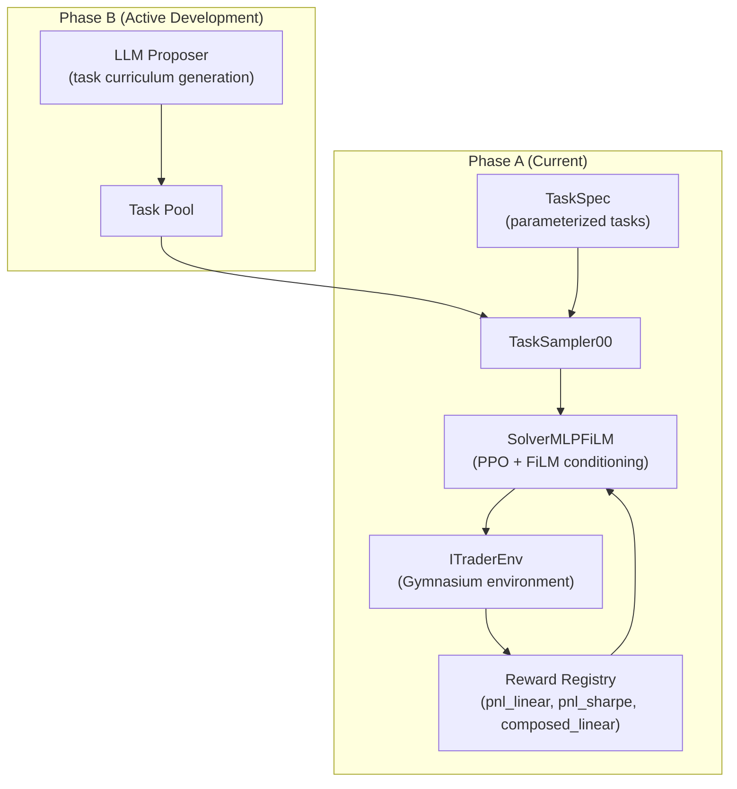

# Other — README.md

# README.md — Project Documentation Index

## Purpose

The `README.md` file serves as the primary entry point for the iTrader-AZR codebase. It provides a comprehensive overview of the autonomous trading research platform, its architecture, operational procedures, and development roadmap. This document functions as both an onboarding guide for new developers and a reference index for locating detailed documentation across the repository.

## Document Structure

The README is organized into the following logical sections:

| Section | Purpose |
|---------|---------|
| **Core Idea** | Explains the proposer-solver paradigm and RLVR principles |
| **Repository Map** | Index of key source files with brief descriptions |
| **Planning and Operations Docs** | Links to detailed architecture and operational documentation |
| **Current Phase Status** | Development milestone tracking |
| **How To Run** | Command-line reference for training, testing, and task generation |
| **Engineering Gaps** | Technical debt and improvement priorities |
| **Suggested Refactor Track** | Development roadmap with timeline |

## Architecture Overview

The README introduces the fundamental architectural separation:



## Key Components Referenced

### Core Training Pipeline

| File | Role |
|------|------|
| `itrader/rl_lib/train/train_solo_V2.py` | Main training entry point for Phase A |
| `itrader/rl_lib/train/train_AZR.py` | Bootstrap runner for proposer-solver handoff |
| `itrader/envs/itrader_env.py` | Gymnasium environment with task-conditioned observations |
| `itrader/models/solver_mlp_film.py` | FiLM-conditioned solver network |

### Task System

| File | Role |
|------|------|
| `itrader/rl_lib/tasks/spec.py` | `TaskSpec` contract definition |
| `itrader/rl_lib/tasks/samplers.py` | Task generation and pool sampling |
| `itrader/rl_lib/tasks/rewards.py` | Reward function registry |
| `itrader/rl_lib/tasks/validation.py` | Task validation utilities |

### Proposer Infrastructure

| File | Role |
|------|------|
| `itrader/proposers/` | Proposer abstraction layer and `BaseProposer` |
| `itrader/llm/proposer_llm.py` | LLM proposer integration |
| `itrader/llm/engine.py` | LLM backend engine |

## Command Reference

### Training Commands

The README documents the primary training invocation:

```bash
# Standard training
python -m itrader.rl_lib.train.train_solo_V2 --iters 200 --workers 6 --window 30 --seed 1234 --experiment_name Phase_A

# CPU-safe smoke test
python -m itrader.rl_lib.train.train_solo_V2 --cpu_pbt --iters 3 --workers 2 --window 30 --seed 2026 --experiment_name Phase_A_Smoke --data_path itrader/data/ohlcv.parquet
```

### Key CLI Flags

| Flag | Values | Purpose |
|------|--------|---------|
| `--start_idx_mode` | `random_episode`, `stream_worker`, `task_spec` | Episode start index strategy |
| `--ret_norm_reset` | `episode`, `stream` | Return normalization reset behavior |
| `--stream_jump_every_episodes` | integer | Stream mode jump frequency |
| `--stream_stride` | integer | Stream mode stride length |
| `--auto_plot_on_end` | flag | Enable automatic plotting at run completion |

### Task Generation Backends

```bash
# Rule-based (deterministic)
python -m itrader.scripts.gen_task_pool --backend rule_based --out /tmp/tasks.jsonl --n_tasks 8

# Ollama (local LLM)
python -m itrader.scripts.gen_task_pool --backend ollama --ollama_model qwen2.5:3b --out /tmp/tasks.jsonl --n_tasks 8

# vLLM/SGLang (OpenAI-compatible server)
python -m itrader.scripts.gen_task_pool --backend vllm --api_base_url http://localhost:8000/v1 --api_model Qwen/Qwen3.5-9B --out /tmp/tasks.jsonl --n_tasks 8
```

## Output Artifacts

The README documents the training output structure:

```
~/ray_results/<experiment_name>/
├── training_fn_*/           # Ray trial artifacts
├── run_manifest_*.json      # Run metadata (git commit, config hash, dataset fingerprint, seed)
└── _stable_metrics/
    └── <trial_dir_name>/
        ├── metrics_full.jsonl    # Flattened scalar metrics
        ├── report_rows.csv       # Session report rows
        └── plots/                # Auto-generated plots
```

## Documentation Hierarchy

The README serves as the root of a documentation tree:

```
README.md (this file)
├── docs/architecture.md          # Baseline and target architecture
├── docs/phase_b_plan.md           # Milestone plan and acceptance criteria
├── docs/ops_runbook.md            # Setup and recovery procedures
├── docs/knowledge/README.md       # GitNexus knowledge layer
├── docs/daily_logs/COMMANDS.md    # Session logging workflow
└── PBT_SETUP_GUIDE.md             # PBT sweep operations
```

## Development Roadmap

The README tracks engineering priorities:

### Phase A (Mostly Complete)
- Learnable reward infrastructure
- Stable solver training with sanitization guards
- PBT workflow with operational documentation

### Phase B (Active)
- LLM proposer integration into training loop
- `stream_worker` stepping strategy validation
- Full proposer-solver co-adaptation loop

### Technical Debt Priorities

1. **Configuration discipline** — Centralize YAML/TOML configs with schema validation
2. **Interface contracts** — Typed interfaces between proposer, sampler, solver, environment
3. **Testing layers** — Unit tests for reward math, integration tests for config assembly, regression tests for stability
4. **Observability** — Standardize metric namespaces and experiment lineage tracking
5. **Reproducibility** — Explicit seed policies, versioned dataset snapshots
6. **Failure isolation** — Retry/recovery for checkpoint I/O and LLM task generation

## Related Documentation

For detailed information on specific topics, refer to:

- **Architecture details**: `docs/architecture.md`
- **Phase B planning**: `docs/phase_b_plan.md`
- **Operational procedures**: `docs/ops_runbook.md`
- **PBT workflows**: `PBT_SETUP_GUIDE.md`
- **Knowledge management**: `docs/knowledge/README.md`