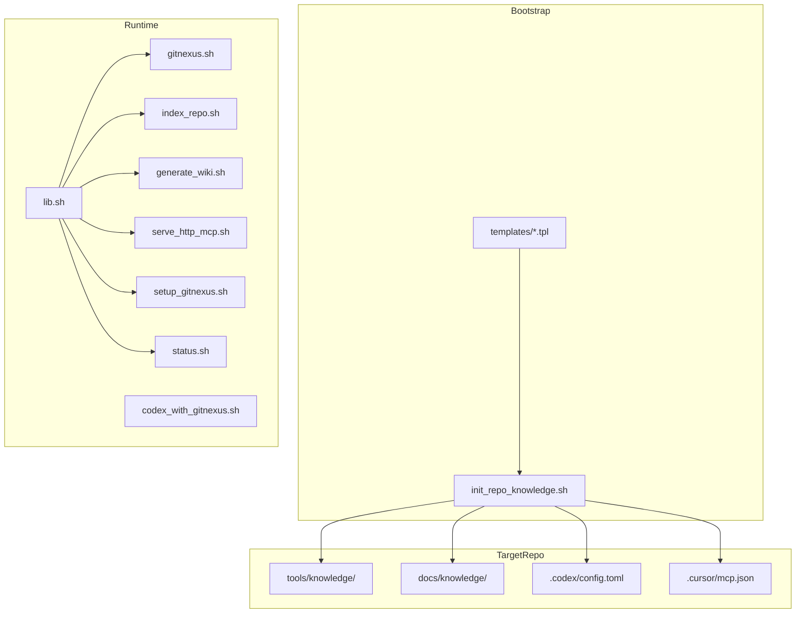
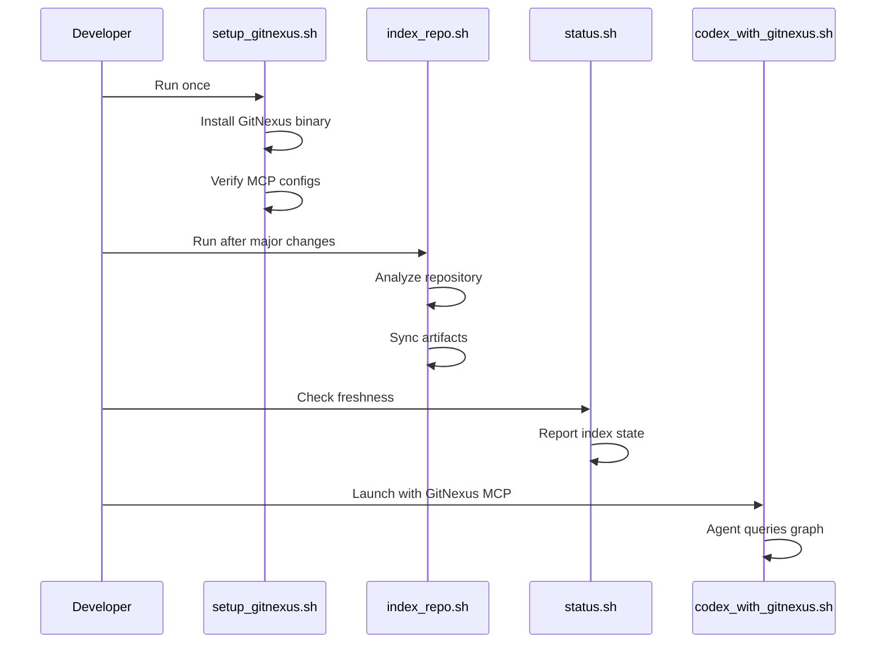

# Other — tools-knowledge

# tools/knowledge — GitNexus Knowledge Layer

## Overview

The `tools/knowledge` module provides a portable, self-contained knowledge infrastructure for repositories. It wraps GitNexus, a local code-intelligence backend, and manages:

- **Repository indexing** — builds call graphs, symbol tables, and dependency maps
- **MCP integration** — exposes GitNexus to AI agents via the Model Context Protocol
- **Wiki generation** — creates LLM-backed documentation from the code graph
- **Artifact synchronization** — keeps `docs/knowledge/` in sync with index state

The design is deliberately **advisory**: it augments normal development workflows without forcing agents to rely exclusively on graph-based queries. Direct file reads and grep remain valid fallbacks.

## Architecture



## Bootstrap System

### `bootstrap/init_repo_knowledge.sh`

Seeds a target repository with the complete knowledge layer. Run once per repo:

```bash
./tools/knowledge/bootstrap/init_repo_knowledge.sh /path/to/target-repo
```

**What it creates:**

| Destination | Content |
|-------------|---------|
| `tools/knowledge/` | Runtime scripts (gitnexus.sh, lib.sh, etc.) |
| `docs/knowledge/` | Skeleton files (README.md, QUICKSTART.md, WORKFLOWS.md, etc.) |
| `.codex/config.toml` | MCP server configuration for Codex |
| `.cursor/mcp.json` | MCP server configuration for Cursor |
| `AGENTS.md` | Agent guidance file |

**Design principle:** The bootstrap copies runtime scripts unconditionally (allowing updates) but skips existing guidance files. This lets repos customize `AGENTS.md` and workflow docs without merge conflicts on refresh.

### Templates

All templates in `bootstrap/templates/` support `__REPO_NAME__` substitution:

- `AGENTS.md.tpl` — Agent instructions for using GitNexus
- `codex-config.toml.tpl` — Codex MCP configuration
- `cursor-mcp.json.tpl` — Cursor MCP configuration
- `docs-knowledge-*.tpl` — Documentation skeletons

## Runtime Scripts

### Core Library: `lib.sh`

Provides shared functions for all other scripts:

```bash
source "${SCRIPT_DIR}/lib.sh"
```

**Key functions:**

| Function | Purpose |
|----------|---------|
| `ensure_gitnexus_installed` | Installs GitNexus to `~/.gitnexus-tooling/` if missing |
| `run_gitnexus` | Executes GitNexus binary with arguments |
| `sync_knowledge_artifacts` | Calls `sync_artifacts.py` to update `docs/knowledge/` |
| `has_wiki_llm_config` | Checks for LLM API credentials |
| `repo_name` | Returns the repository basename |

**Environment variables:**

| Variable | Default | Description |
|----------|---------|-------------|
| `GITNEXUS_VERSION` | `1.5.3` | GitNexus version to install |
| `GITNEXUS_INSTALL_ROOT` | `~/.gitnexus-tooling/gitnexus-{version}` | Installation directory |
| `GITNEXUS_CONFIG_FILE` | `~/.gitnexus/config.json` | GitNexus configuration path |

### Entry Point: `gitnexus.sh`

Thin wrapper that sources `lib.sh` and passes all arguments to the GitNexus binary:

```bash
./tools/knowledge/gitnexus.sh <command> [args...]
```

### Setup: `setup_gitnexus.sh`

Verifies GitNexus installation and reports configuration status:

```bash
./tools/knowledge/setup_gitnexus.sh
```

Output includes:
- GitNexus version and binary path
- Tracked MCP configuration files
- Next steps for indexing

### Indexing: `index_repo.sh`

Analyzes the repository and builds the knowledge graph:

```bash
./tools/knowledge/index_repo.sh
```

This:
1. Runs `gitnexus analyze` on the repository root
2. Calls `sync_knowledge_artifacts` to update `docs/knowledge/`
3. Skips `AGENTS.md` regeneration (preserves customizations)

### Status: `status.sh`

Reports index freshness and sync state:

```bash
./tools/knowledge/status.sh
```

With `--advisory` flag, exits non-zero if the index is stale (useful for pre-commit hooks):

```bash
./tools/knowledge/status.sh --advisory
```

### Wiki Generation: `generate_wiki.sh`

Creates LLM-backed documentation from the code graph:

```bash
./tools/knowledge/generate_wiki.sh
```

**Prerequisites:** One of:
- `OPENAI_API_KEY` environment variable
- `GITNEXUS_API_KEY` environment variable
- `AZURE_OPENAI_API_KEY` environment variable
- Saved `~/.gitnexus/config.json` with API credentials

### HTTP MCP Server: `serve_http_mcp.sh`

Exposes GitNexus via HTTP for shared access:

```bash
./tools/knowledge/serve_http_mcp.sh
```

**Environment variables:**

| Variable | Default | Description |
|----------|---------|-------------|
| `GITNEXUS_HTTP_HOST` | `0.0.0.0` | Bind address |
| `GITNEXUS_HTTP_PORT` | `4747` | Listen port |

MCP endpoint: `http://{host}:{port}/api/mcp`

### Codex Integration: `codex_with_gitnexus.sh`

Launches Codex with GitNexus MCP configured:

```bash
# Uses stdio MCP (spawns GitNexus per session)
./tools/knowledge/codex_with_gitnexus.sh

# Uses HTTP MCP (shares existing server)
GITNEXUS_USE_HTTP=1 ./tools/knowledge/codex_with_gitnexus.sh

# Custom MCP URL
GITNEXUS_MCP_URL=http://custom-host:port/api/mcp ./tools/knowledge/codex_with_gitnexus.sh
```

When using HTTP mode, `codex mcp list` shows the shared backend as `gitnexus_http`.

### Post-Commit Refresh: `post_commit_refresh.sh`

Refreshes the knowledge graph after commits:

```bash
./tools/knowledge/post_commit_refresh.sh
```

Intended for Git post-commit hooks or manual refresh after significant changes.

### Pre-Commit Advisory: `pre_commit_advisory.sh`

Runs status check in advisory mode:

```bash
./tools/knowledge/pre_commit_advisory.sh
```

Non-blocking — reports staleness but doesn't prevent commits.

## Python Utilities

### `sync_artifacts.py`

Synchronizes GitNexus-generated artifacts into `docs/knowledge/`. Called automatically by `index_repo.sh` and `generate_wiki.sh`.

### `status_summary.py`

Generates human-readable status summaries. Called by `status.sh`.

## Typical Workflow



## Integration Points

### MCP Configuration

The bootstrap creates MCP configurations for both Codex and Cursor:

**Codex (`.codex/config.toml`):**
```toml
[mcp_servers.gitnexus]
command = "./tools/knowledge/gitnexus.sh"
args = ["mcp"]
```

**Cursor (`.cursor/mcp.json`):**
```json
{
  "mcpServers": {
    "gitnexus": {
      "command": "./tools/knowledge/gitnexus.sh",
      "args": ["mcp"]
    }
  }
}
```

### Agent Guidance

`AGENTS.md` instructs AI agents on preferred workflows:

1. **Exploration:** `query` → `context` → source reads
2. **Debugging:** `query` symptom → `context` suspect → source confirmation
3. **Refactoring:** `context` + `impact` before edits, refresh after

Agents are told to trust source code when GitNexus and files disagree, and to report mismatches.

## Requirements

- **Node.js ≥ 18** — Required by GitNexus
- **Python 3** — Required by sync utilities
- **npm** — Used for GitNexus installation
- **git** — Required for repository operations

## File Reference

| File | Purpose |
|------|---------|
| `lib.sh` | Shared functions and environment |
| `gitnexus.sh` | GitNexus binary wrapper |
| `setup_gitnexus.sh` | Installation verification |
| `index_repo.sh` | Repository analysis |
| `status.sh` | Index status reporting |
| `generate_wiki.sh` | LLM-backed wiki generation |
| `serve_http_mcp.sh` | HTTP MCP server |
| `codex_with_gitnexus.sh` | Codex launcher with MCP |
| `post_commit_refresh.sh` | Post-commit graph refresh |
| `pre_commit_advisory.sh` | Pre-commit status check |
| `sync_artifacts.py` | Artifact synchronization |
| `status_summary.py` | Status formatting |