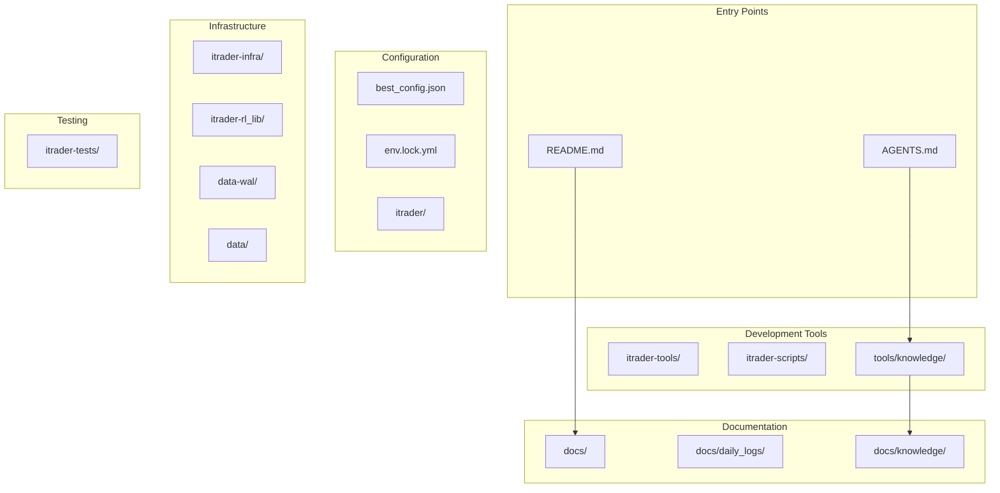

# Other

# Other — Supporting Infrastructure & Documentation

## Overview

The **Other** module aggregates supporting components that don't fit into the core source modules but are essential for project operation. These include documentation, configuration, infrastructure setup, development tools, and testing infrastructure.

## Module Organization

## Key Sub-modules

### Documentation & Guidance

| Module | Purpose |
|--------|---------|
| [README.md](Other-README.md) | Primary entry point and project index |
| [AGENTS.md](Other-AGENTS.md) | Operational guidance for AI agents working in the repository |
| [docs/](Other-docs.md) | Canonical planning, architecture, and operational documentation |
| [docs/daily_logs/](Other-docs-daily_logs.md) | Session continuity and change tracking system |
| [docs/knowledge/](Other-docs-knowledge.md) | Graph-native code intelligence layer |

### Configuration

| Module | Purpose |
|--------|---------|
| [best_config.json](Other-best_config.json) | Optimized RLlib PPO hyperparameters for training |
| [env.lock.yml](Other-env.lock.yml) | Pinned conda environment for reproducibility |
| [itrader/](Other-itrader.md) | Dependency baseline and environment configuration |

### Infrastructure

| Module | Purpose |
|--------|---------|
| [itrader-infra/](Other-itrader-infra.md) | Ray cluster configuration for local development |
| [itrader-rl_lib/](Other-itrader-rl_lib.md) | Prometheus scrape configuration for Ray metrics |
| [data-wal/](Other-data-wal.md) | Write-ahead log segments for crash recovery |
| [data/](Other-data.md) | Active query state markers |

### Development Tools

| Module | Purpose |
|--------|---------|
| [itrader-tools/](Other-itrader-tools.md) | Utility script for consistent Python execution |
| [itrader-scripts/](Other-itrader-scripts.md) | Configuration-driven A/B ablation experiment harness |
| [tools/knowledge/](Other-tools-knowledge.md) | GitNexus wrapper for repository indexing and MCP integration |

### Testing

| Module | Purpose |
|--------|---------|
| [itrader-tests/](Other-itrader-tests.md) | Comprehensive test coverage for environment, models, and training config |

## Cross-cutting Workflows

### Knowledge Layer Integration

The repository uses a two-layer knowledge system:
- [tools/knowledge/](Other-tools-knowledge.md) provides the GitNexus backend for indexing and MCP exposure
- [docs/knowledge/](Other-docs-knowledge.md) stores the synchronized wiki and module tree
- [AGENTS.md](Other-AGENTS.md) documents when to use knowledge queries vs. direct source inspection

### Environment Setup

1. Create environment from [env.lock.yml](Other-env.lock.yml)
2. Use [itrader-tools/](Other-itrader-tools.md) for consistent Python execution
3. Configure Ray cluster via [itrader-infra/](Other-itrader-infra.md)
4. Enable monitoring with [itrader-rl_lib/](Other-itrader-rl_lib.md) Prometheus config

### Training Pipeline

1. Reference [best_config.json](Other-best_config.json) for optimized hyperparameters
2. Follow [PBT_SETUP_GUIDE.md](Other-PBT_SETUP_GUIDE.md) for hyperparameter exploration
3. Run ablation studies via [itrader-scripts/](Other-itrader-scripts.md)
4. Validate with [itrader-tests/](Other-itrader-tests.md)

### Session Continuity

For multi-session development:
1. Log work in [docs/daily_logs/](Other-docs-daily_logs.md)
2. Update architecture docs in [docs/](Other-docs.md)
3. Sync knowledge layer via [tools/knowledge/](Other-tools-knowledge.md)
