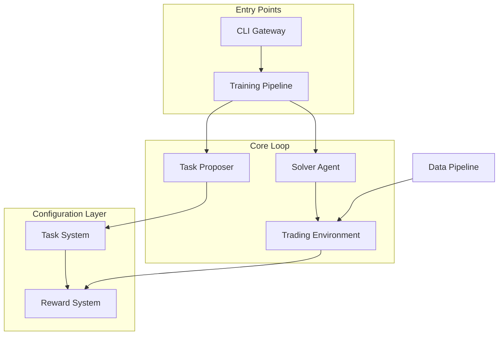

# itrader-azr — Wiki

# iTrader-AZR

Autonomous trading research platform implementing a proposer-solver architecture for Reinforcement Learning with Verifiable Rewards (RLVR). The system separates task generation from policy learning, enabling curriculum-based training with explicit, inspectable reward signals.

## Core Concept

iTrader decouples the trading problem into two distinct roles:

- **Solver** — Learns optimal trading behavior through PPO with a FiLM-conditioned neural network. The solver receives task specifications and learns to maximize shaped rewards.
- **Proposer** — Generates task curricula for the solver. Currently supports rule-based sampling with a path toward LLM-native task generation.

Training follows RLVR principles: rewards are decomposed into measurable components (PnL, drawdown, turnover), tasks are sampled from parameterized specifications, and behavior is optimized under explicit constraints.

## Architecture



## Key End-to-End Flows

### Phase A: Solver Training

The [Training Pipeline](training-pipeline.md) orchestrates PPO training using Ray RLlib. The [Trading Environment](trading-environment.md) provides a Gymnasium-compatible interface with discrete actions (long/flat/short) and rolling OHLCV observations. The [Solver Agent](agent-architecture.md) uses neural networks from the [Neural Network Models](neural-network-models.md) module—typically `SolverMLPFiLM` for task-conditioned learning.

### Phase B: AZR Bootstrap

The proposer generates task specifications that define training objectives. [Task Proposers](task-proposers.md) can use rule-based sampling, Ollama local inference, or OpenAI-compatible endpoints. The [LLM Integration](llm-integration.md) module provides both a lightweight llama.cpp engine and a full-featured Transformers-based proposer with 4-bit quantization.

### Reward Computation

The [Reward System](reward-system.md) uses a registry-based architecture where reward functions are decoupled from environment logic. The [Task System](task-system.md) validates and clamps task parameters before passing them to the reward engine, ensuring verifiable reward shaping.

## Development Phases

| Phase | Focus | Status |
|-------|-------|--------|
| A | Stable solver learning with verifiable reward shaping | Active |
| B | LLM-based proposer integration and AZR loop validation | Planned |

## Getting Started

The [Core Application](core-application.md) module provides a unified CLI entry point:

```bash
# Train a solver (Phase A)
python -m itrader train --config config.yaml

# Train with AZR bootstrap (Phase B)
python -m itrader train-azr --config config.yaml

# Validate environment setup
python -m itrader healthcheck
```

The [Data Pipeline](data-pipeline.md) handles market data collection via Polygon API, storage in DuckDB, and ETL processing for training. Use the [Diagnostic Tools](diagnostic-tools.md) to validate your environment and inspect training runs.

## Module Navigation

- **Training**: [Training Pipeline](training-pipeline.md) → [Trading Environment](trading-environment.md) → [Agent Architecture](agent-architecture.md)
- **Task Generation**: [Task Proposers](task-proposers.md) → [Task System](task-system.md) → [Reward System](reward-system.md)
- **Infrastructure**: [Data Pipeline](data-pipeline.md) → [LLM Integration](llm-integration.md) → [Experiment Scripts](experiment-scripts.md)
- **Utilities**: [Diagnostic Tools](diagnostic-tools.md) → [Knowledge Management](knowledge-management.md)