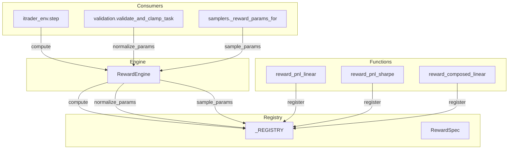
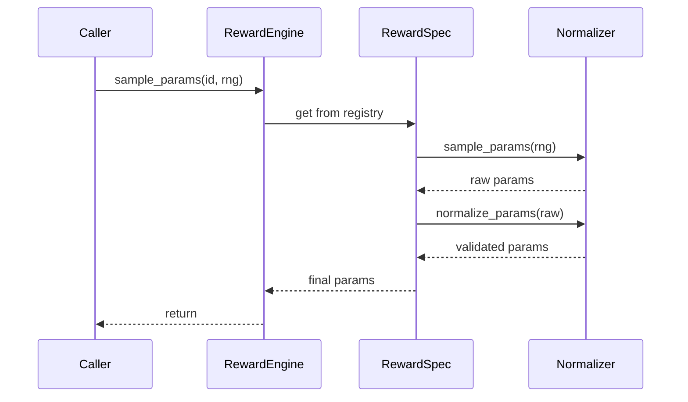

# Reward System

# Reward System

The `rewards.py` module provides a registry-based reward computation framework for reinforcement learning environments. It decouples reward function implementations from environment logic, enabling configurable, extensible reward shaping for trading agents.

## Architecture Overview



## Core Types

### Type Aliases

```python
RewardFn = Callable[[dict[str, Any], dict[str, Any]], tuple[float, dict[str, float]]]
RewardParamNormalizer = Callable[[dict[str, Any]], dict[str, Any]]
RewardParamSampler = Callable[[Any], dict[str, Any]]
```

- **`RewardFn`**: Computes reward from parameters and context. Returns `(total_reward, component_dict)`.
- **`RewardParamNormalizer`**: Validates and constrains parameters to valid ranges.
- **`RewardParamSampler`**: Generates random parameter configurations using an RNG.

### RewardSpec

```python
@dataclass(frozen=True)
class RewardSpec:
    fn: RewardFn
    normalize_params: Optional[RewardParamNormalizer] = None
    sample_params: Optional[RewardParamSampler] = None
```

Immutable specification bundling a reward function with optional normalization and sampling logic.

## RewardEngine

Static interface for reward computation and parameter management.

### Methods

| Method | Purpose |
|--------|---------|
| `compute(reward_id, params, ctx)` | Execute reward function, sanitize outputs |
| `normalize_params(reward_id, params)` | Apply parameter validation/constraints |
| `sample_params(reward_id, rng)` | Generate random valid parameters |
| `registered_ids()` | List available reward functions |

### Usage Example

```python
from rl_lib.tasks.rewards import RewardEngine

# Compute reward
reward, components = RewardEngine.compute(
    reward_id="pnl_linear",
    params={"pnl_w": 1.0, "dd_w": 0.04},
    ctx={"pnl_delta": 0.02, "turnover_t": 100, "dd_inc": 0.01}
)

# Sample random parameters
params = RewardEngine.sample_params("pnl_linear", rng=numpy_random)
```

### Output Sanitization

`RewardEngine.compute` guarantees finite outputs:
- Non-finite rewards return `0.0`
- Non-finite component values return `0.0`
- Unknown `reward_id` raises `KeyError`

## Registered Reward Functions

### pnl_linear

Linear combination of PnL delta, turnover cost, and drawdown penalty with configurable normalization.

**Parameters:**

| Parameter | Type | Default | Range | Description |
|-----------|------|---------|-------|-------------|
| `pnl_w` | float | 1.0 | [0.0, 10.0] | PnL weight |
| `turnover_w` | float | 0.0 | [0.0, 0.01] | Turnover cost weight |
| `dd_mode` | str | "delta" | {"none", "delta", "terminal"} | Drawdown calculation mode |
| `dd_w` | float | 0.04 | [0.0, 0.2] | Drawdown weight (delta mode) |
| `dd_T_weight` | float | 0.0 | [0.0, 1.0] | Terminal drawdown weight |
| `turnover_cap` | float | 0.02 | [0.0, 0.1] | Maximum turnover penalty |
| `dd_cap` | float | 0.05 | [0.0, 0.2] | Maximum drawdown penalty |
| `reward_scale` | float | 1.0 | [0.1, 10.0] | Final reward multiplier |
| `normalize` | bool | True | — | Enable unit normalization |
| `norm_mode` | str | "all" | {"all", "penalties", "off"} | What to normalize |
| `unit_clip` | float | 1e8 | [1.0, ∞) | Maximum unit value |

**Context Fields:**

| Field | Type | Description |
|-------|------|-------------|
| `pnl_delta` | float | Change in PnL |
| `turnover_t` | float | Turnover at step t |
| `dd_inc` | float | Drawdown increment (delta mode) |
| `max_dd` | float | Maximum drawdown (terminal mode) |
| `terminal` | bool | Episode termination flag |
| `ret_unit` | float | Normalization unit |

**Formula:**

```
r = pnl_w * pnl_delta * unit - turnover_w * turnover_t - dd_w * dd_inc * unit
r *= reward_scale
```

### pnl_sharpe

Simplified Sharpe-style reward with PnL, drawdown, and turnover components.

**Parameters:**

| Parameter | Type | Default | Range |
|-----------|------|---------|-------|
| `pnl_w` | float | 1.0 | [0.0, 10.0] |
| `dd_w` | float | 0.0 | [0.0, 0.2] |
| `turnover_w` | float | 0.0 | [0.0, 0.01] |

**Context Fields:**

| Field | Type | Description |
|-------|------|-------------|
| `pnl_t` | float | PnL at time t |
| `pnl_t1` | float | PnL at time t+1 |
| `dd_t1` | float | Drawdown at t+1 |
| `turnover_t` | float | Turnover at step t |

**Formula:**

```
pnl_delta = pnl_t1 - pnl_t
reward = pnl_w * pnl_delta - dd_w * dd_t1 - turnover_w * turnover_t
```

### composed_linear

Extensible weighted sum over arbitrary context components. Automatically discovers weights from parameter keys ending in `_w`.

**Usage:**

```python
params = {
    "pnl_w": 1.0,
    "dd_w": 0.04,
    "turnover_w": 0.001,
    "custom_w": 0.5  # arbitrary component
}
ctx = {"pnl_delta": 0.02, "dd_t1": 0.01, "turnover_t": 100, "custom": 0.5}
```

**Built-in Aliases:**

| Alias | Context Key |
|-------|-------------|
| `dd` | `dd_t1` |
| `turnover` | `turnover_t` |
| `pnl_delta` | `pnl_delta` |
| `ret` | `ret` |

## Registration

Register custom reward functions using the `@register` decorator:

```python
from rl_lib.tasks.rewards import register, RewardEngine

@register(
    "custom_reward",
    normalize_params=my_normalizer,
    sample_params=my_sampler,
)
def my_reward(params: dict, ctx: dict) -> tuple[float, dict]:
    reward = params.get("weight", 1.0) * ctx.get("value", 0.0)
    return reward, {"value": ctx.get("value", 0.0)}

# Immediately available
RewardEngine.compute("custom_reward", {"weight": 2.0}, {"value": 0.5})
```

## Helper Functions

### Value Sanitization

| Function | Purpose |
|----------|---------|
| `_finite_float(value)` | Convert to float, return 0.0 for non-finite |
| `_clamp_signed(value, cap)` | Clamp absolute value, preserve sign |
| `_bounded_float(value, default, lo, hi)` | Bound value within range |

### Type Coercion

| Function | Purpose |
|----------|---------|
| `_coerce_bool(value, default)` | Convert str/int/bool to bool |
| `_normalized_mode(value, default, allowed)` | Validate mode string |

### RNG Wrappers

| Function | Purpose |
|----------|---------|
| `_rng_choice(rng, choices)` | Call `rng.choice()` with fallback |
| `_rng_uniform(rng, lo, hi)` | Call `rng.uniform()` with fallback |

Both wrappers support NumPy arrays (calling `.item()` on results) and raise `TypeError` if the RNG lacks required methods.

## Integration Points

### Environment Integration

Called from `itrader/envs/itrader_env.py` during `step()`:

```python
reward, components = RewardEngine.compute(
    reward_id=self.reward_id,
    params=self.reward_params,
    ctx={
        "pnl_delta": pnl_delta,
        "turnover_t": turnover,
        "dd_inc": dd_increment,
        "terminal": done,
        ...
    }
)
```

### Task Validation

`rl_lib/tasks/validation.py` normalizes parameters before task validation:

```python
normalized = RewardEngine.normalize_params(reward_id, params)
```

### Parameter Sampling

`rl_lib/tasks/samplers.py` and `itrader/proposers/rule_based.py` sample random parameters:

```python
params = RewardEngine.sample_params(reward_id, rng)
# Internally: sample → normalize_params
```

## Parameter Normalization Flow



## Design Notes

1. **Registry Pattern**: Decouples reward definitions from consumers, enabling runtime discovery and extension.

2. **Parameter Sanitization**: All normalizers use `_bounded_float` and `_finite_float` to ensure valid parameter ranges, preventing NaN/Inf propagation.

3. **Component Transparency**: Reward functions return both total reward and individual components, enabling logging and analysis.

4. **Extensibility**: `composed_linear` allows adding new reward components without modifying environment code—just add a `*_w` parameter.

5. **RNG Abstraction**: Sampler functions accept any RNG with `choice()` and `uniform()` methods (NumPy, PyTorch, etc.).
