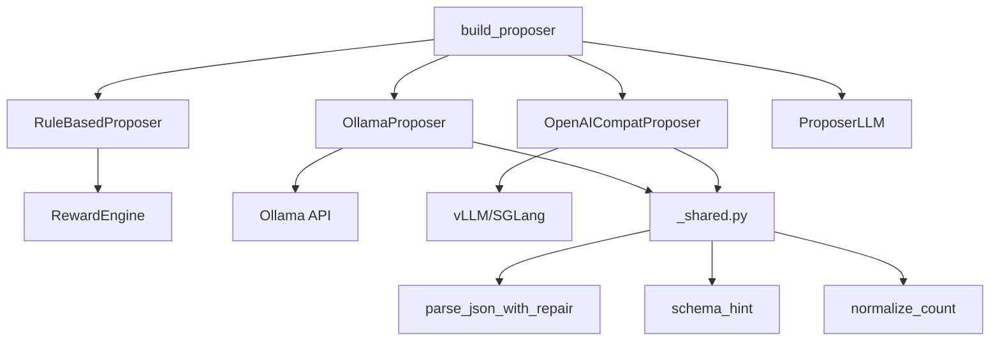

# Task Proposers

# Task Proposers Module

## Overview

The Task Proposers module generates task specifications for trading reinforcement learning experiments. It provides a backend-agnostic abstraction layer supporting multiple generation strategies: deterministic rule-based sampling, local LLM inference via Ollama, and OpenAI-compatible endpoints (vLLM, SGLang).

## Architecture



## Core Components

### BaseProposer

Abstract base class defining the proposer contract. All implementations must inherit from this class.

**Attributes:**
- `backend_name` — Class attribute identifying the backend type

**Abstract Method:**
- `propose_tasks(market_summary: str, n: int, **kwargs) -> List[Dict[str, Any]]` — Returns up to `n` task specification dictionaries

### Factory Function

```python
from itrader.proposers import build_proposer

# Create a rule-based proposer
proposer = build_proposer("rule_based", seed=42, horizons=[64, 128])

# Create an Ollama proposer
proposer = build_proposer("ollama", model="qwen2.5:7b-instruct")

# Create an OpenAI-compatible proposer
proposer = build_proposer("openai_compat", base_url="http://localhost:8000/v1")
```

**Supported Backend Aliases:**

| Backend | Aliases |
|---------|---------|
| RuleBasedProposer | `rule`, `rule_based`, `random` |
| OllamaProposer | `ollama`, `ollama_local` |
| OpenAICompatProposer | `openai`, `openai_compat`, `openai_compatible`, `vllm`, `sglang` |
| ProposerLLM (lazy) | `llm`, `transformers` |

The factory normalizes backend names by stripping whitespace, lowercasing, and replacing hyphens with underscores.

## Proposer Implementations

### RuleBasedProposer

Deterministic, dependency-light proposer for local development and testing. Does not use LLM inference.

**Initialization Parameters:**

| Parameter | Type | Default | Description |
|-----------|------|---------|-------------|
| `seed` | int | 42 | Random seed for reproducibility |
| `window_size` | int | 30 | Observation window size |
| `n_features` | int | 5 | Number of features per bar |
| `t_embed_dim` | int | 32 | Time embedding dimension |
| `action_dim` | int | 3 | Action space dimension |
| `price_ids` | Sequence[str] | ["SIM"] | Available price data identifiers |
| `horizons` | Sequence[int] | [64, 96, 128, 160, 200, 256] | Episode horizon options |
| `reward_id` | str | "pnl_linear" | Reward function identifier |
| `reward_params` | Dict[str, Any] | None | Base reward parameters |
| `bar_resolution` | str | DEFAULT_BAR_RESOLUTION | Data bar resolution |

**Computed Property:**
- `obs_dim` — Calculated as `window_size * n_features + t_embed_dim`

**Task Generation Flow:**
1. Samples `price_id` from configured options
2. Samples `horizon` from configured options
3. Generates reward parameters via `RewardEngine.sample_params()` and `normalize_params()`
4. Assigns random seed for task reproducibility

### OllamaProposer

LLM-backed proposer using Ollama's local inference API.

**Initialization Parameters:**

| Parameter | Type | Default | Description |
|-----------|------|---------|-------------|
| `model` | str | "qwen2.5:7b-instruct" | Ollama model identifier |
| `base_url` | str | "http://localhost:11434" | Ollama server URL |
| `timeout_s` | float | 60.0 | Request timeout in seconds |
| `temperature` | float | 0.2 | Sampling temperature |
| `num_predict` | int | 768 | Maximum tokens to generate |

**API Endpoint:** `{base_url}/api/generate`

**Error Handling:**
- HTTP errors include status code and first 400 characters of response
- Connection errors wrap the underlying URLError with context

### OpenAICompatProposer

LLM-backed proposer for OpenAI-compatible chat completion endpoints (vLLM, SGLang, etc.).

**Initialization Parameters:**

| Parameter | Type | Default | Description |
|-----------|------|---------|-------------|
| `model` | str | "Qwen/Qwen3.5-9B" | Model identifier |
| `base_url` | str | "http://localhost:8000/v1" | API base URL |
| `api_key` | str | None | Optional API key for authentication |
| `timeout_s` | float | 60.0 | Request timeout in seconds |
| `temperature` | float | 0.2 | Sampling temperature |
| `max_tokens` | int | 768 | Maximum tokens in response |

**API Endpoint:** `{base_url}/chat/completions`

**Message Structure:**
- System message: Instructs the model as a trading task generator
- User message: Contains market summary, task count, and schema hint

## Shared Utilities

The `_shared.py` module provides common functionality for LLM-backed proposers.

### JSON Parsing with Repair

```python
from itrader.proposers._shared import parse_json_with_repair

tasks = parse_json_with_repair(raw_llm_output, expected_n=10)
```

**Repair Strategy:**
1. Attempt direct `json.loads()` parsing
2. Fall back to regex extraction using patterns `r"\[[\s\S]*\]"` and `r"\{[\s\S]*\}"`
3. Return up to `expected_n` valid task dictionaries

### Schema Hint

```python
from itrader.proposers._shared import schema_hint

hint = schema_hint()  # Returns task schema guidance for LLM prompts
```

The schema hint instructs LLMs to output valid JSON arrays with canonical task fields.

### Count Normalization

```python
from itrader.proposers._shared import normalize_count

count = normalize_count(n)  # Ensures non-negative integer
```

## Task Specification Schema

Generated tasks follow this canonical structure:

| Field | Type | Description |
|-------|------|-------------|
| `family_id` | str | Task family identifier |
| `price_id` | str | Price data source identifier |
| `horizon` | int | Episode length in bars |
| `reward_id` | str | Reward function identifier |
| `reward_params` | dict | Reward function parameters |
| `seed` | int | Random seed for task |
| `obs_dim` | int | Observation space dimension |
| `action_dim` | int | Action space dimension |
| `start_idx` | int | None | Starting bar index |
| `bar_resolution` | str | Data bar resolution |

**Optional Forward-Compatible Fields:**
- `regime_tags` — Market regime labels
- `difficulty_target` — Target difficulty level
- `metadata` — Additional task metadata

## Integration Points

### Inbound Calls

The factory function is called from:
- `rl_lib/train/train_AZR.py` — Training script builds proposer from CLI arguments
- `itrader/scripts/gen_task_pool.py` — Task pool generation script

### Outbound Dependencies

- `itrader.rl_lib.tasks.rewards.RewardEngine` — RuleBasedProposer samples and normalizes reward parameters
- `itrader.llm.proposer_llm.ProposerLLM` — Lazy-loaded via factory for "llm"/"transformers" backends

## Usage Examples

### Basic Usage

```python
from itrader.proposers import build_proposer

# Create and use a rule-based proposer
proposer = build_proposer("rule_based", seed=42)
tasks = proposer.propose_tasks(market_summary="BTC/USD volatile", n=5)
```

### LLM-Backed Proposer

```python
# Ollama local inference
proposer = build_proposer(
    "ollama",
    model="qwen2.5:7b-instruct",
    base_url="http://localhost:11434",
    temperature=0.3
)
tasks = proposer.propose_tasks(
    market_summary="High volatility regime detected",
    n=10
)

# vLLM endpoint
proposer = build_proposer(
    "vllm",
    base_url="http://gpu-server:8000/v1",
    model="Qwen/Qwen3.5-9B"
)
tasks = proposer.propose_tasks(market_summary="...", n=5)
```

### Custom Configuration

```python
# Rule-based with custom horizons and price sources
proposer = build_proposer(
    "rule_based",
    seed=123,
    horizons=[32, 64, 128],
    price_ids=["BTC", "ETH", "SOL"],
    reward_id="sharpe_ratio"
)
```