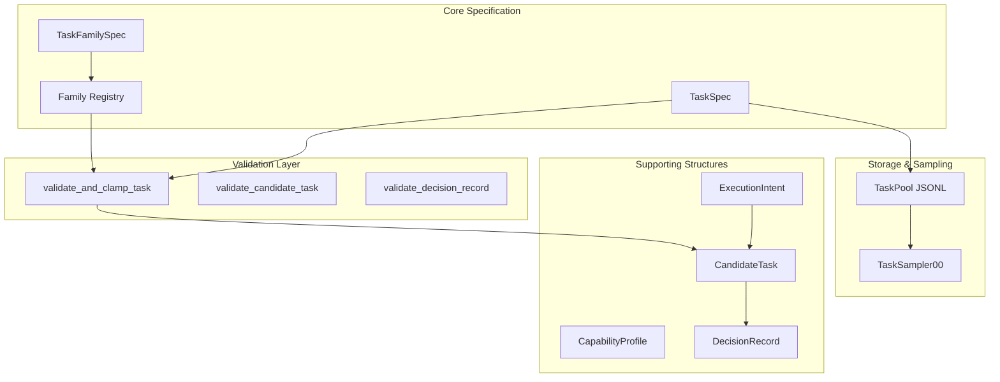

# Task System

# Task System

The Task System provides a unified configuration layer for reinforcement learning training tasks. It handles task specification, validation, storage, sampling, and embedding generation for the training pipeline.

## Architecture Overview



## Core Components

### TaskSpec

The `TaskSpec` dataclass is the single source of truth for training task configuration. It captures all parameters needed to define a reproducible training episode.

```python
from rl_lib.tasks.spec import TaskSpec

# Create directly
spec = TaskSpec(
    family_id="00",
    price_id="AAPL",
    horizon=128,
    reward_id="pnl_linear",
    reward_params={"pnl_w": 1.0, "dd_w": 0.1},
    seed=42,
    obs_dim=182,  # window_size * n_features + t_embed_dim
    action_dim=3,
)

# Or from dict with alias normalization
spec = TaskSpec.from_dict({
    "task_family": "00",        # alias for family_id
    "horizon_bars": 128,        # alias for horizon
    "reward_config": {          # nested reward config
        "name": "pnl_linear",
        "params": {"pnl_w": 1.0}
    }
})
```

**Key Fields:**

| Field | Type | Description |
|-------|------|-------------|
| `family_id` | `str` | Logical task family identifier (e.g., "00" for directional predictor) |
| `price_id` | `str` | Price stream or generator identifier |
| `horizon` | `int` | Episode length in timesteps |
| `reward_id` | `str` | Key into RewardEngine registry |
| `reward_params` | `Dict[str, Any]` | Parameters passed to reward function |
| `t_embed` | `Optional[List[float]]` | Precomputed task embedding (or None for encoder derivation) |
| `seed` | `int` | RNG seed for reproducibility |
| `obs_dim` | `int` | Total observation space dimension |
| `action_dim` | `int` | Action space dimension |
| `start_idx` | `Optional[int]` | Starting index in dataframe (None = random sampling) |
| `regime_tags` | `List[str]` | Market regime labels |
| `difficulty_target` | `Dict[str, Any]` | Difficulty targeting parameters |

**Alias Support:** The `from_dict` method normalizes legacy field names:
- `task_family` → `family_id`
- `horizon_bars` → `horizon`
- `start_index` → `start_idx`
- `reward_config` (nested) → `reward_id` + `reward_params`

### Task Families

Task families define groups of related tasks with shared defaults.

```python
from rl_lib.tasks.families import get_family_spec, known_family_ids, family_registry

# List available families
ids = known_family_ids()  # ("00", "01", "02")

# Get family defaults
family = get_family_spec("00")
print(family.name)           # "directional_predictor"
print(family.action_dim)     # 3
print(family.horizon_range)  # (64, 512)
```

**Registered Families:**

| ID | Name | Description |
|----|------|-------------|
| `00` | directional_predictor | Proven short-horizon directional task family |
| `01` | breakout_expansion | Directional breakout/expansion framing |
| `02` | mean_reversion | Directional mean-reversion framing |

Each `TaskFamilySpec` provides:
- `default_reward_id`: Default reward function ("pnl_linear")
- `default_bar_resolution`: Default bar timeframe ("1m")
- `horizon_range`: Valid horizon bounds `(min, max)`
- `action_dim`: Action space dimension (default 3)

## Validation Layer

The validation layer normalizes raw task dictionaries into safe, validated payloads. All validation functions return new dictionaries rather than mutating inputs.

### Task Validation

```python
from rl_lib.tasks.validation import validate_and_clamp_task

validated = validate_and_clamp_task(
    {"family_id": "00", "horizon": 1000},  # horizon exceeds max
    env_config={"min_horizon": 64, "max_horizon": 512},
    fallback_seed=42,
)
# horizon clamped to 512
```

`validate_and_clamp_task` performs:
1. **Alias normalization** via `normalize_task_spec_payload`
2. **Family lookup** for defaults
3. **Horizon clamping** to `[min_horizon, max_horizon]`
4. **Reward param normalization** via `RewardEngine.normalize_params`
5. **Type coercion** for all fields
6. **Default population** for missing fields

### Candidate Task Validation

```python
from rl_lib.tasks.validation import validate_candidate_task

candidate = validate_candidate_task({
    "task_spec": {"family_id": "00"},
    "execution_intent": {"ttl_bars": 100},
    "expected_difficulty": 0.5,
    "abstain_option": False,
})
```

### Execution Intent Validation

```python
from rl_lib.tasks.validation import validate_and_clamp_execution_intent

intent = validate_and_clamp_execution_intent({
    "entry_logic": {"type": "market", "params": {}},
    "exit_logic": {"type": "ttl", "params": {}},
    "ttl_bars": 100,
    "confidence_band": {"min": 0.3, "target": 0.7},
    "risk_envelope": {"max_position_pct": 0.05},
})
```

Clamps:
- `ttl_bars` to `[1, 1024]`
- `confidence_band` values to `[0.0, 1.0]`
- `risk_envelope.max_position_pct` to `[0.0, 1.0]`

### Decision Record Validation

```python
from rl_lib.tasks.validation import validate_decision_record

record = validate_decision_record({
    "market_summary_ref": "2024-01-15T10:30:00Z",
    "candidate_tasks": [...],
    "selected_candidate_id": "abc123",
    "wait_selected": False,
})
```

## Task Pool

`TaskPool` provides persistent task storage with JSONL backend and in-memory indexing for fast sampling.

```python
from rl_lib.tasks.task_pool import TaskPool, task_uid

# Create or load pool
pool = TaskPool("tasks.jsonl", read_only=False)

# Add task (returns stable UID)
uid = pool.add(task_spec.to_dict(), meta={"source": "proposer"})

# Sample tasks
tasks = pool.sample(batch_size=32, strategy="weighted")

# Update performance stats
pool.update_stats(uid, episode_return=1.5, success=True)

# Prune to keep top performers
pool.prune(max_size=1000, keep_elite_k=100)
```

**Sampling Strategies:**

| Strategy | Behavior |
|-----------|----------|
| `weighted` | 40% elite + 30% recent + 30% random (default) |
| `uniform` | Random uniform sampling |
| `elite` | Top performers by mean return |
| `recent` | Most recently added tasks |

**Task UID:** Each task gets a stable 16-character UID derived from SHA-256 hash of its canonical JSON representation. This ensures identical tasks have identical UIDs across processes.

## Task Sampling

`TaskSampler00` generates tasks for the "00" family, with optional TaskPool integration.

```python
from rl_lib.tasks.samplers import TaskSampler00

sampler = TaskSampler00({
    "price_ids": ["AAPL", "BTCUSDT"],
    "horizons": [64, 128, 256],
    "reward_ids": ["pnl_linear", "pnl_sharpe"],
    "reward_params": {"pnl_w": 1.0, "dd_w": 0.1},
    "window_size": 30,
    "n_features": 5,
    "t_embed_dim": 32,
    "action_dim": 3,
    "seed": 1234,
    "task_pool_path": "tasks.jsonl",
    "p_pool": 0.7,  # 70% from pool, 30% random
})

task = sampler.sample()
```

**Sampling Flow:**

1. If TaskPool enabled and `rng.random() < p_pool`, sample from pool
2. Otherwise, generate random task:
   - Random `price_id` from `price_ids`
   - Random `horizon` from `horizons`
   - Random `reward_id` from `reward_ids`
   - Merge global and per-reward params

**Reward Parameter Merging:**

```python
# Global params
"reward_params": {"pnl_w": 1.0, "dd_w": 0.1}

# Per-reward overrides
"reward_params_by_id": {
    "pnl_sharpe": {"sharpe_window": 50}
}
```

## Task Encoding

`TaskEncoder` produces fixed-length embeddings for task specifications.

```python
from rl_lib.tasks.encoder import TaskEncoder

# Use precomputed embedding
spec.t_embed = [0.1, 0.2, ...]  # 32 floats
embedding = TaskEncoder.embed(spec, dim=32)

# Or derive from spec fields
spec.t_embed = None
embedding = TaskEncoder.embed(spec, dim=32)  # derived from family_id, price_id, etc.
```

**Derivation Strategy:**

1. Hash categorical fields (`family_id`, `price_id`, `reward_id`) to vectors
2. Scale numeric fields (`horizon`, `obs_dim`, `action_dim`, `seed`) to `[-1, 1]`
3. Mix categorical and numeric vectors
4. Normalize to zero mean, unit variance

## Supporting Data Structures

### CandidateTask

Wraps a TaskSpec with execution metadata.

```python
from rl_lib.tasks.candidate_task import CandidateTask

candidate = CandidateTask(
    task_spec=spec,
    execution_intent=intent,
    expected_difficulty=0.5,
    expected_utility=1.2,
    rationale="High momentum regime",
    abstain_option=False,
)
```

### ExecutionIntent

Specifies how a task should be executed.

```python
from rl_lib.tasks.execution_intent import ExecutionIntent

intent = ExecutionIntent(
    entry_logic={"type": "market", "params": {}},
    exit_logic={"type": "ttl", "params": {}},
    ttl_bars=100,
    confidence_band={"min": 0.3, "target": 0.7},
    risk_envelope={"max_position_pct": 0.05, "max_spread_bps": 10.0},
    abstain_allowed=True,
)
```

### CapabilityProfile

Tracks agent capability metrics per task family.

```python
from rl_lib.tasks.capability_profile import CapabilityProfile

profile = CapabilityProfile(
    task_family="00",
    bar_resolution="1m",
    regime_tags=["trending", "high_vol"],
    horizon_bars=128,
    estimated_p_solve=0.65,
    expected_net_utility=0.8,
    calibration_error=0.05,
    sample_count=1000,
    last_updated="2024-01-15T10:30:00Z",
)
```

### DecisionRecord

Records a complete decision cycle with candidates and outcomes.

```python
from rl_lib.tasks.decision_record import DecisionRecord

record = DecisionRecord(
    market_summary_ref="2024-01-15T10:30:00Z",
    candidate_tasks=[candidate1, candidate2],
    selected_candidate_id="abc123",
    wait_selected=False,
    solver_scores={"solver_a": 0.8, "solver_b": 0.6},
    risk_decisions={"approved": True},
    executor_action={"action": "long", "size": 0.05},
    realized_outcome={"pnl": 1.5, "success": True},
)
```

## Integration Points

### Environment Reset Flow

During environment reset, the sampler provides a task:

```
env.reset() → sampler.sample() → TaskSpec
```

If TaskPool is configured, sampling prioritizes stored tasks with performance history.

### Validation Flow

All external task dictionaries flow through validation:

```
raw_task_dict → validate_and_clamp_task() → TaskSpec.from_dict()
```

This ensures:
1. All required fields populated
2. Values clamped to valid ranges
3. Types coerced correctly
4. Family defaults applied

### Serialization Flow

All dataclasses support bidirectional serialization:

```python
# To dict
payload = spec.to_dict()  # removes None/empty optional fields

# From dict
spec = TaskSpec.from_dict(payload)
```

## Best Practices

1. **Always validate external input** - Use validation functions for any task dictionaries from external sources (APIs, files, LLMs)

2. **Use TaskPool for curriculum learning** - Store successful tasks and sample weighted toward high performers

3. **Precompute embeddings** - Set `t_embed` on TaskSpec when possible to avoid recomputation

4. **Leverage family defaults** - Let family specs fill in defaults rather than specifying everything

5. **Handle aliases** - Use `from_dict` which normalizes legacy field names
