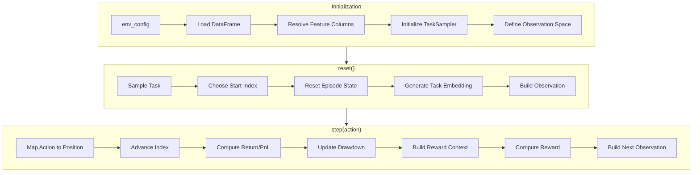

# Trading Environment

# Trading Environment Module

A Gymnasium-compatible trading environment for reinforcement learning, supporting long/flat/short positions with rolling OHLCV observations and multi-task learning capabilities.

## Overview

`ITraderEnv` implements a discrete-action trading environment where an agent learns to take one of three positions at each timestep:

| Action | Position |
|--------|----------|
| 0 | Short (-1) |
| 1 | Flat (0) |
| 2 | Long (+1) |

The environment returns a flattened rolling window of OHLCV features concatenated with an optional task embedding, enabling both single-task and multi-task reinforcement learning workflows.

## Architecture



## Configuration

### Core Parameters

| Parameter | Type | Default | Description |
|-----------|------|---------|-------------|
| `df_path` | `str \| Path` | `itrader/data/ohlcv.parquet` | Path to parquet file containing OHLCV data |
| `window_size` | `int` | `30` | Number of timesteps in each observation window |
| `feature_cols` | `list[str]` | OHLCV columns | Feature columns to use from dataframe |
| `t_embed_dim` | `int` | `DEFAULT_T_EMBED_DIM` | Dimension of task embedding vector |
| `t_embed_mode` | `str` | `"concat"` | Task embedding mode: `"off"`, `"scale"`, or `"concat"` |
| `t_scale` | `float` | `1.0` | Scaling factor when `t_embed_mode="scale"` |

### Episode Start Modes

| `start_idx_mode` | Behavior |
|------------------|----------|
| `"random_episode"` | Random starting index per episode using task seed |
| `"stream_worker"` | Sequential streaming with optional jumps; worker-aware |
| `"task_spec"` | Use `start_idx` from TaskSpec if provided |

### Streaming Configuration

For `start_idx_mode="stream_worker"`:

| Parameter | Default | Description |
|-----------|---------|-------------|
| `stream_stride` | `horizon` | Steps to advance between episodes (0 = use horizon) |
| `stream_jump_every_episodes` | `0` | Jump to random position after N episodes (0 = disabled) |
| `stream_jump_on_wrap` | `True` | Jump to random position when stream wraps |

### Return Normalization

| Parameter | Default | Description |
|-----------|---------|-------------|
| `ret_norm_alpha` | `0.01` | EMA smoothing factor for return normalization |
| `ret_norm_reset` | `"episode"` | When to reset EMA: `"episode"` or `"stream"` |

### Debug Options

| Parameter | Default | Description |
|-----------|---------|-------------|
| `debug_resets` | `False` | Enable reset logging |
| `debug_reset_every` | `100` | Log every N resets |

## Spaces

```python
# Observation: flattened window + task embedding
observation_space = Box(low=-inf, high=inf, shape=(window_size * n_features + t_embed_dim,), dtype=float32)

# Action: discrete position choice
action_space = Discrete(3)  # 0=short, 1=flat, 2=long
```

## Episode Lifecycle

### Initialization

```python
env = ITraderEnv({
    "df_path": "data/ohlcv.parquet",
    "window_size": 30,
    "task_sampler": {"seed": 42}
})
```

During `__init__`:
1. Loads and validates the OHLCV dataframe
2. Extracts feature columns and CLOSE column
3. Initializes `TaskSampler00` with worker-aware seeding
4. Creates observation/action spaces
5. Calls `_reset_state()` to initialize episode buffers

### Reset

```python
obs, info = env.reset(seed=42)
```

The `reset()` method:
1. Samples a task from `TaskSampler00`
2. Chooses starting index based on `start_idx_mode`
3. Resets episode state (position, PnL, drawdown tracking)
4. Generates task embedding via `TaskEncoder.embed()`
5. Returns initial observation and task info

### Step

```python
obs, reward, done, truncated, info = env.step(action)
```

Each step:
1. Maps action to position target (-1, 0, +1)
2. Advances dataframe index by one timestep
3. Computes scale-invariant return: `(price_next - price_t) / price_t`
4. Updates mark-to-market PnL: `pnl += position * return`
5. Tracks drawdown from peak equity
6. Updates return normalization EMA
7. Builds reward context and computes reward via `RewardEngine`
8. Returns next observation, reward, and episode info

## Reward Computation

The environment delegates reward computation to `RewardEngine.compute()`:

```python
r, comps = RewardEngine.compute(
    task.reward_id,
    task.reward_params,
    reward_context
)
```

### Reward Context

The `_reward_context()` method builds a dictionary containing:

| Field | Description |
|-------|-------------|
| `pnl_t`, `pnl_t1` | PnL before and after step |
| `pnl_delta` | Change in PnL |
| `dd_t`, `dd_t1` | Drawdown before and after step |
| `dd_inc` | Drawdown increase (max 0) |
| `max_dd` | Maximum drawdown this episode |
| `turnover_t` | Position change magnitude (0, 1, or 2) |
| `ret` | Price return this step |
| `ret_unit` | Normalization factor (1/ret_ema) |
| `position_t` | Current position |
| `action_t` | Action taken |
| `terminal` | Whether episode ended |

## Episode Statistics

The environment tracks episode-level statistics:

```python
# In info dict when done=True:
{
    "ep_sums": {
        "steps": int,
        "horizon": int,
        "act_counts": np.ndarray,  # action counts
        "rc_sums": dict[str, float]  # summed reward components
    }
}
```

## Task Integration

### Task Sampling

Tasks are sampled via `TaskSampler00`:

```python
self.current_task = self.task_sampler.sample()
```

Each task provides:
- `horizon`: Episode length
- `reward_id`: Reward function identifier
- `reward_params`: Reward function parameters
- `seed`: For reproducible start index sampling

### Task Embedding

Task embeddings are generated via `TaskEncoder.embed()`:

```python
self._t_embed = TaskEncoder.embed(self.current_task, dim=self.t_embed_dim)
```

Three embedding modes:
- `"off"`: Zero vector (no task info)
- `"scale"`: Scaled embedding (`t_embed * t_scale`)
- `"concat"`: Concatenated to observation (default)

## Data Requirements

The input dataframe must:
1. Be in parquet format
2. Contain columns matching `_FEATURE_COLUMN_NAMES`: `OPEN`, `HIGH`, `LOW`, `CLOSE`, `VOLUME` (case-insensitive)
3. Have a `CLOSE` column for price calculations

## Numerical Stability

The `_sanitize()` function guards against NaN/Inf values:

```python
def _sanitize(x: np.ndarray) -> np.ndarray:
    return np.nan_to_num(x, nan=0.0, posinf=1e6, neginf=-1e6)
```

This is applied to:
- Feature rows via `_row()`
- Observations via `_get_obs()` and `_build_obs()`

## Worker-Aware Initialization

For distributed training, the environment supports worker-aware seeding:

```python
# Seeds are derived from worker_index and vector_index
ts_cfg["seed"] = base_seed + 1_000_003 * worker_index + 97 * vector_index
stream_seed = base_seed + 7 * worker_index + 13 * vector_index + 99
```

This ensures different workers sample different tasks and starting positions.

## Example Usage

```python
from itrader.envs import ITraderEnv

# Basic usage
env = ITraderEnv({
    "df_path": "data/ohlcv.parquet",
    "window_size": 30,
})

obs, info = env.reset()
done = False
while not done:
    action = env.action_space.sample()
    obs, reward, done, truncated, info = env.step(action)

# Multi-task with streaming
env = ITraderEnv({
    "df_path": "data/ohlcv.parquet",
    "start_idx_mode": "stream_worker",
    "stream_stride": 1000,
    "stream_jump_every_episodes": 10,
    "task_sampler": {
        "seed": 42,
        "horizon_range": [100, 500],
    },
})
```