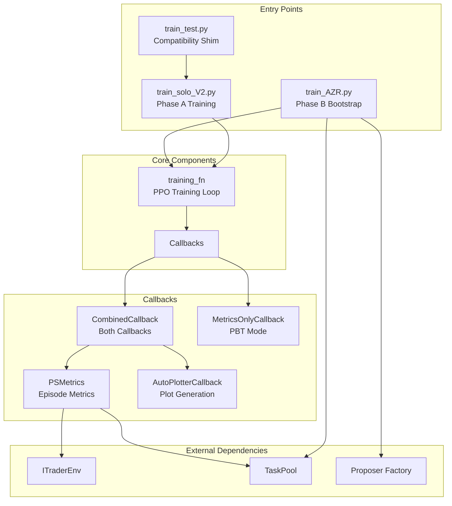

# Training Pipeline

# Training Pipeline

The training pipeline provides the core infrastructure for training reinforcement learning agents using Ray RLlib and Ray Tune. It supports both direct PPO training (Phase A) and task-curriculum bootstrapping (Phase B) with Population-Based Training (PBT) support.

## Architecture Overview



## Entry Points

### train_solo_V2.py — Phase A Training

The primary training entry point for PPO-based policy optimization with Ray Tune.

**Usage:**
```bash
python -m itrader.rl_lib.train.train_solo_V2 \
    --data_path ~/data/ohlcv.parquet \
    --iters 200 \
    --workers 6 \
    --experiment_name Phase_A
```

**Key Arguments:**

| Argument | Default | Description |
|----------|---------|-------------|
| `--iters` | 200 | Number of training iterations |
| `--workers` | 6 | Number of parallel workers |
| `--window` | 30 | Observation window size |
| `--lr` | 5e-5 | Learning rate |
| `--gamma` | 0.99 | Discount factor |
| `--lambda` | 0.95 | GAE lambda |
| `--train_batch_size` | 4800 | Samples per training batch |
| `--pbt` | False | Enable Population-Based Training |
| `--cpu_pbt` | False | Run PBT on CPU (many trials) |
| `--pop` | 10 | Population size for PBT |
| `--timeout_hours` | 5 | Global timeout |
| `--restore_ckpt` | "" | Path to checkpoint to restore from |
| `--task_pool_path` | "" | JSONL task pool for curriculum |
| `--p_pool` | 0.7 | Probability of sampling from task pool |
| `--start_idx_mode` | random_episode | Episode start index policy |
| `--seed` | 1234 | Global random seed |

### train_AZR.py — Phase B Bootstrap

Generates task curricula via proposers and hands off to the solver training.

**Usage:**
```bash
python -m itrader.rl_lib.train.train_AZR \
    --backend rule_based \
    --n_tasks 200 \
    --task_pool_path ~/data/task_pool_azr.jsonl

# Or with LLM proposer:
python -m itrader.rl_lib.train.train_AZR \
    --backend llm \
    --model_id Qwen/Qwen2.5-7B-Instruct \
    --n_tasks 200
```

**Key Arguments:**

| Argument | Default | Description |
|----------|---------|-------------|
| `--backend` | rule_based | Proposer backend (rule_based or llm) |
| `--model_id` | Qwen/Qwen2.5-7B-Instruct | LLM model for llm backend |
| `--n_tasks` | 200 | Number of tasks to generate |
| `--gen_batch_size` | 8 | Tasks per proposer call |
| `--max_empty_batches` | 10 | Max consecutive empty batches before abort |
| `--no_train` | False | Generate task pool only, skip training |

### train_test.py — Compatibility Shim

Deprecated entry point that delegates to `train_solo_V2`. Maintained for backward compatibility.

## Core Training Function

### training_fn(config)

The trainable function executed by Ray Tune. Handles the complete training lifecycle:

1. **Initialization**: Creates PPO algorithm with custom logger pointing to Tune trial directory
2. **Checkpoint Restoration**: Supports PBT weight inheritance and explicit `--restore_ckpt`
3. **Training Loop**: Iterates `stop_iters` times, calling `algo.train()` and reporting metrics
4. **Metric Persistence**: Writes to three locations:
   - `trial_dir/rllib/metrics_full.jsonl` — Full flattened metrics
   - `~/ray_results/_stable_metrics/<trial>/metrics_full.jsonl` — Stable path for plotting
   - `~/ray_results/_stable_metrics/<trial>/report_rows.csv` — CSV for analysis
5. **Checkpointing**: Saves checkpoints at configurable intervals for PBT exploitation
6. **Final Plotting**: Generates plots on completion if `auto_plot_on_end` is enabled

**Key Helper Functions:**

- `_extract_report(result, default_iteration)` — Extracts scalar metrics for Tune reporting
- `_flatten_scalar_metrics(result)` — Recursively flattens nested result dicts
- `_append_json_line(path, payload)` — Appends JSON lines atomically
- `_append_report_row(path, row)` — Handles CSV with dynamic column expansion

## Callbacks

### PSMetrics — Episode Metrics Callback

Logs custom metrics at episode end for monitoring training progress.

**Metrics Logged:**

| Metric | Description |
|--------|-------------|
| `episode_return_mean` | Primary scalar — total episode reward |
| `act_{i}_frac` | Action fraction for action index i |
| `act_short_frac` | Legacy: action 0 fraction |
| `act_flat_frac` | Legacy: action 1 fraction |
| `act_long_frac` | Legacy: action 2 fraction |
| `rc_<component>` | Per-step average of reward components |
| `success_mean` | Episode success flag average |
| `task_horizon_mean` | Task horizon average |
| `task_pool_return_mean` | Aggregate return across task pool |
| `task_pool_success_rate_mean` | Aggregate success rate |

**Environment Resolution:**

The callback resolves the underlying environment through multiple access paths:
1. `base_env.get_sub_environments()` — Vector env (RLlib standard)
2. `base_env.vector_env.envs` — Older vector env access
3. `base_env.envs` — Fallback env list

### AutoPlotterCallback — Automatic Plot Generation

Generates training plots at configurable intervals without interrupting training.

**Initialization:**
```python
callback = AutoPlotterCallback(
    plot_interval=50,           # Plot every N iterations
    plot_script_path=None,      # Auto-detect tools/plot_ray_results.py
    auto_plot=True,             # Enable/disable plotting
    plot_at_end_of_loop=False,  # Plot at end vs. during training
)
```

**Trial Directory Resolution:**

The callback resolves the Ray Tune trial directory through a priority chain:
1. `ray.air.session.get_trial_dir()` — Most reliable (AIR session)
2. `result["logdir"]` — From training result
3. `algorithm.logdir` — From algorithm object
4. Fallback: Scan `~/ray_results` for most recent trial

**Plot Generation Flow:**
1. Check `_should_plot(current_iter)` based on interval and mode
2. Resolve trial directory via `_trial_dir()`
3. Compute stable output path: `~/ray_results/_stable_metrics/<trial_name>/`
4. Execute `tools/plot_ray_results.py` as subprocess
5. Handle errors gracefully (never interrupts training)

### CombinedCallback and MetricsOnlyCallback

**CombinedCallback**: Combines `PSMetrics` and `AutoPlotterCallback` for single-trial runs.

**MetricsOnlyCallback**: Uses only `PSMetrics` for PBT mode to avoid file collisions across many parallel trials.

## Configuration

### Base Config Construction

`build_base_config(args, data_path, use_pbt_mode)` assembles the complete PPO configuration:

```python
config = {
    "env": "ITraderEnv",
    "env_config": {
        "df_path": str(data_path),
        "window_size": args.window,
        "task_sampler": {...},
    },
    "model": {
        "custom_model": "solver_mlp_film",
        "custom_model_config": {...},
    },
    "num_gpus": 1,
    "num_workers": args.workers,
    "framework": "torch",
    "callbacks": CombinedCallback,  # or MetricsOnlyCallback for PBT
    # ... PPO hyperparameters
}
```

### Task Sampler Config

Configured via `_task_sampler_config(args)`:

```python
{
    "window_size": args.window,
    "n_features": 5,
    "t_embed_dim": 32,
    "action_dim": 3,
    "horizons": [96, 128, 160, 200],
    "turnover_w_choices": [0.0, 0.0005, 0.001, 0.002],
    "dd_w_range": (0.0, 0.04),
    "task_pool_path": "...",  # Optional
    "p_pool": 0.7,            # Probability of pool sampling
}
```

### Model Config

Configured via `_model_config(args)`:

```python
{
    "custom_model": "solver_mlp_film",
    "custom_model_config": {
        "window_size": 30,
        "t_embed_dim": 32,
        "fcnet_hiddens": [256, 256],
        "conditioning": "film",
        "t_keep_p": 0.7,
        "t_proj": 64,
    },
}
```

## Population-Based Training

When `--pbt` is enabled, the training uses Ray Tune's `PopulationBasedTraining` scheduler:

```python
pbt = PopulationBasedTraining(
    time_attr="training_iteration",
    perturbation_interval=3,
    quantile_fraction=0.25,
    resample_probability=0.25,
    hyperparam_mutations={
        "lr": tune.loguniform(1e-5, 5e-3),
        "clip_param": tune.choice([0.1, 0.2]),
        "lambda": tune.choice([0.90, 0.95, 0.97]),
        "gamma": tune.choice([0.98, 0.99]),
        # ... more hyperparameters
    },
)
```

**PBT Workflow:**
1. Runs `--pop` trials in parallel
2. Every 3 iterations, bottom 25% replaced by top 25% with perturbations
3. Checkpoints saved at `checkpoint_interval` for weight inheritance
4. Best params can be loaded via `--best_params_json` for retraining

## Run Manifest

Each run writes a manifest for reproducibility:

```python
{
    "run_id": "20240115T143022Z",
    "created_at_utc": "2024-01-15T14:30:22Z",
    "experiment_name": "Phase_A",
    "git_commit": "abc123...",
    "seed": 1234,
    "config_hash": "def456...",
    "dataset_path": "/path/to/data.parquet",
    "dataset_sha256": "789abc...",
    "is_pbt": false,
}
```

## Metric Persistence

Training metrics are persisted to multiple locations:

| Path | Format | Purpose |
|------|--------|---------|
| `trial_dir/rllib/metrics_full.jsonl` | JSONL | Full nested metrics |
| `~/ray_results/_stable_metrics/<trial>/metrics_full.jsonl` | JSONL | Stable path for plotting |
| `~/ray_results/_stable_metrics/<trial>/report_rows.csv` | CSV | Tabular analysis |

The stable metrics directory provides a consistent location for plotting tools, avoiding the variable trial directory names generated by Tune.

## Error Handling

The pipeline is designed for robustness:

- **AutoPlotterCallback**: All exceptions caught and logged; never interrupts training
- **PSMetrics**: Task pool errors logged once and suppressed
- **Training Loop**: Checkpoint failures fall back to metric-only reporting
- **PBT**: `max_failures=3` allows trial recovery

## Integration Points

### Environment Factory

```python
def make_env(cfg):
    e = ITraderEnv(cfg)
    e.spec = EnvSpec("ITraderEnv")
    return e

tune.register_env("ITraderEnv", make_env)
```

### Model Registration

```python
ModelCatalog.register_custom_model("solver_lstm_v2", SolverLSTMModel)
ModelCatalog.register_custom_model("solver_mlp", SolverMLPModel)
ModelCatalog.register_custom_model("solver_mlp_film", SolverMLPFiLM)
```

### Task Pool Integration

When `--task_pool_path` is set:
1. `TaskPool` loads tasks from JSONL
2. Environment samples from pool with probability `--p_pool`
3. `PSMetrics` updates task pool statistics after each episode
4. Aggregate metrics logged: `task_pool_return_mean`, `task_pool_success_rate_mean`
