# Dataset v2 and R0 Phase A audit

Date: 2026-09-24
Branch: `agent/Watson-dev`
Decision: **dataset v2 and the repaired synchronous-PBT contract pass; the bounded crossed-panel staged-cost and exact-1-bp R0 arms are complete, neither passes the economic gate, and R0 is now the frozen control for a Ray-2.58 platform-parity gate followed by a matched R-series representation study**

## Executive decision

The repository now has a reproducible, immutable Alpaca SIP snapshot for twelve
liquid US equities and ETFs from 2022-01-03 through the last complete all-session
date, 2026-09-22. It retains pre-market, regular, and after-hours partitions but
Phase A training and evaluation select regular trading hours (RTH) only. The
snapshot contains 10,370,064 unique one-minute bars and has no duplicate
symbol/timestamp keys, OHLC invariant failures, or negative volumes.

This closes the most important uncertainty around `dataset_v1`: its close path
was overwhelmingly real, but its market representation was not full OHLCV.
Across the 8,581-bar authenticated overlap sample, more than 99.7% of v1 closes
matched Alpaca SIP after correcting timestamp alignment, while every sampled v1
row had `open == high == low == close`. Its volumes commonly appeared at exact
1x, 2x, or 3x multiples of the corresponding SIP volume, and naive local-time
handling shifted summer timestamps by one hour. Dataset v1 therefore remains a
historical solver-development fixture, not an economic-promotion dataset.

There is one important correction to the historical interpretation: close-to-
close PnL on v1 was not intrinsically wrong when the close path matched SIP. The
faults were collapsed OHLC information, duplicated/summed volume, timestamp/DST
provenance, earlier reward/reporting seams, and the inability to make a robust
multi-symbol market claim. The old results still demonstrate that PPO could
optimize a signal on a genuine but impoverished price path. They do not prove an
annualized Sharpe of 1, and richer inputs do not guarantee a better policy.

The dataset-v2 R0 experiments confirm that distinction. PPO remains active,
policy fractions move materially, KL and explained variance remain finite, and
cost pressure changes turnover and action persistence. The repaired PBT search
also mutates and transfers candidates with exact generation-bound provenance.
Neither the staged-cost nor exact-1-bp arm sustains positive net return and
positive Sharpe. This is a useful negative baseline: behavior and search are
learnable, but R0 has not demonstrated economic edge.

## What changed

```text
Alpaca historical data API (read-only SIP bars + exchange calendar)
                         |
                         v
raw gzip pages + build request + immutable content manifest
                         |
                         v
Parquet authority: session / symbol / year
                         |
                         v
DuckDB query/catalog view -- filtered projection --> Ray ITraderEnv
                                                    (RTH only in Phase A)
                         |
                         v
frozen starts -> flat/long/short/random/untrained controls -> PPO/PBT
                         |
                         v
EpisodeEvidence -> net return, Sharpe/sqrt(bar), turnover, actions, PPO metrics
```

The provider adapter is acquisition-only. It does not implement brokerage,
orders, risk, or execution. Future Alpaca broker support must remain behind the
Phase C `Executor` and deterministic `RiskEngine`; it must not leak into
`TaskSpec`, `ITraderEnv`, or this historical data adapter.

The Parquet snapshot is authoritative. DuckDB discovers and queries immutable
partitions; it is not a single mutable dataset table. Ray environments load only
the selected session/symbol partitions and projected columns. Episode candidates
are constrained to continuous one-minute runs within the configured session
boundary, so an RTH episode cannot cross an overnight gap or early close.
Incomplete builds use per-symbol/year completion markers; a partial Parquet
write is removed and rebuilt rather than being mistaken for a completed unit.

## Snapshot contract

| Field | Value |
|---|---|
| Dataset ID | `dataset_v2_20220103_20260922_alpaca_sip_split` |
| Provider/feed | Alpaca / SIP |
| Adjustment | split-adjusted prices; dividends not applied |
| Period | 2022-01-03 through 2026-09-22 |
| Resolution | provider one-minute aggregates |
| Symbols | AAPL, MSFT, AMZN, NVDA, AMD, AVGO, GOOGL, META, SPY, QQQ, IWM, TLT |
| Total rows | 10,370,064 |
| RTH rows | 5,515,061 |
| Pre-market rows | 2,829,443 |
| After-hours rows | 2,025,560 |
| Raw provider pages retained | 1,067 |
| Content SHA-256 | `fac41f6d42f8c5b1eac739755667bb38407461f82c168d7955de26bb2e5fb79c` |
| Physical partitioning | `session / symbol / year` |

The cutoff is deliberate. At acquisition time, 2026-09-23 RTH had closed but
the complete after-hours session had not. The bar snapshot therefore ends on
2026-09-22. The retained raw calendar response includes 2026-09-23 as harmless
provenance; the build request, bar files, and manifest all fix the data cutoff at
2026-09-22.

### Integrity results

| Check | Result |
|---|---:|
| Unique `(symbol, timestamp)` rows | 10,370,064 |
| Duplicate keys | 0 |
| OHLC invariant failures | 0 |
| Negative-volume rows | 0 |
| Flat OHLC rows | 1,551,950 (14.97%) |
| RTH bars/day/symbol | min 203; median 390; max 390; mean 388.17 |
| Trading dates/symbol | 1,184 |

The 203-bar minimum is compatible with a shortened exchange session plus sparse
symbol minutes; the exchange calendar, not a fixed 390-row assumption, defines
session boundaries. Dataset v1 was 100% flat OHLC in the audited overlap, versus
14.97% naturally flat minute bars in v2.

## Loader and resource check

Predicate and column pushdown changed the RTH loader materially:

| Load | Rows | Init time | Process memory |
|---|---:|---:|---:|
| Original AAPL/AMZN/MSFT RTH, before | 1,380,289 | 7.91 s | 742 MB |
| Same slice, after | 1,380,289 | 0.91 s | 432 MB |
| Full 12-symbol RTH | 5,515,061 | 3.01 s | 1,210 MB |

The full RTH load exposed 9,196 valid training ranges at a 200-bar horizon. On
the present 16 GB / 16-logical-processor host this remains compatible with the
validated Ray-2.9 topology of one rollout worker per trial, four declared Ray
CPUs, and two concurrent trials. A storage-speed A/B remains useful but is not a
prerequisite for the next solver experiment.

## Original fixed R0 control panel (historical bridge)

All policies used the same 32 deterministic validation episodes, random/generated
tasks, 12-symbol RTH slice, and 1 bp reporting cost.

| Policy | Gross return | Net return | Sharpe / sqrt(bar) | Turnover | Short / Flat / Long |
|---|---:|---:|---:|---:|---:|
| Flat | 0.0000% | 0.0000% | 0.00000 | 0.00 | 0.0 / 100.0 / 0.0% |
| Long-only | +0.0797% | +0.0597% | +0.00757 | 2.00 | 0.0 / 0.0 / 100.0% |
| Short-only | -0.0797% | -0.0997% | -0.01649 | 2.00 | 100.0 / 0.0 / 0.0% |
| Random | +0.0315% | -1.2560% | -0.29842 | 128.75 | 33.5 / 33.6 / 33.0% |
| Untrained MLP-FiLM | -0.0275% | -0.1919% | -0.02812 | 16.44 | 72.6 / 25.0 / 2.4% |


This original fixed panel is mildly bullish in aggregate, so long-only is its
strongest directional control. It remains the historical v2 bridge, but it is no
longer the next P0 selection panel: its horizon groups used different starts, and
`semantic_v2` exposes horizon. That combination let R0 associate horizon with a
different market path rather than learning a clean horizon effect. Direction is
still diagnostic, not a universal penalty; only effectively all-flat behavior
is an automatic action gate.

## Matched 12-update R0 bridges

Both arms started from fresh random weights, reused the same historical winner
hyperparameter recipe, and used identical train/evaluation seeds, starts,
horizons, data, and evaluation cost. They differ only in optimization cost:

- `no_cost`: historical gross PnL-shaped optimization; evaluated at 1 bp.
- `cost_1bp`: 1 bp net-return optimization; evaluated at 1 bp.

| Arm / point | Gross return | Net return | Sharpe / sqrt(bar) | Turnover | Short / Flat / Long | KL | Entropy | EV |
|---|---:|---:|---:|---:|---:|---:|---:|---:|
| No-cost best net, update 9 | +0.1443% | -0.6319% | -0.15048 | 77.63 | 32.6 / 28.5 / 38.9% | 0.00928 | 1.06413 | 0.466 |
| No-cost terminal, update 12 | -0.0006% | -0.8075% | -0.17880 | 80.69 | 21.4 / 25.9 / 52.7% | 0.00851 | 1.04629 | 0.360 |
| Cost-aware terminal/best, update 12 | -0.1145% | -0.2951% | -0.05399 | 18.06 | 95.2 / 2.4 / 2.4% | 0.00940 | 1.06282 | 0.509 |

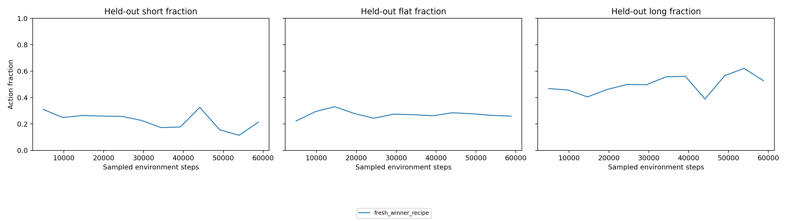

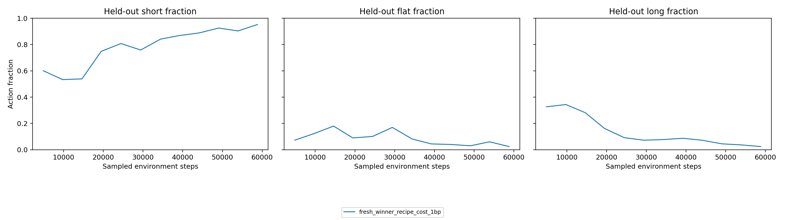

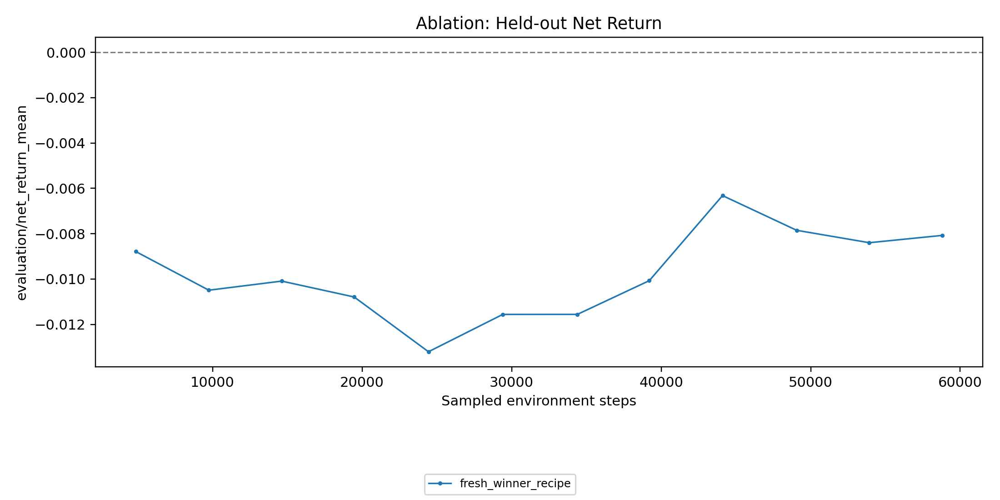

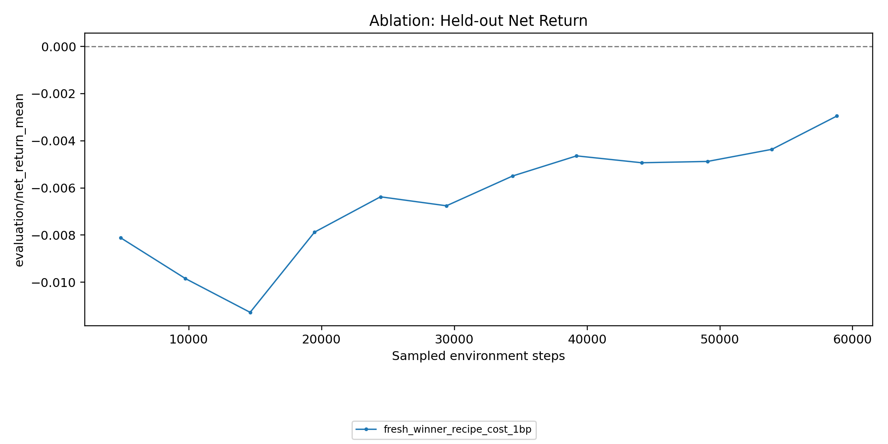

### Interpretation

1. **PPO is active on v2.** Policy fractions, turnover, value fit, and validation
   outcomes changed; the result is not a dead optimizer or static policy.
2. **The objective is learnable as behavior.** At 1 bp, the optimizer learned to
   reduce switching exposure. That is weaker than learning economic edge.
3. **Static cost created a shortcut.** The cheapest route was persistent short
   exposure. It reduced turnover by 76.7% relative to the no-cost terminal point,
   but remained below flat and long-only and had negative Sharpe.
4. **Dataset v2 changes the problem shape.** Twelve real OHLCV streams and clean
   session boundaries increase input and regime variation. Old winner settings
   are a bridge recipe, not presumed optimal hyperparameters.
5. **Checkpoint retention needs tighter cadence.** The best no-cost point occurred
   at update 9, while the short run retained its terminal update-12 checkpoint.
   Promotion studies must retain every evaluation improvement or use an aligned
   shorter checkpoint cadence.

## Sharpe interpretation

The invariant metric in these experiments is mean episode Sharpe per square-root
bar. It is not itself annualized. Under an unrealistic iid assumption and
continuous 390-minute RTH exposure, annualization would multiply by roughly
`sqrt(390 * 252) = 313.5`; an annualized Sharpe of 1 would correspond to about
0.00319 per square-root bar. That conversion is not valid for this overlapping,
selected episode panel because bars, episodes, symbols, and regimes are
correlated and the policy is not continuously deployed.

Accordingly, old per-bar values near 0.02--0.03 must not be described as
annualized Sharpe near or above 1. They are encouraging selection-panel signals
that require non-overlapping chronological replay. Dataset v2 makes a future
annualized calculation more defensible because session duration and timezone are
explicit; it does not retroactively annualize dataset-v1 results.

## Gate D: synchronous PBT checkpoint closure

The 35-update, four-member no-cost Gate D completed on the official ablation
path after the earlier Gates A--C exposed three distinct Ray 2.9 ordering
failures. It used `stream_worker`, family 00, random/generated tasks, the fixed
32-episode RTH panel, one rollout worker per trial, four declared Ray CPUs, and
the same dataset/config hashes as the interrupted v2 P0 arm.

Gate D closes the checkpoint/search seam, not the economic gate:

- all four trials terminated at 170,152--170,416 trial-owned environment steps;
- all 140 evaluation reports have a corresponding non-empty immutable stable
  checkpoint;
- five genuine exploits produced five `stable_checkpoint_selected` receipts;
- every donor receipt had exactly zero score-to-checkpoint step lag, including
  the former Gate C failure at 102,080 steps;
- both exploited targets emitted fresh post-restore reports on the donor-owned
  cumulative environment-step clock;
- no exploit skip, trial error, missing artifact, required-metric nonfinite, or
  storage stop occurred. Ray 2.9's unavailable `clip_fraction` remained the
  predeclared exception for all 140 rows.

A subsequent forensic audit verified all five restores directly against the
retained temporary restore copies and selected donor checkpoint tree hashes.
The older Gate D event schema did not yet bind the target's first post-restore
report and later checkpoint to an explicit restore generation. The new strict
contract does: scheduler selection -> exactly one target receipt with matching
full-tree SHA-256 -> same-generation target report -> same-generation retained
checkpoint. Strict inspection is the default for new arms; historical Gate D is
accepted only with the explicit legacy-inspection flag.

| Member | Best step | Best 1 bp net | Best Sharpe / sqrt(bar) | Positive net + Sharpe rows | Terminal 1 bp net | Terminal Sharpe |
|---|---:|---:|---:|---:|---:|---:|
| `00000` | 29,232 | +0.08116% | +0.01576 | 5 | -0.17602% | -0.03071 |
| `00001` | 141,112 | -0.04265% | -0.03835 | 0 | -0.22433% | -0.04221 |
| `00002` | 68,080 | +0.05681% | +0.00369 | 1 | -0.18540% | -0.02802 |
| `00003` | 82,936 | -0.07390% | -0.00715 | 0 | -0.19078% | -0.03199 |

Member `00000` is the useful transient: three consecutive evaluations were
positive in both net return and Sharpe, four observations exceeded the matched
long-only return, and its best point used 0.02% short, 49.95% flat, and 50.03%
long actions with turnover 1.25. It then regressed and ended negative. Member
`00002` briefly became positive but did not beat long-only and did not persist.
No Gate D checkpoint is promoted or treated as an independent winner.

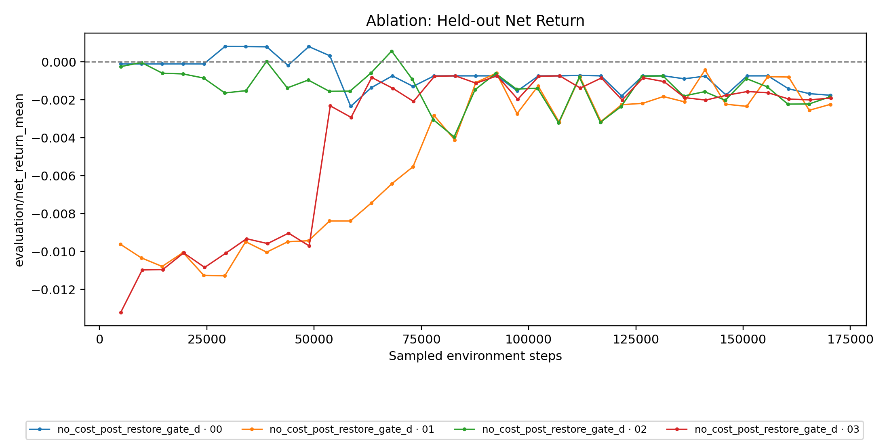

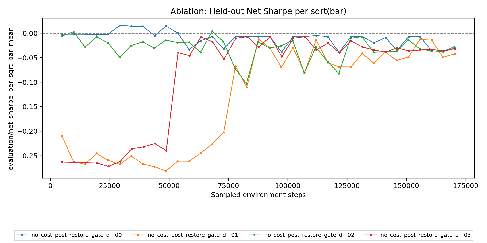

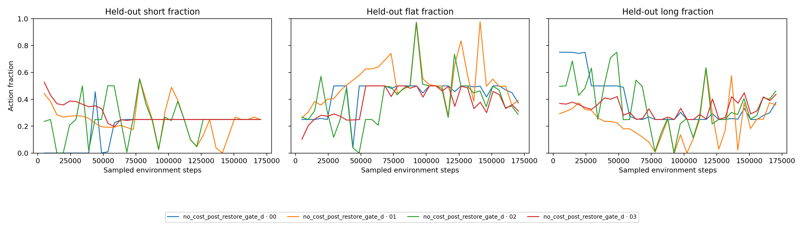

The matched P0 therefore used the repaired synchronous machinery. Gate D was
only the no-cost seam proof; the later staged-cost and exact-1-bp arms supplied
the reward/cost comparison summarized below.

## Crossed development panel and completed P0 controls

The completed P0 used one explicit task panel rather than regenerating evaluation
tasks inside each process. Eight fixed RTH anchors are each crossed with horizons
96, 128, 160, and 200, producing 32 unique `(start_idx, horizon)` tasks. This
removes the old horizon/start identity shortcut while preserving the same task
count and evaluation cost. The anchors were chosen from the existing development
panel for complete 200-bar validity and mixed full-horizon direction; the panel
is therefore selection-informed and is **not** an independent or final test.

| Policy | Net return | Sharpe / sqrt(bar) | Turnover | Short / Flat / Long |
|---|---:|---:|---:|---:|
| Flat | 0.00000% | 0.00000 | 0.00 | 0.0 / 100.0 / 0.0% |
| Long-only | -0.09785% | +0.00827 | 2.00 | 0.0 / 0.0 / 100.0% |
| Short-only | +0.05785% | -0.01558 | 2.00 | 100.0 / 0.0 / 0.0% |
| Random | -1.31143% | -0.25857 | 128.75 | 33.5 / 33.6 / 33.0% |
| Untrained MLP-FiLM | +0.05785% | -0.01558 | 2.00 | 100.0 / 0.0 / 0.0% |

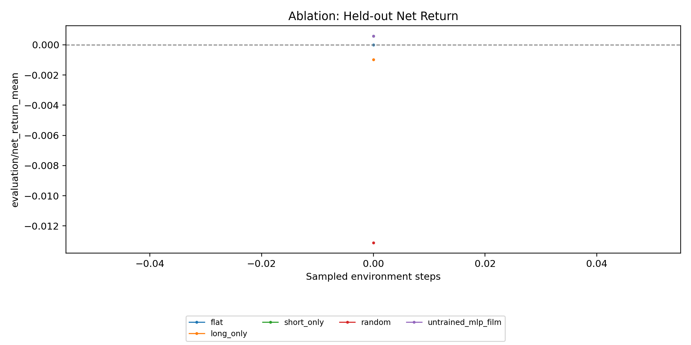

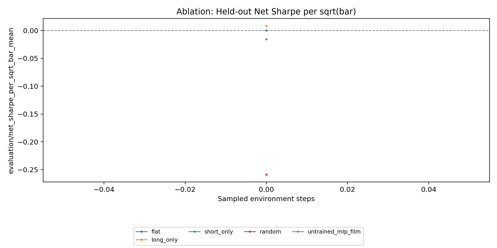

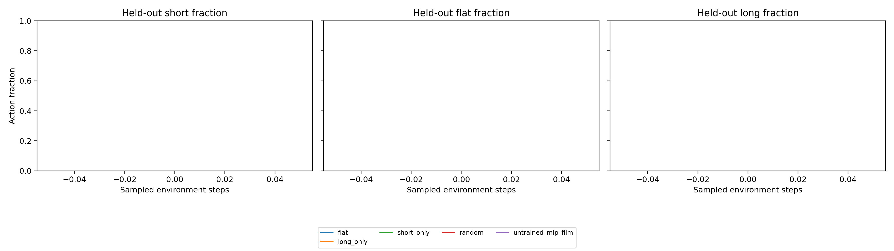

The panel is direction-mixed in return rather than neutral in every risk metric:
short-only has positive net return but negative Sharpe, while long-only has
negative net return but positive Sharpe. Neither deterministic direction passes
the joint positive-return/positive-Sharpe criterion. A learned candidate is not
rejected for being directionally biased; it must instead show that its result is
not merely the matched block's prevailing direction. The seeded untrained
argmax policy happened to be 100% short and exactly reproduced short-only,
which is a useful control rather than evidence of learning.

The loadout is frozen to this panel, `stream_worker`, family 00,
random/generated tasks, synchronous Ray-2.9 PBT, four members, one rollout
worker per member, and 60 updates per arm. The search jointly mutates learning
rate (`5e-6` to `3e-4`), bounded decaying entropy schedules, gamma, GAE lambda,
clip/value settings, minibatch size, and SGD passes. The reward arms alone vary
no cost, the predeclared 0 -> 0.25 -> 0.5 -> 1 bp schedule, and exact 1 bp. This
keeps the entropy expansion explicit inside the same new-P0 search rather than
attributing its gains to the reward arm.

The no-cost Gate D run remains the search-seam reference. The subsequent
staged-cost and exact-1-bp arms were run one at a time against the crossed panel
and stopped at their predeclared evidence gates rather than consuming the full
60-update allowance after the economic continuation condition failed.

## Bounded synchronous P0 cost follow-up

The final exact-1-bp arm is
`v2p0_nonflat_search_sync30_20260924_173537_exact_1bp`. All four members crossed
96,000 trial-owned sampled environment steps. Three exploit operations produced
three verified generation-bound target receipts; the scheduler selection,
donor checkpoint path and tree digest, target restore receipt, first restored
report, and retained target checkpoint all agree. The strict inspector reported
no missing, invalid, stale, or pending lineage evidence.

This clean result followed several intentionally invalidated probes. Those
probes exposed a Ray-2.9 ordering hazard: a synchronous boundary target could be
pre-staged before all live peers reached the barrier, so a later exploit changed
the Tune `Trial` while the already-created actor still held its target-local
checkpoint and configuration. The scheduler now vetoes that early resume,
unstages orphaned targets after exploitation, and fails closed if an exploited
paused target already owns an actor. The focused scheduler/gate suite passes all
118 tests.

| Arm | Valid exposure | Exploit evidence | Behavior at review/stop | Decision |
|---|---:|---:|---|---|
| Staged 0 -> 0.25 -> 0.5 -> 1 bp | Four members >= 96k | Three scheduled; bounded mutations | All four converged to short-only: +0.05785% net, -0.01558 Sharpe, turnover 2 | Mechanical/search evidence retained; no economic promotion |
| Exact 1 bp | Four members >= 96k | Three verified generation-bound exploits | Terminal net -0.07377% to -0.04489%; Sharpe -0.05796 to -0.01396; 52.5--73.3% flat | Mechanical pass; economic stop |

The strongest exact-cost transient was member `00001` at its initial 4,848-step
report: +0.02266% net with -0.00897 Sharpe. Member `00000` later reached
+0.01296% net at 53,904 steps with -0.03622 Sharpe. No member produced a report
with both positive net return and positive Sharpe. At the stopping gate, member
`00000` retained the most directional policy (47.55% short, 52.45% flat), while
members `00001`--`00003` were 71.3--73.3% flat with the remainder almost entirely
short. Gross return was weakly positive for three terminal members, but explicit
costs were larger.

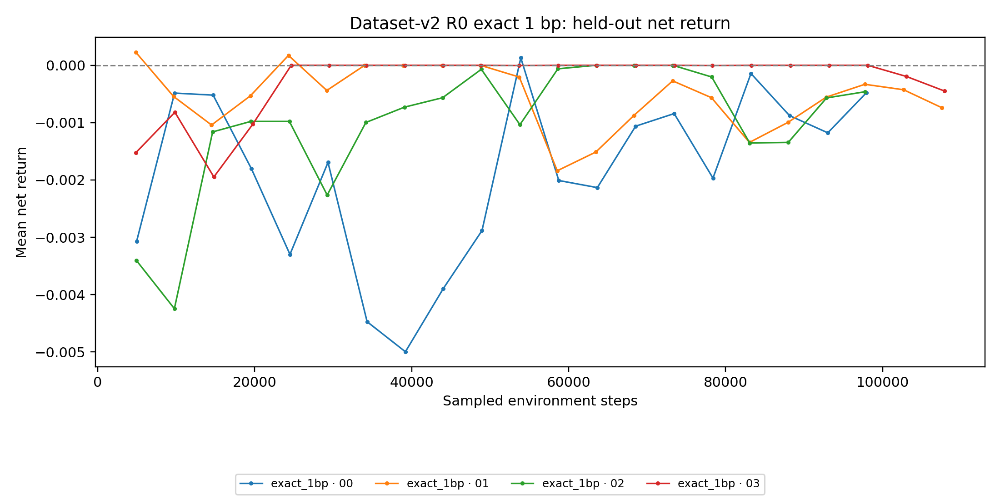

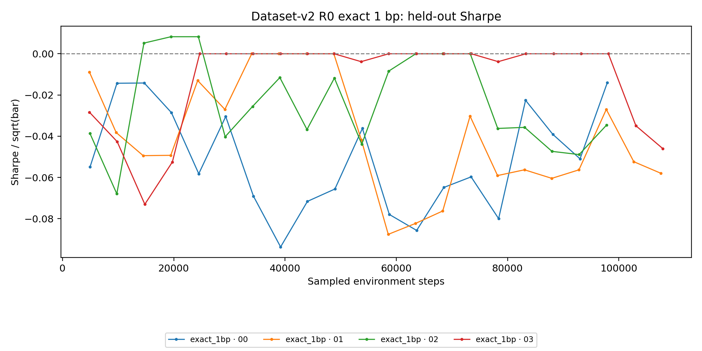

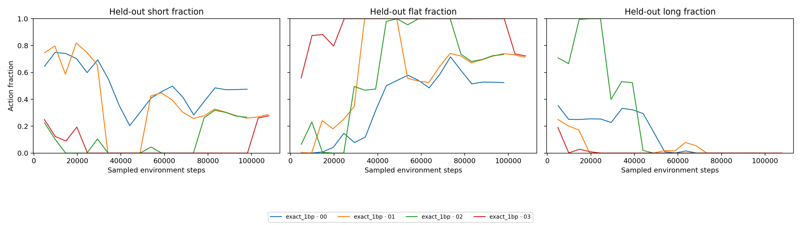

The staged/exact contrast is informative. Gradually increasing cost retained the
panel's short directional control, whereas exact cost from the start drove lower
turnover and progressively more flat decisions. Neither arm found risk-adjusted
edge. PBT did search: the three exact-cost exploits mutated learning rate to
approximately `1.09e-5`, `1.24e-5`, and `8.69e-6`, and transferred bounded
entropy/PPO settings with verified weights. The basin is therefore not explained
by absent perturbation or silent restore contamination.

Exploit count is a mechanical-search fact, not an economic-win count. The
`nonflat_net` donor rule deliberately preferred active donors over flat targets,
including donors with negative net return at the three exploit boundaries. This
is useful for probing whether R0 can escape flat collapse, but it must remain
separate from promotion, which still requires positive net return and Sharpe.

One post-run provenance defect affects presentation, not the executed search.
The retained run manifest serialized the global Ray learning-rate domain as a
process-local object string, while this loadout configured `pbt_lr_min=5e-6`
and `pbt_lr_max=6e-5`. The per-generation resolved-config histories contain
those bounds and the actual sampled/mutated learning rates, so they remain the
authority for this completed run. Future manifests now persist the resolved
domain as stable JSON. Existing manifests and source fingerprints are retained
unchanged rather than rewritten after the fact.

This result does **not** prove that recurrence will solve the problem. It does
show that spending more exact-1-bp R0 budget against the same 32 development
episodes has low information value. R0 lacks persistent hidden state and also
does not observe its position or previous action; a cost-aware sequential choice
is consequently a credible representation/lifecycle hypothesis. The next useful
comparison changes only that representation while freezing data, tasks, seeds,
cost schedule, PBT cadence, and promotion gates.

### Why the earlier edge was transient

The strongest historical R0 candidates were not smoothly selecting trades. The
v1 +0.39258% checkpoint used one action for more than 95% of steps in 29 of 32
episodes: short for every 96/128/160-bar episode and long for every 200-bar
episode. Gate D member `00000` showed the same family resemblance—its positive
point was nearly half flat/half long, with most return supplied by the 200-bar
group. The original panel made that routing easy because horizon identified a
different set of starts.

At the same time, Gate D policy entropy remained 99.2--99.6% of the three-action
maximum and explained variance stayed near zero. Small logit changes could flip
an entire horizon group under deterministic argmax evaluation, producing a sharp
but unstable economic transient. The best Gate D point occurred before its first
exploit, so PBT restore contamination cannot explain its appearance. The crossed
panel is the immediate discriminator: it asks whether horizon-conditioned FiLM
still adds market-dependent selection when every horizon sees the same starts.

R0 also does not observe current position or previous action. A transaction-cost
objective is therefore partially observable to the policy and naturally favors
static direction or flat shortcuts. Do not change that observation contract
inside this matched P0. If the crossed search remains horizon-static with weak
value fit, preserve R0 as the compatibility baseline and run named market-only,
task-only/horizon-only, and matched explicit-state (`R4-v1`) diagnostics before
attributing the limitation to recurrence alone.

## Promotion gate and next experiment

Dataset v2 and the PBT machinery pass. R0 economic promotion remains blocked.
The crossed-panel cost study is now a frozen negative baseline, not a candidate
to extend indefinitely:

Run one arm at a time from the canonical three-arm JSON via
`run_ablation --variant <id>`. The 20-update/roughly-96k-step review is a hard
continuation gate: all four members must remain healthy, PBT must record at least
two genuine exploits with exact donor receipts and fresh post-restore reports,
required evidence must remain finite and non-empty, and C must retain at least
20 GB free. Failure stops the study before another arm consumes budget; it does
not justify changing the matched loadout in place. The read-only
`itrader.scripts.experiments.inspect_pbt_gate` command evaluates this contract
from repository-owned stable evidence and returns pass/stop/pending without
controlling the process or authorizing another arm.

1. Freeze R0, the crossed panel, control metrics, and the valid staged/exact arm
   evidence. Do not select further against these same 32 episodes.
2. Review the separately developed Ray-2.58 migration in an isolated
   environment and run a bounded R0-only parity bridge. Preserve Ray 2.9 as the
   reproduction authority unless that bridge passes, and do not change platform
   and solver representation in the same attribution cell.
3. Start R1 as a bounded, from-scratch representation challenger on the
   accepted platform with identical
   dataset-v2 RTH partitions, family 00 tasks, random/generated proposer, seeds,
   cost schedules, compute budget, PBT cadence, and evidence gates. R1 tests a
   reset-every-step chronological window encoder; it is not yet a memory claim.
4. Proceed to native recurrent R2 lifecycle work only after shape, reset,
   checkpoint/replay, masking, and finite forward/backward tests pass. Attribute
   memory only through matched carry-versus-reset controls.
5. Predeclare genuinely new, non-overlapping chronological blocks before P1
   economic selection or any Phase A promotion claim.
6. Stage a later causal conditioning study: C0 current features, C1 trailing
   train-fitted regime summaries, and shuffled-C1. Current `regime_tags` remain
   ex-post reporting labels because they use the future outcome window.

The working candidate gate remains deliberately hard:

- positive 1 bp net return and positive net Sharpe;
- beat flat and the strongest matched directional control on aggregate;
- no effectively all-flat policy (`flat < 98%`), while long/short bias remains
  diagnostic rather than independently disqualifying;
- sustain the gate across consecutive evaluations and exact fresh-process replay;
- paired block-aware uplift not explained by a single direction/regime;
- remain net-positive at 2 bp before independent population replication;
- reproduce from an independent population seed before opening the sealed final
  test.

`Sharpe / sqrt(bar) >= 0.02` and a `+0.005` margin over the directional control
remain useful high-signal challenger thresholds, not an annualized-Sharpe claim
and not substitutes for the block/replay gates.

## Roadmap after this audit

```text
[DONE] characterize and quarantine dataset_v1
   |
   v
[DONE] build + hash dataset_v2; freeze RTH data contract and controls
   |
   v
[DONE] Gate D exact-step synchronous-PBT checkpoint closure
   |
   v
[DONE / NO PROMOTION] dataset_v2 R0 no-cost/staged/exact-cost evidence
   |
   +--> [NOW] Ray-2.58 review + bounded R0-only platform parity
   |
   v
[THEN] bounded R1 representation control on the accepted platform
   |
   v
[GATE] R0/R1 challenger passes net/Sharpe/control/block/cost criteria on new blocks
   |
   +--> native recurrent carry/reset ablations on frozen data/evidence contracts
   +--> causal C0/C1/shuffled-C1 representation study
   +--> System-One/CLM/Jev S-series only after R-series closure
   +--> frozen Qwen3.8 proposer vs random/generated at equal solver compute
   +--> families 01/02 only as named, matched curriculum factors
   |
   v
[LATER] adaptive proposer/reward, dividend cashflows, extended-hours studies
   |
   v
[SEALED] untouched final chronological test, then Phase B capability claims
```

R-series engineering should now proceed as a controlled challenger because R0's
mechanically valid cost study reached a low-information basin. It may not consume
a dataset-v1 PBT checkpoint as an economic winner, and the v1/v2 contrast remains
qualitative because data representation and evidence contracts differ.
Frozen proposer work begins after the R0 data/evidence baseline is frozen and
must compare curriculum uplift at equal solver compute. Adaptive proposer reward,
dividend cashflows, and family expansion are Phase B factors, not ways to rescue
the Phase A gate.

## Dividend and session boundary

Dataset v2 retains split-adjusted prices and does not dividend-adjust history.
When dividends are introduced, they should be explicit signed cashflows in
episode evidence/reward accounting rather than silently rewritten prices. That
requires an environment contract and tests for ex-date ownership, long/short
sign, tax/withholding assumptions, and checkpoint/replay parity.

Pre-market and after-hours data are retained now because they are difficult to
reconstruct later and are operationally relevant. Phase A remains RTH-only to
avoid mixing liquidity, spread, volatility, annualization, and execution regimes.
Extended-hours becomes a predeclared Phase B factor.

## Evidence and reproducibility

- Dataset request: `dataset-v2-r0-audit-2026-09-24-evidence/dataset_build_request.json`
- Dataset manifest: `dataset-v2-r0-audit-2026-09-24-evidence/dataset_manifest.json`
- Quality summary: `dataset-v2-r0-audit-2026-09-24-evidence/quality_summary.json`
- Fixed controls: `dataset-v2-r0-audit-2026-09-24-evidence/control_metrics.json`
- Crossed-panel controls and per-episode receipts use the `crossed_controls_`
  prefix; `crossed_controls_analysis.json` records exact task/dataset/file hashes
  and the matched control interpretation.
- Full control/no-cost/cost-aware summaries, report rows, and plots are stored in
  the same evidence directory.
- Gate D manifest/status, all four report/config/checkpoint-index ledgers, PBT
  events, retained-best receipts, and comparison plots are stored there with the
  `gate_d_` prefix.
- Exact matched-run hashes, the arm loadout, validation results, and continuation
  stops are frozen in
  [`p0_matched_preflight.json`](dataset-v2-r0-audit-2026-09-24-evidence/p0_matched_preflight.json).
- The valid exact-cost gate, all-member report/config/checkpoint ledgers, three
  verified exploit receipts, comparison CSVs, and plots are under
  [`p0_exact_1bp_gate_20260924/`](dataset-v2-r0-audit-2026-09-24-evidence/p0_exact_1bp_gate_20260924/).
- Loadouts:
  - `itrader/scripts/experiments/configs/phase_a_r0_dataset_v2_controls_32_20260924.json`
  - `itrader/scripts/experiments/configs/phase_a_r0_dataset_v2_controls_crossed_8x4_20260924.json`
  - `itrader/scripts/experiments/configs/phase_a_r0_dataset_v2_p0_cost_search_sync_60_20260924.json`
  - `itrader/scripts/experiments/configs/phase_a_r0_dataset_v2_p0_early_cost_low_lr_sync_30_20260924.json`
  - `itrader/scripts/experiments/configs/phase_a_r0_dataset_v2_p0_nonflat_search_sync_30_20260924.json`
  - `itrader/scripts/experiments/configs/evaluation_panels/dataset_v2_r0_crossed_8x4_20260924.json`
  - `itrader/scripts/experiments/configs/phase_a_r0_dataset_v2_mlp_film_12_20260924.json`
  - `itrader/scripts/experiments/configs/phase_a_r0_dataset_v2_cost_aware_12_20260924.json`

The local Parquet/raw snapshot is intentionally ignored because it contains
provider-licensed market data. The manifest, request, tests, configs, aggregate
metrics, and plots are the reviewable repository evidence. API credentials were
read from ignored `.env` variables and are absent from all artifacts.

## Limitations

- This is one original 32-episode development panel, one selection-informed
  crossed 32-episode development panel, two 12-update single-member arms, one
  35-update four-member no-cost checkpoint gate, and bounded staged/exact-cost
  arms through the 96k review gate. Independent chronological replication
  remains outstanding.
- The sealed final-test partition remains untouched.
- Corporate-action dividend cashflows are not modeled.
- No extended-hours training result is claimed.
- The snapshot needs a future second-provider overlap audit before operational
  data-source certification.
- The original control panel is mildly bullish. The crossed panel removes the
  horizon/start identity shortcut but is selection-informed; block/regime
  attribution and independent chronological replication remain mandatory.
- The bounded runs establish seam behavior and an R0 negative baseline, not
  Phase A closure or evidence that recurrence will succeed.

## Goal-run closeout

This goal closes the dataset-v2 R0 investigation, not Phase A economic
promotion. The result separates three claims that had previously been mixed:

1. **Measurement and search are now credible.** Dataset-v2 RTH episodes use
   full OHLCV, session/continuity-safe partitions, explicit costs, deterministic
   controls, sampled-environment-step scheduling, immutable checkpoints, and
   generation-bound PBT lineage. PPO updated and PBT genuinely searched.
2. **R0 is behaviorally learnable but not economically validated on dataset v2.**
   Cost schedules changed turnover and action persistence, yet the staged arm
   reproduced short-only and the exact-cost arm produced no jointly positive
   net-return/Sharpe report. This supports optimization responsiveness, not a
   profitable or robust learned policy.
3. **The two replay-exact `00001`/`00003` research candidates are historical
   dataset-v1 evidence.** They each sustained five reports above short-only,
   replayed exactly, remained positive at 2 bp, and had distinct final policy
   hashes, but shared ancestry and failed independent replication. Dataset-v2
   supersedes them for selection, so they are mechanism evidence only—not
   dataset-v2 candidates or promotion evidence.

The repeated Ray-2.9 ordering, restore, pause, and actor-lifecycle defects are
fixed for this locked reproduction stack, but the repair cost is itself evidence
that platform migration deserves an explicit gate before solver work. The next
goal should therefore review the existing Ray-2.58 migration in a separate
environment before implementing R1. Do not combine the platform and model
changes in one comparison.

### Next-goal contract

```text
[FROZEN] dataset-v2 R0 + Ray-2.9 evidence
    |
    v
[PLATFORM GATE] review Ray-2.58 migration; run R0-only parity probes
    |
    +-- fail --> retain Ray 2.9 for a matched R0/R1 bridge
    |
    v
[R SERIES] R1 shape control -> R2 lifecycle/carry-reset attribution
    |
    v
[C SERIES] causal C0/C1/shuffled-C1 market representation
    |
    v
[S SERIES] CLM/Jev/System-One study on a frozen solver contract
```

The Ray gate must preserve dataset/panel/config hashes, deterministic controls,
economic metrics, mutation domains, sampled-step cadence, immutable checkpoint
replay, and generation-bound exploit receipts. A fresh bounded R0 run on Ray
2.58 is a compatibility bridge, not a renewed same-panel performance search.
Only after that platform bridge passes should R1 change representation under the
same platform. C-series features must be causal and train-fitted; future-derived
`regime_tags` remain ex-post labels. S-series research stays separate until the
R-series solver interface and evidence contract are frozen, so CLM/Jev coupling
cannot hide a solver or platform regression.
