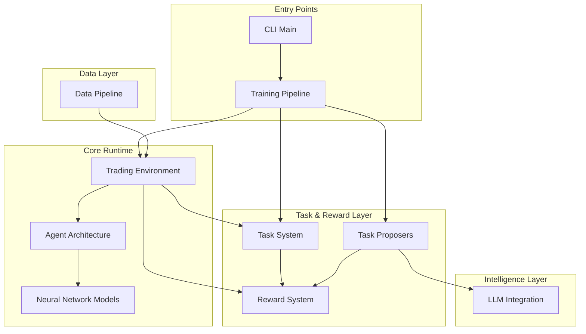

# itrader-azr — Wiki

# iTrader-AZR

Welcome to iTrader-AZR, an autonomous trading research platform that applies Reinforcement Learning with Verifiable Rewards (RLVR) to financial markets. The system separates learning into two roles: a **Solver** that learns trading behavior, and a **Proposer** that generates task curricula. This architecture is inspired by the Absolute Zero Reasoner (AZR) paradigm.

## What This Project Does

iTrader trains trading agents through verifiable, inspectable reward signals rather than black-box optimization. Instead of a single monolithic learning objective, the system decomposes training into:

- **Tasks** — parameterized specifications defining trading scenarios (instruments, time horizons, constraints)
- **Rewards** — explicit, decomposed components (PnL, drawdown, turnover) computed by a registry-based engine
- **Agents** — neural networks that learn position decisions (long/flat/short) from market observations

The project is currently focused on two phases:
- **Phase A**: Stable solver learning with shaped rewards in a controllable Gymnasium environment
- **Phase B**: LLM-native task proposers that generate adaptive curricula

## Architecture



## Key End-to-End Flows

### Training Flow

The main entry point is the CLI dispatcher in [Core Application](core-application.md). When you run `python -m itrader train`, the system:

1. Loads configuration and initializes the [Training Pipeline](training-pipeline.md)
2. Samples or generates tasks via [Task Proposers](task-proposers.md) (rule-based or LLM-powered)
3. Validates and clamps task parameters through the [Task System](task-system.md)
4. Instantiates the [Trading Environment](trading-environment.md) with market data from the [Data Pipeline](data-pipeline.md)
5. Runs PPO optimization with agents defined in [Agent Architecture](agent-architecture.md) using [Neural Network Models](neural-network-models.md)
6. Computes rewards via the [Reward System](reward-system.md) registry

### Task Generation Flow

For Phase B curriculum learning, the [LLM Integration](llm-integration.md) module provides two backends:

- A lightweight llama.cpp engine for fast local inference
- A full-featured proposer using Transformers with 4-bit quantization

Task proposers generate structured specifications that the Task System validates before passing to the environment.

## Module Overview

The codebase is organized into functional layers:

**Runtime Core** — The [Trading Environment](trading-environment.md) implements a Gymnasium-compatible interface with discrete actions (short/flat/long) and rolling OHLCV observations. Agents are defined through the [Agent Architecture](agent-architecture.md) abstraction, with concrete implementations using [Neural Network Models](neural-network-models.md) that support both MLP and FiLM-conditioned architectures.

**Task & Reward Layer** — The [Task System](task-system.md) provides unified configuration for training tasks, including specification, validation, and embedding generation. The [Reward System](reward-system.md) decouples reward computation from environment logic through a registry pattern, enabling extensible reward shaping.

**Intelligence Layer** — [Task Proposers](task-proposers.md) support multiple generation strategies: deterministic rules, local Ollama inference, and OpenAI-compatible endpoints. The [LLM Integration](llm-integration.md) module handles the underlying model loading and inference.

**Data & Infrastructure** — The [Data Pipeline](data-pipeline.md) manages historical backfill, real-time streaming, and ETL processing. [Training Pipeline](training-pipeline.md) orchestrates Ray RLlib and Ray Tune for distributed training with PBT support.

**Tooling** — [Experiment Scripts](experiment-scripts.md) provide CLI utilities for ablation studies and result analysis. [Diagnostic Tools](diagnostic-tools.md) offer healthchecks and run diagnostics. [Knowledge Management](knowledge-management.md) syncs GitNexus artifacts into documentation.

## Getting Started

1. **Install dependencies** — The project uses Ray RLlib for distributed training. Ensure you have a compatible Python environment.

2. **Run a healthcheck** — Validate your setup:
   ```bash
   python -m itrader healthcheck
   ```

3. **Start training** — Begin with Phase A solo training:
   ```bash
   python -m itrader train --config path/to/config.yaml
   ```

4. **Explore results** — Use the diagnostic tools to inspect checkpoints and plot training progress.

## Where to Go Next

- Read [Trading Environment](trading-environment.md) to understand the observation/action space
- Review [Reward System](reward-system.md) to see how rewards are decomposed and computed
- Explore [Task System](task-system.md) to understand task specification and validation
- Check [Training Pipeline](training-pipeline.md) for PPO hyperparameters and PBT configuration
